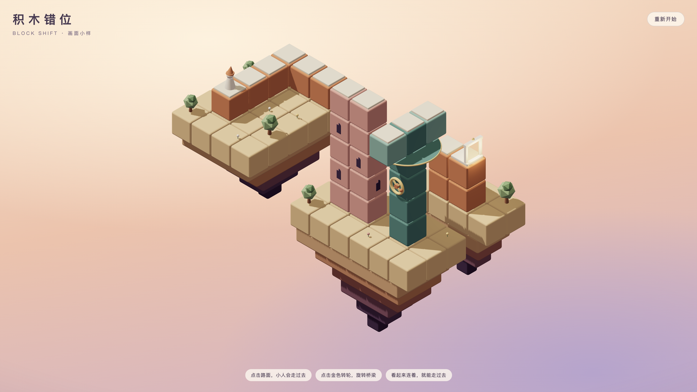

<h1 align="center">Seemingly</h1>

<p align="center">
  <strong>积木错位 · 一条看起来连着的路</strong>
</p>

<p align="center">
  浏览器里的等距视角解谜游戏：路看似相连，就能走过去。
</p>

---



## 项目状态

当前是**画面小样（v0）**：一关可玩，用来验证画面风格和核心玩法。正式开发尚未开始，计划与里程碑见[路线图](docs/roadmap.md)。

## 玩法

在等距视角下，两块不相邻的积木只要在屏幕上看起来接在一起，小人就能从一块走到另一块。玩家通过旋转、移动机关，改变「看起来」的样子，为小人拼出一条通往终点的路。

小样这一关：

1. 点击路面，小人走过去。低处的步道和高塔塔顶并不相连，只是看起来相连。
2. 点击立柱上的金色转轮，桥梁转动 90 度，把塔顶和终点接上。
3. 走到发光的门前即通关。

## 本地运行

需要 Node.js 22 以上。

```bash
npm install
npm run dev        # http://127.0.0.1:5180
npm run typecheck  # 类型检查
npm run build      # 生成静态站点到 dist/
npm run preview    # 预览构建产物
```

## 技术栈

- Vite + React 19 + TypeScript
- Three.js + React Three Fiber + drei
- 画面全部由代码生成，不依赖外部模型和贴图
- 纯静态站点，计划部署到 GitHub Pages

## 目录结构

```text
Seemingly/
├── docs/                文档与文档用图
├── public/              原样拷贝到站点根目录的静态资源
└── src/
    ├── main.tsx         入口
    ├── app/             页面外壳：画布、标题、提示、按钮等界面
    └── game/
        ├── core/        纯逻辑：屏幕坐标、连通图、寻路、移动插值（不依赖 Three.js）
        ├── levels/      关卡数据与类型定义
        └── render/      3D 场景：积木、机关、角色、装饰、灯光、相机、配色
```

各模块的职责和后续拆分计划见[架构说明](docs/architecture.md)。

## 文档

| 文档 | 内容 |
| --- | --- |
| [设计稿](docs/design.md) | 核心规则、机关、关卡规划、交互与范围 |
| [美术方向](docs/art-direction.md) | 配色、积木与光影、角色优化要点、界面风格 |
| [架构说明](docs/architecture.md) | 技术方案、核心算法、目录职责、性能预算、部署 |
| [路线图](docs/roadmap.md) | 里程碑、开发前准备清单、已知问题 |
