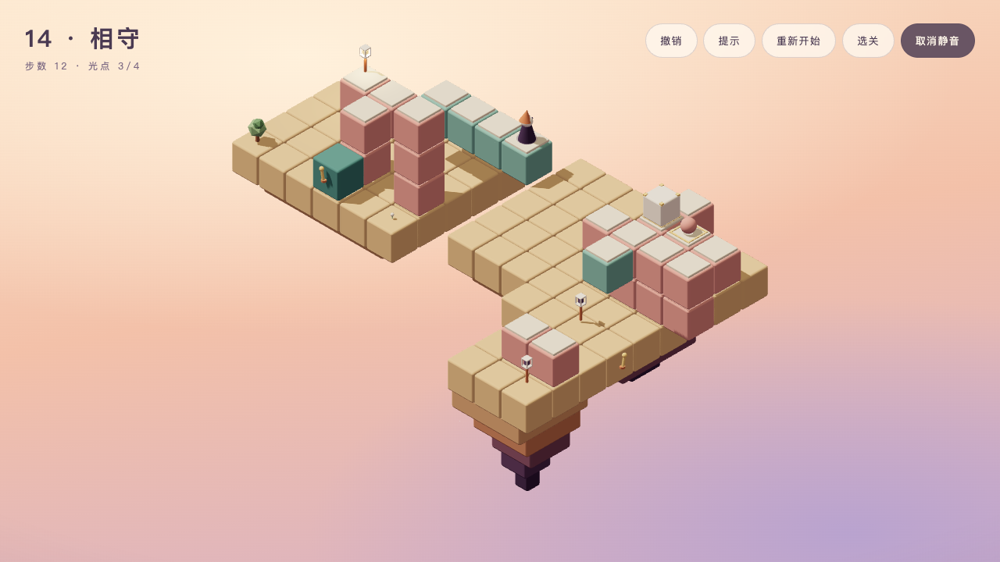
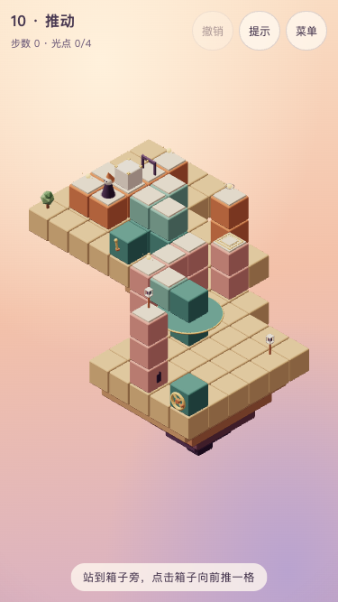

<h1 align="center">Seemingly</h1>

<p align="center">
  <strong>积木错位 · 一条看起来连着的路</strong>
</p>

<p align="center">
  浏览器里的等距视角解谜游戏：路看似相连，就能走过去。
</p>

<p align="center">
  <a href="https://zzugbb.github.io/Seemingly/">在线试玩</a> ·
  <a href="docs/design.md">设计稿</a> ·
  <a href="docs/roadmap.md">路线图</a> ·
  <a href="LICENSE">MIT</a>
</p>

---



当前开发版提供五章十五个主线关卡与五个挑战关：从改变连接、乘坐和换乘，到联动、压板召台、推箱规划与巡逻重量交接。主线最终点亮十五盏灯和一座塔，挑战独立解锁、不影响结局。在线版本以最近一次发布为准。

五章依次为「看似、转动、升起、推动、遮挡」，每章三关。五章主线、完整结局、五个挑战与各自音乐已通过分阶段用户试玩确认，开发记录见[路线图](docs/roadmap.md)。

## 玩法

在等距视角下，两块不相邻的积木只要在屏幕上看起来接在一起，小人就能从一块走到另一块。玩家通过转盘和平移台改变「看起来」的样子，为小人拼出一条通往终点的路。

1. 点击路面，小人自动走过去；看起来相邻的路面就能连通。
2. 点击金色转轮或拉杆操作转盘、平移台；小人站在机关上时会随它移动。
3. 后续关卡中，踏上单框压板触发机关，用小人或积木箱压住双框压板保持门打开；站在积木箱旁，点击箱子推一格。箭头只限制进入方向，限次把手旁的亮点表示剩余额度。
4. 第五章的小生物每当你完成一个动作就走一格，受阻会停下，也能压住双框压板；等待现实时间不会让它前进。
5. 集齐必需光点后抵达灯笼即可通关；带细环的是选做光点。每关可获得抵达、全收集与最少步数三项评价，历史分别累计；本局使用提示会影响本局步数评价。进度保存在浏览器本地。

第一章全部通关后解锁挑战一；第二至五章集齐本章选做光点后解锁对应挑战。挑战进一步运用已学机制：安排回访顺序、回岸换端、换用正反控制、交接箱位和让巡逻换岗。二十关共有六十项历史评价；挑战完成后，下一挑战已解锁就可直接进入，否则回到选关。主线与挑战分别统计抵达进度，补完五挑战会显示“全部挑战已抵达”，六十项评价齐全时标题显示“全部关卡与评价已完成”。

电脑和手机都用点击操作。`Z` 撤销，`H` 提示，`R` 重新开始，`Esc` 返回选关；右上角可切换静音。首次交互后播放按章编写的主题音乐与合成反馈音，挑战沿用对应章乐句并以90%速度播放；收光、点灯等反馈出现时背景会短暂降低，静音选择也会保存。

需要支持 WebGL2 的浏览器。手机默认使用低画质，也可用 `?quality=low` 或 `?quality=high` 指定画质；支持系统的「减少动态效果」设置。



## 技术亮点

- **屏幕上的连通**：用 `(x - y, z - y)` 判断路面是否相邻，以固定等距正交视角呈现跨越三维距离的错觉连接。
- **可验证的关卡**：纯 TypeScript 规则层供模拟器、求解器和后台提示共用；二十关均附确定解法，由 Vitest 校验连通、遮挡、机关规则与难度目标。
- **代码生成的积木世界**：圆角积木、岛屿岩层、树木、角色与灯笼由几何体组成，共享积木几何体、缓存材质，同色静态实心积木合批绘制。
- **实时合成声音**：Web Audio 生成五章主题乐句、脚步、机关、收光和点灯反馈；按实际收光展开律动，关键反馈时背景让位，无外部音频文件。
- **打开即玩**：纯静态站点，无账号、后端、统计或广告；进度与静音保存在浏览器本地。

当前二十关的绘制调用、加载体积、提示准备耗时与测试环境见[性能检查](docs/performance.md)。桌面与手机尺寸模拟分别实测，不将模拟结果视为目标手机的真机帧率。

## 本地运行

需要 Node.js 24（见 `.nvmrc`）。

```bash
npm install
npm run dev           # http://127.0.0.1:5180
npm run typecheck     # 类型检查
npm test              # 单元测试
npm run metrics       # 关卡难度指标表
npm run format        # 格式化
npm run format:check  # 检查格式
npm run build         # 生成静态站点到 dist/
npm run preview       # 预览构建产物
```

GitHub Actions 在推送到 `main` 后执行类型检查、格式检查、测试和构建，再发布到 GitHub Pages 的 `/Seemingly/` 子路径。开发进度以路线图为准；README 截图来自本地二十关开发版，在线版本随发布更新。

`npm run metrics` 输出全部关卡的最少步数、全收集最少步数、可达状态数、死局数、随机通关率、标准解法中的错觉连接数与取舍次数。随机模拟固定种子为 `20261016`，每关运行 500 次，步数预算采用难度目标中的设置，未设置时使用 30 步。当前二十关均由设计者在 `src/game/levels/targets.ts` 登记目标，测试强制检查指标及标准解法最优步数。

## 技术栈

- Vite + React 19 + TypeScript
- Three.js + React Three Fiber + drei
- 画面全部由代码生成，声音用 Web Audio 实时合成，不依赖任何外部素材
- 纯静态站点，通过 GitHub Actions 发布到 GitHub Pages

## 目录结构

```text
Seemingly/
├── AGENTS.md            AI 开发指南
├── docs/                设计、决策、架构、关卡规范、美术、路线图
├── public/              原样拷贝到站点根目录的静态资源
└── src/
    ├── main.tsx         入口
    ├── app/             页面外壳与界面
    ├── audio/           Web Audio 引擎、合成音效与环境和弦
    └── game/
        ├── core/        纯逻辑：屏幕坐标、连通、寻路、移动（不依赖 Three.js）
        ├── levels/      关卡数据与类型
        └── render/      3D 场景、角色、装饰、配色
```

目标目录和模块职责见[架构说明](docs/architecture.md)。

## 文档

| 文档 | 内容 |
| --- | --- |
| [AI 开发指南](AGENTS.md) | 开发规则、提交前检查、常见陷阱 |
| [决策记录](docs/decisions.md) | 已定的产品、玩法、声音、技术决策 |
| [设计稿](docs/design.md) | 核心规则、机关、关卡、界面流程、反馈与声音 |
| [关卡制作规范](docs/level-design.md) | 坐标系、遮挡规则、制作步骤、校验 |
| [架构说明](docs/architecture.md) | 目标目录、数据格式、模拟器接口、性能预算、部署 |
| [性能检查](docs/performance.md) | 二十关绘制调用、帧时间、首屏体积、提示耗时与测量限制 |
| [美术方向](docs/art-direction.md) | 配色、积木、角色、机关、灯笼、界面 |
| [路线图](docs/roadmap.md) | 按顺序执行的任务与验收标准 |

## 许可证

[MIT](LICENSE)
