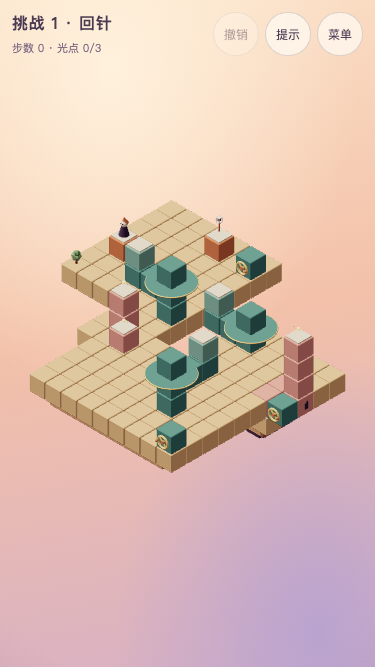

# 挑战 1 · 回针

## 状态与能力衔接

**正式版本，关卡与声音已获用户试玩确认。** chapter 1，challenge true，revision 1；主线 **23步**，全收集 **23步**。主题短句：**三庭的回访顺序**。解锁：第一章全部通关。挑战不影响主线结局。

第一章通关后，对乘坐、离台和返回连接作一次完整应用。只用三个独立转盘，不提前引入平移、压板或箱子。

「原来如此」：**先去远庭，再在归途取中庭光，才能少转一整圈。**

近庭先取南光，借中桥到远庭取西光，返回时再取中庭东光，最后回到近庭北端灯笼。不是把随行关原样延长：三座转盘形成折线去返，取光顺序改变返程转向成本。

共同行为、章节衔接与验证命令见[关卡索引](README.md)。



## 屏幕草图

`(a,b)=(x-y,z-y)`；数字是高度。@起点、G灯笼、o必需、*选做、M活动路面、p普通路面、h按住板、t触发板、D门。光点与起终点优先标记；草图是现有rules生成的开局路面快照，门的模式、状态和单向入格方向以下表及完整实现为准，岛屿不可行走。

```text
b\a    -3   -2   -1    0    1    2    3    4    5    6    7    8
 -3     ·    ·    ·  G-1    ·    ·    ·    ·    ·    ·    ·    ·
 -2     ·    ·    ·    ·    ·    ·    ·    ·    ·    ·    ·    ·
 -1     ·    ·    ·    ·    ·    ·    ·    ·    ·    ·    ·    ·
  0   @-1   M1    ·    ·    ·    ·   M4    ·    ·    ·    ·   o6
  1     ·    ·    ·    ·    ·    ·    ·    ·    ·    ·    ·    ·
  2     ·    ·    ·    ·    ·    ·    ·    ·    ·    ·    ·    ·
  3     ·    ·    ·   o3    ·    ·    ·    ·   M7    ·    ·    ·
  4     ·    ·    ·    ·    ·    ·    ·    ·    ·    ·    ·    ·
  5     ·    ·    ·    ·    ·   o5    ·    ·    ·    ·    ·    ·
```

## 构图与静态积木

沿用母章的暖色积木、青绿机关、浅顶板、暖白人物与固定相机。岛屿4处，装饰3件。所有机关把手要在手机构图内可见且可点，人物运动使用现有轻微收身，遮挡时沿用剪影，不消除合法的投影错觉连接。

岛屿精确范围：`[{"x":[-5,1],"z":[-5,1],"y":-2,"depth":2},{"x":[2,4],"z":[5,7],"y":1,"depth":2},{"x":[8,13],"z":[3,7],"y":2,"depth":2.5},{"x":[6,14],"z":[9,14],"y":4,"depth":2.5}]`。其余装饰的坐标及类型在完整实现内；静态积木全部如下，重复高度列出的实体是柱体，不能当成额外路。

| 世界坐标 | 类型 | 颜色 | 单向入格 |
| --- | --- | --- | --- |
| `[-5, -2, -5]` | solid | sand | — |
| `[-5, -2, -4]` | solid | sand | — |
| `[-5, -2, -3]` | solid | sand | — |
| `[-5, -2, -2]` | solid | sand | — |
| `[-5, -2, -1]` | solid | sand | — |
| `[-5, -2, 0]` | solid | sand | — |
| `[-5, -2, 1]` | solid | sand | — |
| `[-4, -2, -5]` | solid | sand | — |
| `[-4, -2, -4]` | solid | sand | — |
| `[-4, -2, -3]` | solid | sand | — |
| `[-4, -2, -2]` | solid | sand | — |
| `[-4, -2, -1]` | solid | sand | — |
| `[-4, -2, 0]` | solid | sand | — |
| `[-4, -2, 1]` | solid | sand | — |
| `[-3, -2, -5]` | solid | sand | — |
| `[-3, -2, -4]` | solid | sand | — |
| `[-3, -2, -3]` | solid | sand | — |
| `[-3, -2, -2]` | solid | sand | — |
| `[-3, -2, -1]` | solid | sand | — |
| `[-3, -2, 0]` | solid | sand | — |
| `[-3, -2, 1]` | solid | sand | — |
| `[-2, -2, -5]` | solid | sand | — |
| `[-2, -2, -4]` | solid | sand | — |
| `[-2, -2, -3]` | solid | sand | — |
| `[-2, -2, -2]` | solid | sand | — |
| `[-2, -2, -1]` | solid | sand | — |
| `[-2, -2, 0]` | solid | sand | — |
| `[-2, -2, 1]` | solid | sand | — |
| `[-1, -2, -5]` | solid | sand | — |
| `[-1, -2, -4]` | solid | sand | — |
| `[-1, -2, -3]` | solid | sand | — |
| `[-1, -2, -2]` | solid | sand | — |
| `[-1, -2, -1]` | solid | sand | — |
| `[-1, -2, 0]` | solid | sand | — |
| `[-1, -2, 1]` | solid | sand | — |
| `[0, -2, -5]` | solid | sand | — |
| `[0, -2, -4]` | solid | sand | — |
| `[0, -2, -3]` | solid | sand | — |
| `[0, -2, -2]` | solid | sand | — |
| `[0, -2, -1]` | solid | sand | — |
| `[0, -2, 0]` | solid | sand | — |
| `[0, -2, 1]` | solid | sand | — |
| `[1, -2, -5]` | solid | sand | — |
| `[1, -2, -4]` | solid | sand | — |
| `[1, -2, -3]` | solid | sand | — |
| `[1, -2, -2]` | solid | sand | — |
| `[1, -2, -1]` | solid | sand | — |
| `[1, -2, 0]` | solid | sand | — |
| `[1, -2, 1]` | solid | sand | — |
| `[2, 1, 5]` | solid | sand | — |
| `[2, 1, 6]` | solid | sand | — |
| `[2, 1, 7]` | solid | sand | — |
| `[3, 1, 5]` | solid | sand | — |
| `[3, 1, 6]` | solid | sand | — |
| `[3, 1, 7]` | solid | sand | — |
| `[4, 1, 5]` | solid | sand | — |
| `[4, 1, 6]` | solid | sand | — |
| `[4, 1, 7]` | solid | sand | — |
| `[8, 2, 3]` | solid | sand | — |
| `[8, 2, 4]` | solid | sand | — |
| `[8, 2, 5]` | solid | sand | — |
| `[8, 2, 6]` | solid | sand | — |
| `[8, 2, 7]` | solid | sand | — |
| `[9, 2, 3]` | solid | sand | — |
| `[9, 2, 4]` | solid | sand | — |
| `[9, 2, 5]` | solid | sand | — |
| `[9, 2, 6]` | solid | sand | — |
| `[9, 2, 7]` | solid | sand | — |
| `[10, 2, 3]` | solid | sand | — |
| `[10, 2, 4]` | solid | sand | — |
| `[10, 2, 5]` | solid | sand | — |
| `[10, 2, 6]` | solid | sand | — |
| `[10, 2, 7]` | solid | sand | — |
| `[11, 2, 3]` | solid | sand | — |
| `[11, 2, 4]` | solid | sand | — |
| `[11, 2, 5]` | solid | sand | — |
| `[11, 2, 6]` | solid | sand | — |
| `[11, 2, 7]` | solid | sand | — |
| `[12, 2, 3]` | solid | sand | — |
| `[12, 2, 4]` | solid | sand | — |
| `[12, 2, 5]` | solid | sand | — |
| `[12, 2, 6]` | solid | sand | — |
| `[12, 2, 7]` | solid | sand | — |
| `[13, 2, 3]` | solid | sand | — |
| `[13, 2, 4]` | solid | sand | — |
| `[13, 2, 5]` | solid | sand | — |
| `[13, 2, 6]` | solid | sand | — |
| `[13, 2, 7]` | solid | sand | — |
| `[6, 4, 9]` | solid | sand | — |
| `[6, 4, 10]` | solid | sand | — |
| `[6, 4, 11]` | solid | sand | — |
| `[6, 4, 12]` | solid | sand | — |
| `[6, 4, 13]` | solid | sand | — |
| `[6, 4, 14]` | solid | sand | — |
| `[7, 4, 9]` | solid | sand | — |
| `[7, 4, 10]` | solid | sand | — |
| `[7, 4, 11]` | solid | sand | — |
| `[7, 4, 12]` | solid | sand | — |
| `[7, 4, 13]` | solid | sand | — |
| `[7, 4, 14]` | solid | sand | — |
| `[8, 4, 9]` | solid | sand | — |
| `[8, 4, 10]` | solid | sand | — |
| `[8, 4, 11]` | solid | sand | — |
| `[8, 4, 12]` | solid | sand | — |
| `[8, 4, 13]` | solid | sand | — |
| `[8, 4, 14]` | solid | sand | — |
| `[9, 4, 9]` | solid | sand | — |
| `[9, 4, 10]` | solid | sand | — |
| `[9, 4, 11]` | solid | sand | — |
| `[9, 4, 12]` | solid | sand | — |
| `[9, 4, 13]` | solid | sand | — |
| `[9, 4, 14]` | solid | sand | — |
| `[10, 4, 9]` | solid | sand | — |
| `[10, 4, 10]` | solid | sand | — |
| `[10, 4, 11]` | solid | sand | — |
| `[10, 4, 12]` | solid | sand | — |
| `[10, 4, 13]` | solid | sand | — |
| `[10, 4, 14]` | solid | sand | — |
| `[11, 4, 9]` | solid | sand | — |
| `[11, 4, 10]` | solid | sand | — |
| `[11, 4, 11]` | solid | sand | — |
| `[11, 4, 12]` | solid | sand | — |
| `[11, 4, 13]` | solid | sand | — |
| `[11, 4, 14]` | solid | sand | — |
| `[12, 4, 9]` | solid | sand | — |
| `[12, 4, 10]` | solid | sand | — |
| `[12, 4, 11]` | solid | sand | — |
| `[12, 4, 12]` | solid | sand | — |
| `[12, 4, 13]` | solid | sand | — |
| `[12, 4, 14]` | solid | sand | — |
| `[13, 4, 9]` | solid | sand | — |
| `[13, 4, 10]` | solid | sand | — |
| `[13, 4, 11]` | solid | sand | — |
| `[13, 4, 12]` | solid | sand | — |
| `[13, 4, 13]` | solid | sand | — |
| `[13, 4, 14]` | solid | sand | — |
| `[14, 4, 9]` | solid | sand | — |
| `[14, 4, 10]` | solid | sand | — |
| `[14, 4, 11]` | solid | sand | — |
| `[14, 4, 12]` | solid | sand | — |
| `[14, 4, 13]` | solid | sand | — |
| `[14, 4, 14]` | solid | sand | — |
| `[-4, -1, -1]` | path | terracotta | — |
| `[-1, -1, -4]` | path | terracotta | — |
| `[3, 3, 6]` | path | rose | — |
| `[3, 2, 6]` | solid | rose | — |
| `[14, 6, 6]` | path | rose | — |
| `[14, 3, 6]` | solid | rose | — |
| `[14, 4, 6]` | solid | rose | — |
| `[14, 5, 6]` | solid | rose | — |
| `[7, 5, 10]` | path | rose | — |
| `[1, -1, 1]` | solid | teal | — |
| `[1, 0, 1]` | solid | teal | — |
| `[1, 1, 1]` | solid | teal | — |
| `[9, 3, 4]` | solid | teal | — |
| `[9, 4, 4]` | solid | teal | — |
| `[12, 5, 12]` | solid | teal | — |
| `[12, 6, 12]` | solid | teal | — |
| `[12, 7, 12]` | solid | teal | — |
| `[13, 3, 6]` | solid | rose | — |
| `[13, 3, 7]` | solid | rose | — |
| `[14, 3, 7]` | solid | teal | — |
| `[1, -1, -4]` | solid | teal | — |
| `[14, 5, 14]` | solid | teal | — |

## 机关清单

无uses表示不限次；rotator默认顺转90度，initialStep缺省0；mover默认从首站开始、到端折返；plate缺mode表示到格触发，once才只触发一次；gate缺initialOpen表示初始关闭。reverse是既有反向链接，不新增控制规则。

| ID | 类型 | 完整参数 |
| --- | --- | --- |
| west | rotator | `{"pivot":[1,1,1],"blocks":[{"offset":[-2,0,0]},{"offset":[-1,-1,0],"kind":"solid","color":"teal"},{"offset":[-2,-1,0],"kind":"solid","color":"teal"}],"handle":{"block":[1,-1,-4],"face":"z"}}` |
| middle | rotator | `{"pivot":[9,4,4],"blocks":[{"offset":[-2,0,0]},{"offset":[-1,-1,0],"kind":"solid","color":"teal"},{"offset":[-2,-1,0],"kind":"solid","color":"teal"}],"handle":{"block":[14,3,7],"face":"z"}}` |
| far | rotator | `{"pivot":[12,7,12],"initialStep":3,"blocks":[{"offset":[-2,0,0]},{"offset":[-1,-1,0],"kind":"solid","color":"teal"},{"offset":[-2,-1,0],"kind":"solid","color":"teal"}],"handle":{"block":[14,5,14],"face":"z"}}` |

## 光点与其他元素

下列数组顺序决定现有orb／crate／patrol编号，不能随意重排。单向箭头仅限制进入，照常允许离开；巡逻随一个玩家动作提交推进一次，整段自动行走不按经过格数推进。

```json
{
  "orbs": [
    {
      "tile": [
        3,
        3,
        6
      ]
    },
    {
      "tile": [
        14,
        6,
        6
      ]
    },
    {
      "tile": [
        7,
        5,
        10
      ]
    }
  ],
  "crates": [],
  "patrols": []
}
```

## 标准解法

每行是一次玩家动作；walk自动经过的中间格不额外计步，禁止为了照稿而强迫额外点击中间转角。所有合法同等或更长路线仍允许。

| 步 | 动作 | 原因 |
| --- | --- | --- |
| 1 | 走到 `[-1, 1, 1]` | 登上近桥，准备乘坐 |
| 2 | 操作 `west` | 带人到南端 |
| 3 | 走到 `[3, 3, 6]` | 取南庭必需光 |
| 4 | 走到 `[1, 1, 3]` | 回到近桥，不空转后再找路 |
| 5 | 操作 `west` | 把近桥送向中庭 |
| 6 | 走到 `[7, 4, 4]` | 直接换乘中桥 |
| 7 | 操作 `middle` | 带人到远庭入口 |
| 8 | 走到 `[12, 7, 10]` | 直接换乘远桥 |
| 9 | 操作 `far` | 带人到远庭西口 |
| 10 | 走到 `[7, 5, 10]` | 离台取远庭光 |
| 11 | 走到 `[10, 7, 12]` | 回到远桥 |
| 12 | 操作 `far` | 开始沿既定方向返航 |
| 13 | 操作 `far` | 继续转向北口 |
| 14 | 操作 `far` | 回到能接中桥的方向 |
| 15 | 走到 `[9, 4, 6]` | 换回中桥 |
| 16 | 操作 `middle` | 把中桥送到东光口 |
| 17 | 走到 `[14, 6, 6]` | 在归程收中庭光 |
| 18 | 走到 `[11, 4, 4]` | 回中桥准备回近庭 |
| 19 | 操作 `middle` | 把桥转过南向 |
| 20 | 操作 `middle` | 回西口接近桥 |
| 21 | 走到 `[3, 1, 1]` | 换回近桥 |
| 22 | 操作 `west` | 送到北端灯笼 |
| 23 | 走到 `[-1, -1, -4]` | 跨错觉连接点灯 |

全收集路线见自动验证基准的`all`，逐步可复现且必须在点灯之前完成；本关没有选做光，主线即全收集。

## 干扰、恢复与反事实

先在中庭东端取光再去远庭仍能通关，最少27步；23步路线把它留到回程。三次连续顺转用于从西口回北口，是现有单向转轮的返程，不把空转本身当作奖励。三个转盘均不可省略。

前三关零死局；本关全状态死局数为0。错误操作可继续调整回到可解状态。

自动检查全部提示只在合法动作中选取，并严格减少到获胜的距离；全部首步／两步前缀有解。反事实只过滤现有rules产生的边，不修改原关卡、光点必需性或规则；结果完整写在下方基准。第一关27步的反例仍是一条合法解，不禁止它。

## 声音与界面

沿用第1章已确认的courtyard谱面与混音，整套音乐时钟按90%速度播放，反馈速度不变；只响应实际收光和通关，不判断正确箱位或解法。不新增首次教学、常驻说明或新结局。三项历史评价独立累计，提示只影响本局步数评价；下一编号挑战已解锁则可连续进入，否则回选关。共同行为见[游戏设计](../design.md)。

## 预期指标

| 项目 | 基准 |
| --- | --- |
| 主线／全收集 | 23／23 |
| 状态／死局 | 3280／0 |
| 80步500次随机，seed 20261016 | 0%（门槛≤10%） |
| 标准主线错觉／取舍 | 12／6 |
| 冷求解记录 | 约63ms；检查时仍强制<2000ms |
| 结构／角色运动组，每组181姿态 | 192／1536，零采样问题 |

净空覆盖顶板、岩层、机关与底盘，后两关另含门、箱及巡逻；精确覆盖数见自动验证基准。181姿态检查不等于连续碰撞证明，验证方法和设备边界见[验收记录](../performance.md)。

## 完整参考实现

```ts
import { defineLevel } from './builders'
import type { Vec3 } from './types'
const p = (a: number, b: number, y: number): Vec3 => [a + y, y, b + y]
export default defineLevel({
  id: 'challenge-1',
  title: '回针',
  chapter: 1,
  challenge: true,
  revision: 1,
  soundtrack: 'courtyard',
  hints: [],
  solution: [
    { type: 'walk', to: [-1, 1, 1] },
    { type: 'operate', mechanism: 'west' },
    { type: 'walk', to: [3, 3, 6] },
    { type: 'walk', to: [1, 1, 3] },
    { type: 'operate', mechanism: 'west' },
    { type: 'walk', to: [7, 4, 4] },
    { type: 'operate', mechanism: 'middle' },
    { type: 'walk', to: [12, 7, 10] },
    { type: 'operate', mechanism: 'far' },
    { type: 'walk', to: [7, 5, 10] },
    { type: 'walk', to: [10, 7, 12] },
    { type: 'operate', mechanism: 'far' },
    { type: 'operate', mechanism: 'far' },
    { type: 'operate', mechanism: 'far' },
    { type: 'walk', to: [9, 4, 6] },
    { type: 'operate', mechanism: 'middle' },
    { type: 'walk', to: [14, 6, 6] },
    { type: 'walk', to: [11, 4, 4] },
    { type: 'operate', mechanism: 'middle' },
    { type: 'operate', mechanism: 'middle' },
    { type: 'walk', to: [3, 1, 1] },
    { type: 'operate', mechanism: 'west' },
    { type: 'walk', to: [-1, -1, -4] },
  ],
  build: (b) => {
    b.island({ x: [-5, 1], z: [-5, 1], y: -2, depth: 2 })
    b.island({ x: [2, 4], z: [5, 7], y: 1, depth: 2 })
    b.island({ x: [8, 13], z: [3, 7], y: 2, depth: 2.5 })
    b.island({ x: [6, 14], z: [9, 14], y: 4, depth: 2.5 })
    b.path(p(-3, 0, -1), 'terracotta')
    b.path(p(0, -3, -1), 'terracotta')
    b.path(p(0, 3, 3), 'rose')
    b.solid([3, 2, 6], 'rose')
    b.path(p(8, 0, 6), 'rose')
    b.column({ x: 14, z: 6, from: 3, to: 5 }, 'rose')
    b.path(p(2, 5, 5), 'rose')
    b.column({ x: 1, z: 1, from: -1, to: 1 }, 'teal')
    b.column({ x: 9, z: 4, from: 3, to: 4 }, 'teal')
    b.column({ x: 12, z: 12, from: 5, to: 7 }, 'teal')
    b.solid([13, 3, 6], 'rose')
    b.solid([13, 3, 7], 'rose')
    b.solid([14, 3, 7], 'teal')
    b.solid([1, -1, -4], 'teal')
    b.solid([14, 5, 14], 'teal')
    const arms = [
      { offset: [-2, 0, 0] as Vec3 },
      {
        offset: [-1, -1, 0] as Vec3,
        kind: 'solid' as const,
        color: 'teal' as const,
      },
      {
        offset: [-2, -1, 0] as Vec3,
        kind: 'solid' as const,
        color: 'teal' as const,
      },
    ]
    b.rotator({
      id: 'west',
      pivot: p(0, 0, 1),
      blocks: arms,
      handle: { block: [1, -1, -4], face: 'z' },
    })
    b.rotator({
      id: 'middle',
      pivot: p(5, 0, 4),
      blocks: arms,
      handle: { block: [14, 3, 7], face: 'z' },
    })
    b.rotator({
      id: 'far',
      pivot: p(5, 5, 7),
      initialStep: 3,
      blocks: arms,
      handle: { block: [14, 5, 14], face: 'z' },
    })
    b.orb({ tile: p(0, 3, 3) })
    b.orb({ tile: p(8, 0, 6) })
    b.orb({ tile: p(2, 5, 5) })
    b.tree([-5, -2, 1])
    b.flower([4, 1, 7])
    b.window({ pos: [14, 3, 6], face: 'x' })
    b.start(p(-3, 0, -1))
    b.goal(p(0, -3, -1))
  },
})
```

## 自动验证基准

```json
{
  "metrics": {
    "minActions": 23,
    "minActionsAll": 23,
    "reachableStates": 3280,
    "deadEndStates": 0,
    "illusions": 12,
    "tradeoffs": 6,
    "randomSteps": 80,
    "randomRate": 0
  },
  "target": {
    "minActions": 23,
    "minActionsAll": 23,
    "reachableStatesMin": 150,
    "randomWin": {
      "steps": 80,
      "maxRate": 0.1
    },
    "illusionsMin": 2,
    "tradeoffsMin": 2
  },
  "all": [
    {
      "type": "walk",
      "to": [
        -1,
        1,
        1
      ]
    },
    {
      "type": "operate",
      "mechanism": "west"
    },
    {
      "type": "walk",
      "to": [
        3,
        3,
        6
      ]
    },
    {
      "type": "walk",
      "to": [
        1,
        1,
        3
      ]
    },
    {
      "type": "operate",
      "mechanism": "west"
    },
    {
      "type": "walk",
      "to": [
        7,
        4,
        4
      ]
    },
    {
      "type": "operate",
      "mechanism": "middle"
    },
    {
      "type": "walk",
      "to": [
        12,
        7,
        10
      ]
    },
    {
      "type": "operate",
      "mechanism": "far"
    },
    {
      "type": "walk",
      "to": [
        7,
        5,
        10
      ]
    },
    {
      "type": "walk",
      "to": [
        10,
        7,
        12
      ]
    },
    {
      "type": "operate",
      "mechanism": "far"
    },
    {
      "type": "operate",
      "mechanism": "far"
    },
    {
      "type": "operate",
      "mechanism": "far"
    },
    {
      "type": "walk",
      "to": [
        9,
        4,
        6
      ]
    },
    {
      "type": "operate",
      "mechanism": "middle"
    },
    {
      "type": "walk",
      "to": [
        14,
        6,
        6
      ]
    },
    {
      "type": "walk",
      "to": [
        11,
        4,
        4
      ]
    },
    {
      "type": "operate",
      "mechanism": "middle"
    },
    {
      "type": "operate",
      "mechanism": "middle"
    },
    {
      "type": "walk",
      "to": [
        3,
        1,
        1
      ]
    },
    {
      "type": "operate",
      "mechanism": "west"
    },
    {
      "type": "walk",
      "to": [
        -1,
        -1,
        -4
      ]
    }
  ],
  "clearance": {
    "structuralTransitions": 192,
    "characterTransitions": 1536,
    "samples": 181,
    "issues": []
  },
  "counterfactuals": {
    "first": 4,
    "second": 15,
    "unsafe1": 0,
    "unsafe2": 0,
    "badPath": null,
    "scheduleAll": 23,
    "blocked": {
      "middleBeforeFar": 27,
      "no-west": null,
      "no-middle": null,
      "no-far": null
    }
  }
}
```
