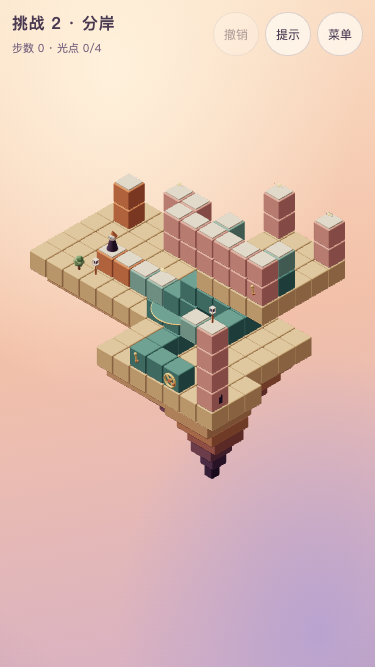

# 挑战 2 · 分岸

## 状态与能力衔接

**正式版本，关卡与声音已获用户试玩确认。** chapter 2，challenge true，revision 1；主线 **16步**，全收集 **21步**。主题短句：**两端错开的渡台**。解锁：第2章三关全部取得全收集历史评价。挑战不影响主线结局。

承接第二章旋转、高低换乘与投影连接；上庭增加一个两端相隔三格的渡台，两端不能在台上互走。

「原来如此」：**选做在另一端，必须先回岸换站位，再渡一次。**

主线只需在渡台近端往返，选做要求回固定廊道换到远端。16步主线并不声称比23步回针更长：两关按母章独立解锁，第二关增加转盘、升降、两端站位的协同负担。

共同行为、章节衔接与验证命令见[关卡索引](README.md)。



## 屏幕草图

`(a,b)=(x-y,z-y)`；数字是高度。@起点、G灯笼、o必需、*选做、M活动路面、p普通路面、h按住板、t触发板、D门。光点与起终点优先标记；草图是现有rules生成的开局路面快照，门的模式、状态和单向入格方向以下表及完整实现为准，岛屿不可行走。

```text
b\a    -3   -2   -1    0    1    2    3    4    5    6    7
 -6     ·    ·    ·    ·    ·   o8    ·    ·   *8    ·    ·
 -5     ·    ·    ·    ·    ·    ·    ·    ·    ·    ·    ·
 -4     ·    ·    ·    ·    ·    ·    ·    ·    ·    ·    ·
 -3     ·    ·   o1   p1    ·   M8    ·    ·   M8    ·    ·
 -2    p1    ·    ·   p1   p1   p8   p8   p8   p8    ·    ·
 -1     ·    ·    ·    ·    ·    ·    ·    ·    ·    ·    ·
  0     ·    ·    ·    ·    ·    ·    ·    ·    ·    ·    ·
  1     ·    ·    ·    ·    ·    ·    ·    ·    ·    ·    ·
  2     ·    ·    ·   @0   p0   M1   M1    ·    ·    ·    ·
  3     ·    ·    ·    ·    ·    ·    ·    ·    ·   M3   G5
```

## 构图与静态积木

沿用母章的暖色积木、青绿机关、浅顶板、暖白人物与固定相机。岛屿4处，装饰6件。所有机关把手要在手机构图内可见且可点，人物运动使用现有轻微收身，遮挡时沿用剪影，不消除合法的投影错觉连接。

岛屿精确范围：`[{"x":[-3,3],"z":[-2,3],"y":-1,"depth":2.5},{"x":[4,9],"z":[0,6],"y":-1,"depth":3.5},{"x":[10,12],"z":[6,8],"y":1,"depth":4},{"x":[10,13],"z":[2,6],"y":6,"depth":0.6}]`。其余装饰的坐标及类型在完整实现内；静态积木全部如下，重复高度列出的实体是柱体，不能当成额外路。

| 世界坐标 | 类型 | 颜色 | 单向入格 |
| --- | --- | --- | --- |
| `[-3, -1, -2]` | solid | sand | — |
| `[-3, -1, -1]` | solid | sand | — |
| `[-3, -1, 0]` | solid | sand | — |
| `[-3, -1, 1]` | solid | sand | — |
| `[-3, -1, 2]` | solid | sand | — |
| `[-3, -1, 3]` | solid | sand | — |
| `[-2, -1, -2]` | solid | sand | — |
| `[-2, -1, -1]` | solid | sand | — |
| `[-2, -1, 0]` | solid | sand | — |
| `[-2, -1, 1]` | solid | sand | — |
| `[-2, -1, 2]` | solid | sand | — |
| `[-2, -1, 3]` | solid | sand | — |
| `[-1, -1, -2]` | solid | sand | — |
| `[-1, -1, -1]` | solid | sand | — |
| `[-1, -1, 0]` | solid | sand | — |
| `[-1, -1, 1]` | solid | sand | — |
| `[-1, -1, 2]` | solid | sand | — |
| `[-1, -1, 3]` | solid | sand | — |
| `[0, -1, -2]` | solid | sand | — |
| `[0, -1, -1]` | solid | sand | — |
| `[0, -1, 0]` | solid | sand | — |
| `[0, -1, 1]` | solid | sand | — |
| `[0, -1, 2]` | solid | sand | — |
| `[0, -1, 3]` | solid | sand | — |
| `[1, -1, -2]` | solid | sand | — |
| `[1, -1, -1]` | solid | sand | — |
| `[1, -1, 0]` | solid | sand | — |
| `[1, -1, 1]` | solid | sand | — |
| `[1, -1, 2]` | solid | sand | — |
| `[1, -1, 3]` | solid | sand | — |
| `[2, -1, -2]` | solid | sand | — |
| `[2, -1, -1]` | solid | sand | — |
| `[2, -1, 0]` | solid | sand | — |
| `[2, -1, 1]` | solid | sand | — |
| `[2, -1, 2]` | solid | sand | — |
| `[2, -1, 3]` | solid | sand | — |
| `[3, -1, -2]` | solid | sand | — |
| `[3, -1, -1]` | solid | sand | — |
| `[3, -1, 0]` | solid | sand | — |
| `[3, -1, 1]` | solid | sand | — |
| `[3, -1, 2]` | solid | sand | — |
| `[3, -1, 3]` | solid | sand | — |
| `[0, 0, 2]` | path | terracotta | — |
| `[1, 0, 2]` | path | terracotta | — |
| `[4, -1, 0]` | solid | sand | — |
| `[4, -1, 1]` | solid | sand | — |
| `[4, -1, 2]` | solid | sand | — |
| `[4, -1, 3]` | solid | sand | — |
| `[4, -1, 4]` | solid | sand | — |
| `[4, -1, 5]` | solid | sand | — |
| `[4, -1, 6]` | solid | sand | — |
| `[5, -1, 0]` | solid | sand | — |
| `[5, -1, 1]` | solid | sand | — |
| `[5, -1, 2]` | solid | sand | — |
| `[5, -1, 3]` | solid | sand | — |
| `[5, -1, 4]` | solid | sand | — |
| `[5, -1, 5]` | solid | sand | — |
| `[5, -1, 6]` | solid | sand | — |
| `[6, -1, 0]` | solid | sand | — |
| `[6, -1, 1]` | solid | sand | — |
| `[6, -1, 2]` | solid | sand | — |
| `[6, -1, 3]` | solid | sand | — |
| `[6, -1, 4]` | solid | sand | — |
| `[6, -1, 5]` | solid | sand | — |
| `[6, -1, 6]` | solid | sand | — |
| `[7, -1, 0]` | solid | sand | — |
| `[7, -1, 1]` | solid | sand | — |
| `[7, -1, 2]` | solid | sand | — |
| `[7, -1, 3]` | solid | sand | — |
| `[7, -1, 4]` | solid | sand | — |
| `[7, -1, 5]` | solid | sand | — |
| `[7, -1, 6]` | solid | sand | — |
| `[8, -1, 0]` | solid | sand | — |
| `[8, -1, 1]` | solid | sand | — |
| `[8, -1, 2]` | solid | sand | — |
| `[8, -1, 3]` | solid | sand | — |
| `[8, -1, 4]` | solid | sand | — |
| `[8, -1, 5]` | solid | sand | — |
| `[8, -1, 6]` | solid | sand | — |
| `[9, -1, 0]` | solid | sand | — |
| `[9, -1, 1]` | solid | sand | — |
| `[9, -1, 2]` | solid | sand | — |
| `[9, -1, 3]` | solid | sand | — |
| `[9, -1, 4]` | solid | sand | — |
| `[9, -1, 5]` | solid | sand | — |
| `[9, -1, 6]` | solid | sand | — |
| `[6, 0, 4]` | solid | teal | — |
| `[6, 1, 4]` | solid | teal | — |
| `[6, 2, 4]` | solid | teal | — |
| `[6, 0, 5]` | solid | teal | — |
| `[6, 0, 6]` | solid | teal | — |
| `[7, 0, 6]` | solid | teal | — |
| `[11, 3, 9]` | solid | teal | — |
| `[0, 0, -2]` | solid | rose | — |
| `[0, 1, -2]` | path | rose | — |
| `[1, 0, -2]` | solid | rose | — |
| `[1, 1, -2]` | path | rose | — |
| `[1, 0, -1]` | solid | rose | — |
| `[1, 1, -1]` | path | rose | — |
| `[-2, 0, -1]` | solid | terracotta | — |
| `[-2, 1, -1]` | path | terracotta | — |
| `[10, 1, 6]` | solid | sand | — |
| `[10, 1, 7]` | solid | sand | — |
| `[10, 1, 8]` | solid | sand | — |
| `[11, 1, 6]` | solid | sand | — |
| `[11, 1, 7]` | solid | sand | — |
| `[11, 1, 8]` | solid | sand | — |
| `[12, 1, 6]` | solid | sand | — |
| `[12, 1, 7]` | solid | sand | — |
| `[12, 1, 8]` | solid | sand | — |
| `[12, 2, 8]` | solid | rose | — |
| `[12, 3, 8]` | solid | rose | — |
| `[12, 4, 8]` | solid | rose | — |
| `[12, 5, 8]` | path | rose | — |
| `[10, 6, 2]` | solid | sand | — |
| `[10, 6, 3]` | solid | sand | — |
| `[10, 6, 4]` | solid | sand | — |
| `[10, 6, 5]` | solid | sand | — |
| `[10, 6, 6]` | solid | sand | — |
| `[11, 6, 2]` | solid | sand | — |
| `[11, 6, 3]` | solid | sand | — |
| `[11, 6, 4]` | solid | sand | — |
| `[11, 6, 5]` | solid | sand | — |
| `[11, 6, 6]` | solid | sand | — |
| `[12, 6, 2]` | solid | sand | — |
| `[12, 6, 3]` | solid | sand | — |
| `[12, 6, 4]` | solid | sand | — |
| `[12, 6, 5]` | solid | sand | — |
| `[12, 6, 6]` | solid | sand | — |
| `[13, 6, 2]` | solid | sand | — |
| `[13, 6, 3]` | solid | sand | — |
| `[13, 6, 4]` | solid | sand | — |
| `[13, 6, 5]` | solid | sand | — |
| `[13, 6, 6]` | solid | sand | — |
| `[2, 1, -1]` | path | rose | — |
| `[2, 0, -1]` | solid | rose | — |
| `[10, 8, 6]` | path | rose | — |
| `[10, 7, 6]` | solid | rose | — |
| `[11, 8, 6]` | path | rose | — |
| `[11, 7, 6]` | solid | rose | — |
| `[12, 8, 6]` | path | rose | — |
| `[12, 7, 6]` | solid | rose | — |
| `[13, 8, 6]` | path | rose | — |
| `[13, 7, 6]` | solid | rose | — |
| `[10, 8, 2]` | path | rose | — |
| `[10, 7, 2]` | solid | rose | — |
| `[13, 8, 2]` | path | rose | — |
| `[13, 7, 2]` | solid | rose | — |

## 机关清单

无uses表示不限次；rotator默认顺转90度，initialStep缺省0；mover默认从首站开始、到端折返；plate缺mode表示到格触发，once才只触发一次；gate缺initialOpen表示初始关闭。reverse是既有反向链接，不新增控制规则。

| ID | 类型 | 完整参数 |
| --- | --- | --- |
| ferry | rotator | `{"pivot":[6,2,4],"blocks":[{"offset":[-1,0,0]},{"offset":[1,0,0],"kind":"solid","color":"teal"},{"offset":[3,1,2]},{"offset":[1,1,0],"kind":"solid","color":"teal"},{"offset":[2,1,0],"kind":"solid","color":"teal"},{"offset":[3,1,0],"kind":"solid","color":"teal"},{"offset":[4,1,0],"kind":"solid","color":"teal"},{"offset":[4,1,1],"kind":"solid","color":"teal"},{"offset":[4,1,2],"kind":"solid","color":"teal"}],"handle":{"block":[11,3,9],"face":"z"}}` |
| lift | mover | `{"origin":[4,1,3],"axis":"y","stops":[0,4],"blocks":[{"offset":[0,0,0]},{"offset":[-1,0,0]},{"offset":[0,-1,0],"kind":"solid","color":"teal"}],"handle":{"block":[6,0,6],"face":"z"}}` |
| shuttle | mover | `{"origin":[10,8,5],"axis":"z","stops":[0,-2],"blocks":[{"offset":[0,0,0]},{"offset":[3,0,0]},{"offset":[0,-1,0],"kind":"solid","color":"teal"},{"offset":[1,-1,0],"kind":"solid","color":"teal"},{"offset":[2,-1,0],"kind":"solid","color":"teal"},{"offset":[3,-1,0],"kind":"solid","color":"teal"}],"handle":{"block":[13,7,6],"face":"z"}}` |

## 光点与其他元素

下列数组顺序决定现有orb／crate／patrol编号，不能随意重排。单向箭头仅限制进入，照常允许离开；巡逻随一个玩家动作提交推进一次，整段自动行走不按经过格数推进。

```json
{
  "orbs": [
    {
      "mechanism": "ferry",
      "block": 0
    },
    {
      "tile": [
        0,
        1,
        -2
      ]
    },
    {
      "tile": [
        13,
        8,
        2
      ],
      "optional": true
    },
    {
      "tile": [
        10,
        8,
        2
      ]
    }
  ],
  "crates": [],
  "patrols": []
}
```

## 标准解法

每行是一次玩家动作；walk自动经过的中间格不额外计步，禁止为了照稿而强迫额外点击中间转角。所有合法同等或更长路线仍允许。

| 步 | 动作 | 原因 |
| --- | --- | --- |
| 1 | 走到 `[5, 2, 4]` | 从起庭登上近桥端 |
| 2 | 走到 `[3, 1, 3]` | 沿桥到升降换乘端 |
| 3 | 操作 `ferry` | 转桥避让升降通道 |
| 4 | 操作 `ferry` | 转桥连上北侧 |
| 5 | 操作 `lift` | 召升降台到北层 |
| 6 | 走到 `[0, 1, -2]` | 取北庭必需光 |
| 7 | 操作 `lift` | 送升降台回高廊 |
| 8 | 走到 `[10, 8, 5]` | 经固定廊道登上渡台近端 |
| 9 | 操作 `shuttle` | 带人去远岸 |
| 10 | 走到 `[10, 8, 2]` | 下台取必需光 |
| 11 | 走到 `[10, 8, 3]` | 回渡台近端 |
| 12 | 操作 `shuttle` | 返岸，主线无需换到另一端 |
| 13 | 走到 `[3, 3, 2]` | 借固定廊道回转桥 |
| 14 | 操作 `ferry` | 转向归程 |
| 15 | 操作 `ferry` | 恢复目标端连接 |
| 16 | 走到 `[12, 5, 8]` | 抵达灯笼 |

全收集路线见自动验证基准的`all`，逐步可复现且必须在点灯之前完成；全收集与最少步数仍可分局历史累计，本关不改变评价规则。

## 干扰、恢复与反事实

渡台在远岸时，两端不通，不能从横梁走过去；在近岸可以一次自动经固定岸廊走到另一端，不要求先单独点击岸廊。全收集至少21步，禁止乘坐shuttle#1操作后全收集不可达；固定主线操作次序再插行走也不能全收集。提前空送可召回，零死局。

前三关零死局；本关全状态死局数为0。错误操作可继续调整回到可解状态。

自动检查全部提示只在合法动作中选取，并严格减少到获胜的距离；全部首步／两步前缀有解。反事实只过滤现有rules产生的边，不修改原关卡、光点必需性或规则；结果完整写在下方基准。

## 声音与界面

沿用第2章已确认的courtyard谱面与混音，整套音乐时钟按90%速度播放，反馈速度不变；只响应实际收光和通关，不判断正确箱位或解法。不新增首次教学、常驻说明或新结局。三项历史评价独立累计，提示只影响本局步数评价；下一编号挑战已解锁则可连续进入，否则回选关。共同行为见[游戏设计](../design.md)。

## 预期指标

| 项目 | 基准 |
| --- | --- |
| 主线／全收集 | 16／21 |
| 状态／死局 | 2996／0 |
| 80步500次随机，seed 20261016 | 0%（门槛≤10%） |
| 标准主线错觉／取舍 | 8／4 |
| 冷求解记录 | 约99ms；检查时仍强制<2000ms |
| 结构／角色运动组，每组181姿态 | 108／1572，零采样问题 |

净空覆盖顶板、岩层、机关与底盘，后两关另含门、箱及巡逻；精确覆盖数见自动验证基准。181姿态检查不等于连续碰撞证明，验证方法和设备边界见[验收记录](../performance.md)。

## 完整参考实现

```ts
import { defineLevel } from './builders'
import type { Vec3 } from './types'
export default defineLevel({
  id: 'challenge-2',
  title: '分岸',
  chapter: 2,
  revision: 1,
  challenge: true,
  soundtrack: 'courtyard',
  hints: ['转轮转动桥臂，拉杆升降平台'],
  build: (b) => {
    b.island({ x: [-3, 3], z: [-2, 3], y: -1, depth: 2.5 })
    for (const x of [0, 1]) b.path([x, 0, 2], 'terracotta')
    b.island({ x: [4, 9], z: [0, 6], y: -1, depth: 3.5 })
    b.column({ x: 6, z: 4, from: 0, to: 2 }, 'teal')
    for (const p of [
      [6, 0, 5],
      [6, 0, 6],
      [7, 0, 6],
      [11, 3, 9],
    ] as Vec3[])
      b.solid(p, 'teal')
    b.rotator({
      id: 'ferry',
      pivot: [6, 2, 4],
      blocks: [
        { offset: [-1, 0, 0] },
        { offset: [1, 0, 0], kind: 'solid', color: 'teal' },
        { offset: [3, 1, 2] },
        ...(
          [
            [1, 1, 0],
            [2, 1, 0],
            [3, 1, 0],
            [4, 1, 0],
            [4, 1, 1],
            [4, 1, 2],
          ] as Vec3[]
        ).map((offset) => ({
          offset,
          kind: 'solid' as const,
          color: 'teal' as const,
        })),
      ],
      handle: { block: [11, 3, 9], face: 'z' },
    })
    b.orb({ mechanism: 'ferry', block: 0 })
    b.mover({
      id: 'lift',
      origin: [4, 1, 3],
      axis: 'y',
      stops: [0, 4],
      blocks: [{ offset: [0, 0, 0] }, { offset: [-1, 0, 0] }, { offset: [0, -1, 0], kind: 'solid', color: 'teal' }],
      handle: { block: [6, 0, 6], face: 'z' },
    })
    for (const p of [
      [0, 1, -2],
      [1, 1, -2],
      [1, 1, -1],
    ] as Vec3[]) {
      b.solid([p[0], 0, p[2]], 'rose')
      b.path(p, 'rose')
    }
    b.orb({ tile: [0, 1, -2] })
    b.solid([-2, 0, -1], 'terracotta')
    b.path([-2, 1, -1], 'terracotta')
    b.orb({ tile: [13, 8, 2], optional: true })
    b.island({ x: [10, 12], z: [6, 8], y: 1, depth: 4 })
    b.column({ x: 12, z: 8, from: 2, to: 4 }, 'rose')
    b.path([12, 5, 8], 'rose')
    b.island({ x: [10, 13], z: [2, 6], y: 6, depth: 0.6 })
    b.path([2, 1, -1], 'rose')
    b.column({ x: 2, z: -1, from: 0, to: 0 }, 'rose')
    for (let x = 10; x <= 13; x++) {
      b.path([x, 8, 6], 'rose')
      b.solid([x, 7, 6], 'rose')
    }
    for (const x of [10, 13]) {
      b.path([x, 8, 2], 'rose')
      b.solid([x, 7, 2], 'rose')
    }
    b.mover({
      id: 'shuttle',
      origin: [10, 8, 5],
      axis: 'z',
      stops: [0, -2],
      blocks: [
        { offset: [0, 0, 0] },
        { offset: [3, 0, 0] },
        ...[0, 1, 2, 3].map((x) => ({
          offset: [x, -1, 0] as Vec3,
          kind: 'solid' as const,
          color: 'teal' as const,
        })),
      ],
      handle: { block: [13, 7, 6], face: 'z' },
    })
    b.orb({ tile: [10, 8, 2] })
    b.tree([-1, -1, 3])
    b.flower([7, -1, 6])
    b.window({ pos: [12, 2, 8], face: 'x' })
    b.lamp([0, -1, 3])
    b.lamp([8, -1, 6])
    b.lamp([10, 1, 8])
    b.start([0, 0, 2])
    b.goal([12, 5, 8])
  },
  solution: [
    { type: 'walk', to: [5, 2, 4] },
    { type: 'walk', to: [3, 1, 3] },
    { type: 'operate', mechanism: 'ferry' },
    { type: 'operate', mechanism: 'ferry' },
    { type: 'operate', mechanism: 'lift' },
    { type: 'walk', to: [0, 1, -2] },
    { type: 'operate', mechanism: 'lift' },
    { type: 'walk', to: [10, 8, 5] },
    { type: 'operate', mechanism: 'shuttle' },
    { type: 'walk', to: [10, 8, 2] },
    { type: 'walk', to: [10, 8, 3] },
    { type: 'operate', mechanism: 'shuttle' },
    { type: 'walk', to: [3, 3, 2] },
    { type: 'operate', mechanism: 'ferry' },
    { type: 'operate', mechanism: 'ferry' },
    { type: 'walk', to: [12, 5, 8] },
  ],
})
```

## 自动验证基准

```json
{
  "metrics": {
    "minActions": 16,
    "minActionsAll": 21,
    "reachableStates": 2996,
    "deadEndStates": 0,
    "illusions": 8,
    "tradeoffs": 4,
    "randomSteps": 80,
    "randomRate": 0
  },
  "target": {
    "minActions": 16,
    "minActionsAll": 21,
    "reachableStatesMin": 150,
    "randomWin": {
      "steps": 80,
      "maxRate": 0.1
    },
    "illusionsMin": 2,
    "tradeoffsMin": 2
  },
  "all": [
    {
      "type": "walk",
      "to": [
        5,
        2,
        4
      ]
    },
    {
      "type": "walk",
      "to": [
        3,
        1,
        3
      ]
    },
    {
      "type": "operate",
      "mechanism": "ferry"
    },
    {
      "type": "operate",
      "mechanism": "ferry"
    },
    {
      "type": "operate",
      "mechanism": "lift"
    },
    {
      "type": "walk",
      "to": [
        0,
        1,
        -2
      ]
    },
    {
      "type": "operate",
      "mechanism": "lift"
    },
    {
      "type": "walk",
      "to": [
        10,
        8,
        5
      ]
    },
    {
      "type": "operate",
      "mechanism": "shuttle"
    },
    {
      "type": "walk",
      "to": [
        10,
        8,
        2
      ]
    },
    {
      "type": "walk",
      "to": [
        10,
        8,
        3
      ]
    },
    {
      "type": "operate",
      "mechanism": "shuttle"
    },
    {
      "type": "walk",
      "to": [
        13,
        8,
        5
      ]
    },
    {
      "type": "operate",
      "mechanism": "shuttle"
    },
    {
      "type": "walk",
      "to": [
        13,
        8,
        2
      ]
    },
    {
      "type": "walk",
      "to": [
        13,
        8,
        3
      ]
    },
    {
      "type": "operate",
      "mechanism": "shuttle"
    },
    {
      "type": "walk",
      "to": [
        3,
        3,
        2
      ]
    },
    {
      "type": "operate",
      "mechanism": "ferry"
    },
    {
      "type": "operate",
      "mechanism": "ferry"
    },
    {
      "type": "walk",
      "to": [
        12,
        5,
        8
      ]
    }
  ],
  "clearance": {
    "structuralTransitions": 108,
    "characterTransitions": 1572,
    "samples": 181,
    "issues": []
  },
  "counterfactuals": {
    "first": 6,
    "second": 34,
    "unsafe1": 0,
    "unsafe2": 0,
    "badPath": null,
    "scheduleAll": null,
    "blocked": {
      "noSecondEnd": null,
      "noShuttle": null
    }
  }
}
```
