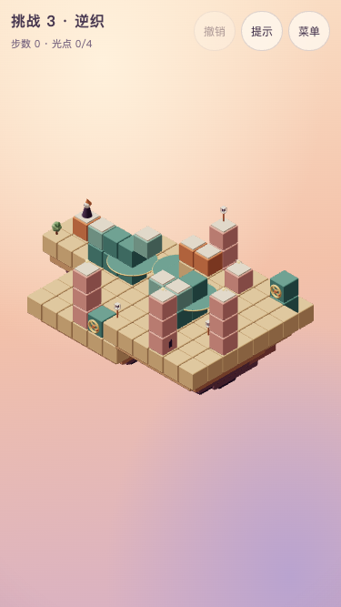

# 挑战 3 · 逆织

## 状态与能力衔接

**T6.20设计合同，T6.21已按本稿正式接入。** chapter 3，challenge true，revision 1；主线 **18步**，全收集 **20步**。主题短句：**同桥的正反控制**。解锁：第3章三关全部取得全收集历史评价。挑战不影响主线结局。

承接第三章联动与改变控制来源。pair让远桥正转，relay让同一远桥反转；仍是既有reverse链接。

「原来如此」：**人已上远桥，也能换用另一处转轮改变下一次离台方向。**

保留三个转盘的高低庭院语言，但远桥新增必需东口与选做北口。两处把手共同改变远桥，解题是人所在站位与控制来源的配对，不是死记同转次数。

全章范围、声音、验证与开发顺序以[共同交接](challenges.md)为准。指标只证明设计约束，不代替用户实际难度体验。



## 屏幕草图

`(a,b)=(x-y,z-y)`；数字是高度。@起点、G灯笼、o必需、*选做、M活动路面、p普通路面、h按住板、t触发板、D门。光点与起终点优先标记；草图是现有rules生成的开局路面快照，门的模式、状态和单向入格方向以下表及完整实现为准，岛屿不可行走。

```text
b\a    -1    0    1    2    3    4    5    6    7    8
 -2     ·    ·    ·    ·    ·   G2    ·    ·    ·    ·
 -1     ·    ·    ·    ·    ·    ·    ·    ·    ·    ·
  0     ·    ·    ·    ·    ·   p7   p7    ·   *7    ·
  1     ·    ·    ·   M4    ·    ·    ·    ·    ·    ·
  2    @0   M1    ·    ·    ·    ·    ·    ·    ·   o9
  3     ·    ·    ·    ·    ·    ·   M8   M8    ·    ·
  4     ·    ·    ·    ·    ·    ·    ·   o9    ·    ·
  5     ·    ·    ·   o2    ·    ·    ·    ·    ·    ·
```

## 构图与静态积木

沿用母章的暖色积木、青绿机关、浅顶板、暖白人物与固定相机。岛屿4处，装饰5件。所有机关把手要在手机构图内可见且可点，人物运动使用现有轻微收身，遮挡时沿用剪影，不消除合法的投影错觉连接。

岛屿精确范围：`[{"x":[-2,0],"z":[1,3],"y":-1,"depth":2},{"x":[1,6],"z":[0,7],"y":-1,"depth":3},{"x":[12,17],"z":[7,13],"y":6,"depth":3},{"x":[7,10],"z":[-1,6],"y":-1,"depth":2.5}]`。其余装饰的坐标及类型在完整实现内；静态积木全部如下，重复高度列出的实体是柱体，不能当成额外路。

| 世界坐标 | 类型 | 颜色 | 单向入格 |
| --- | --- | --- | --- |
| `[-2, -1, 1]` | solid | sand | — |
| `[-2, -1, 2]` | solid | sand | — |
| `[-2, -1, 3]` | solid | sand | — |
| `[-1, -1, 1]` | solid | sand | — |
| `[-1, -1, 2]` | solid | sand | — |
| `[-1, -1, 3]` | solid | sand | — |
| `[0, -1, 1]` | solid | sand | — |
| `[0, -1, 2]` | solid | sand | — |
| `[0, -1, 3]` | solid | sand | — |
| `[1, -1, 0]` | solid | sand | — |
| `[1, -1, 1]` | solid | sand | — |
| `[1, -1, 2]` | solid | sand | — |
| `[1, -1, 3]` | solid | sand | — |
| `[1, -1, 4]` | solid | sand | — |
| `[1, -1, 5]` | solid | sand | — |
| `[1, -1, 6]` | solid | sand | — |
| `[1, -1, 7]` | solid | sand | — |
| `[2, -1, 0]` | solid | sand | — |
| `[2, -1, 1]` | solid | sand | — |
| `[2, -1, 2]` | solid | sand | — |
| `[2, -1, 3]` | solid | sand | — |
| `[2, -1, 4]` | solid | sand | — |
| `[2, -1, 5]` | solid | sand | — |
| `[2, -1, 6]` | solid | sand | — |
| `[2, -1, 7]` | solid | sand | — |
| `[3, -1, 0]` | solid | sand | — |
| `[3, -1, 1]` | solid | sand | — |
| `[3, -1, 2]` | solid | sand | — |
| `[3, -1, 3]` | solid | sand | — |
| `[3, -1, 4]` | solid | sand | — |
| `[3, -1, 5]` | solid | sand | — |
| `[3, -1, 6]` | solid | sand | — |
| `[3, -1, 7]` | solid | sand | — |
| `[4, -1, 0]` | solid | sand | — |
| `[4, -1, 1]` | solid | sand | — |
| `[4, -1, 2]` | solid | sand | — |
| `[4, -1, 3]` | solid | sand | — |
| `[4, -1, 4]` | solid | sand | — |
| `[4, -1, 5]` | solid | sand | — |
| `[4, -1, 6]` | solid | sand | — |
| `[4, -1, 7]` | solid | sand | — |
| `[5, -1, 0]` | solid | sand | — |
| `[5, -1, 1]` | solid | sand | — |
| `[5, -1, 2]` | solid | sand | — |
| `[5, -1, 3]` | solid | sand | — |
| `[5, -1, 4]` | solid | sand | — |
| `[5, -1, 5]` | solid | sand | — |
| `[5, -1, 6]` | solid | sand | — |
| `[5, -1, 7]` | solid | sand | — |
| `[6, -1, 0]` | solid | sand | — |
| `[6, -1, 1]` | solid | sand | — |
| `[6, -1, 2]` | solid | sand | — |
| `[6, -1, 3]` | solid | sand | — |
| `[6, -1, 4]` | solid | sand | — |
| `[6, -1, 5]` | solid | sand | — |
| `[6, -1, 6]` | solid | sand | — |
| `[6, -1, 7]` | solid | sand | — |
| `[12, 6, 7]` | solid | sand | — |
| `[12, 6, 8]` | solid | sand | — |
| `[12, 6, 9]` | solid | sand | — |
| `[12, 6, 10]` | solid | sand | — |
| `[12, 6, 11]` | solid | sand | — |
| `[12, 6, 12]` | solid | sand | — |
| `[12, 6, 13]` | solid | sand | — |
| `[13, 6, 7]` | solid | sand | — |
| `[13, 6, 8]` | solid | sand | — |
| `[13, 6, 9]` | solid | sand | — |
| `[13, 6, 10]` | solid | sand | — |
| `[13, 6, 11]` | solid | sand | — |
| `[13, 6, 12]` | solid | sand | — |
| `[13, 6, 13]` | solid | sand | — |
| `[14, 6, 7]` | solid | sand | — |
| `[14, 6, 8]` | solid | sand | — |
| `[14, 6, 9]` | solid | sand | — |
| `[14, 6, 10]` | solid | sand | — |
| `[14, 6, 11]` | solid | sand | — |
| `[14, 6, 12]` | solid | sand | — |
| `[14, 6, 13]` | solid | sand | — |
| `[15, 6, 7]` | solid | sand | — |
| `[15, 6, 8]` | solid | sand | — |
| `[15, 6, 9]` | solid | sand | — |
| `[15, 6, 10]` | solid | sand | — |
| `[15, 6, 11]` | solid | sand | — |
| `[15, 6, 12]` | solid | sand | — |
| `[15, 6, 13]` | solid | sand | — |
| `[16, 6, 7]` | solid | sand | — |
| `[16, 6, 8]` | solid | sand | — |
| `[16, 6, 9]` | solid | sand | — |
| `[16, 6, 10]` | solid | sand | — |
| `[16, 6, 11]` | solid | sand | — |
| `[16, 6, 12]` | solid | sand | — |
| `[16, 6, 13]` | solid | sand | — |
| `[17, 6, 7]` | solid | sand | — |
| `[17, 6, 8]` | solid | sand | — |
| `[17, 6, 9]` | solid | sand | — |
| `[17, 6, 10]` | solid | sand | — |
| `[17, 6, 11]` | solid | sand | — |
| `[17, 6, 12]` | solid | sand | — |
| `[17, 6, 13]` | solid | sand | — |
| `[7, -1, -1]` | solid | sand | — |
| `[7, -1, 0]` | solid | sand | — |
| `[7, -1, 1]` | solid | sand | — |
| `[7, -1, 2]` | solid | sand | — |
| `[7, -1, 3]` | solid | sand | — |
| `[7, -1, 4]` | solid | sand | — |
| `[7, -1, 5]` | solid | sand | — |
| `[7, -1, 6]` | solid | sand | — |
| `[8, -1, -1]` | solid | sand | — |
| `[8, -1, 0]` | solid | sand | — |
| `[8, -1, 1]` | solid | sand | — |
| `[8, -1, 2]` | solid | sand | — |
| `[8, -1, 3]` | solid | sand | — |
| `[8, -1, 4]` | solid | sand | — |
| `[8, -1, 5]` | solid | sand | — |
| `[8, -1, 6]` | solid | sand | — |
| `[9, -1, -1]` | solid | sand | — |
| `[9, -1, 0]` | solid | sand | — |
| `[9, -1, 1]` | solid | sand | — |
| `[9, -1, 2]` | solid | sand | — |
| `[9, -1, 3]` | solid | sand | — |
| `[9, -1, 4]` | solid | sand | — |
| `[9, -1, 5]` | solid | sand | — |
| `[9, -1, 6]` | solid | sand | — |
| `[10, -1, -1]` | solid | sand | — |
| `[10, -1, 0]` | solid | sand | — |
| `[10, -1, 1]` | solid | sand | — |
| `[10, -1, 2]` | solid | sand | — |
| `[10, -1, 3]` | solid | sand | — |
| `[10, -1, 4]` | solid | sand | — |
| `[10, -1, 5]` | solid | sand | — |
| `[10, -1, 6]` | solid | sand | — |
| `[-1, 0, 2]` | path | terracotta | — |
| `[4, 2, 7]` | path | rose | — |
| `[12, 7, 7]` | path | terracotta | — |
| `[15, 9, 13]` | path | rose | — |
| `[3, 0, 3]` | solid | teal | — |
| `[3, 1, 3]` | solid | teal | — |
| `[5, 0, 7]` | solid | teal | — |
| `[4, 0, 7]` | solid | rose | — |
| `[4, 1, 7]` | solid | rose | — |
| `[14, 7, 10]` | solid | teal | — |
| `[14, 8, 10]` | solid | teal | — |
| `[15, 7, 13]` | solid | rose | — |
| `[15, 8, 13]` | solid | rose | — |
| `[6, 2, 0]` | path | rose | — |
| `[6, 0, 0]` | solid | rose | — |
| `[6, 1, 0]` | solid | rose | — |
| `[11, 7, 7]` | path | terracotta | — |
| `[11, 6, 7]` | solid | sand | — |
| `[8, 0, 5]` | solid | teal | — |
| `[8, 1, 5]` | solid | teal | — |
| `[8, 2, 5]` | solid | teal | — |
| `[8, 3, 5]` | solid | teal | — |
| `[10, 0, 0]` | solid | teal | — |
| `[10, 1, 0]` | solid | teal | — |
| `[14, 7, 7]` | path | rose | — |
| `[17, 9, 11]` | path | rose | — |
| `[17, 7, 11]` | solid | rose | — |
| `[17, 8, 11]` | solid | rose | — |

## 机关清单

无uses表示不限次；rotator默认顺转90度，initialStep缺省0；mover默认从首站开始、到端折返；plate缺mode表示到格触发，once才只触发一次；gate缺initialOpen表示初始关闭。reverse是既有反向链接，不新增控制规则。

| ID | 类型 | 完整参数 |
| --- | --- | --- |
| pair | rotator | `{"pivot":[3,1,3],"blocks":[{"offset":[-2,0,0]},{"offset":[-1,0,0],"kind":"solid","color":"teal"},{"offset":[-2,-1,0],"kind":"solid","color":"teal"},{"offset":[-1,-1,0],"kind":"solid","color":"teal"}],"handle":{"block":[5,0,7],"face":"z"},"links":[{"target":"remote"}]}` |
| remote | rotator | `{"pivot":[14,8,10],"initialStep":1,"blocks":[{"offset":[-1,0,0]},{"offset":[-1,0,-1]},{"offset":[-1,-1,0],"kind":"solid","color":"teal"},{"offset":[-1,-1,-1],"kind":"solid","color":"teal"}]}` |
| relay | rotator | `{"pivot":[8,4,5],"blocks":[{"offset":[-2,0,0]}],"handle":{"block":[10,1,0],"face":"z"},"links":[{"target":"remote","reverse":true}]}` |

## 光点与其他元素

下列数组顺序决定现有orb／crate／patrol编号，不能随意重排。单向箭头仅限制进入，照常允许离开；巡逻随一个玩家动作提交推进一次，整段自动行走不按经过格数推进。

```json
{
  "orbs": [
    {
      "tile": [
        4,
        2,
        7
      ]
    },
    {
      "tile": [
        14,
        7,
        7
      ],
      "optional": true
    },
    {
      "tile": [
        15,
        9,
        13
      ]
    },
    {
      "tile": [
        17,
        9,
        11
      ]
    }
  ],
  "crates": [],
  "patrols": []
}
```

## 标准解法

每行是一次玩家动作；walk自动经过的中间格不额外计步，禁止为了照稿而强迫额外点击中间转角。所有合法同等或更长路线仍允许。

| 步 | 动作 | 原因 |
| --- | --- | --- |
| 1 | 走到 `[1, 1, 3]` | 登近桥 |
| 2 | 操作 `pair` | 近桥与远桥同转 |
| 3 | 走到 `[4, 2, 7]` | 取南端必需光 |
| 4 | 走到 `[3, 1, 5]` | 回到近桥 |
| 5 | 操作 `pair` | 为中庭换乘改向 |
| 6 | 操作 `pair` | 接上relay |
| 7 | 走到 `[6, 4, 5]` | 登relay端 |
| 8 | 操作 `pair` | 从另一控制源调整远桥 |
| 9 | 操作 `pair` | 把远桥连接转到合适方位 |
| 10 | 操作 `relay` | relay带人转动，并令远桥反转 |
| 11 | 走到 `[15, 9, 13]` | 经远桥取南庭光 |
| 12 | 走到 `[14, 8, 11]` | 登远桥继续乘坐 |
| 13 | 操作 `pair` | pair正转远桥到东口 |
| 14 | 走到 `[17, 9, 11]` | 取东口必需光 |
| 15 | 走到 `[15, 8, 10]` | 登远桥准备返程 |
| 16 | 操作 `relay` | relay反转调整近桥接点 |
| 17 | 操作 `relay` | 继续调整到归路 |
| 18 | 走到 `[6, 2, 0]` | 经近桥回灯笼 |

全收集路线见自动验证基准的`all`，逐步可复现且必须在点灯之前完成；全收集与最少步数仍可分局历史累计，本关不改变评价规则。

## 干扰、恢复与反事实

只用pair或只用relay都不能获胜。全收集20步，不能在18步主线原有非行走动作序列中单插行走完成；需要改变控制次序。任意合法状态都有获胜策略，错误方向可以继续转回。

前三关零死局；本关全状态死局数为0。错误操作可继续调整回到可解状态。

自动检查全部提示只在合法动作中选取，并严格减少到获胜的距离；全部首步／两步前缀有解。反事实只过滤现有rules产生的边，不修改原关卡、光点必需性或规则；结果完整写在下方基准。

## 声音与界面合同

复用第3章已确认的courtyard谱面与h1混音，挑战按既定设计以90%速度播放，反馈音保持原速度、音量和35ms让位。**T6.21已统一接入音符、和弦、脉冲、currentChord与暂停恢复的90%时钟；2026-10-25用户已确认本轮挑战体验与慢速听感，保留现有谱面及混音；该确认来自本轮实际试玩，非电平检查外推。** 不写新旋律、不恢复低频嗡鸣，不靠巡逻或正确箱位触发推进；只响应实际收光、集齐必需、点灯与新评价。

挑战不新增首次教学或常驻操作说明。T6.21复用主线已认可的按压、提亮、运动／到位一句反馈和不可达文案；标题、选关预览关闭。完成后返回选关，不进入十五灯主线结局；三项评价独立累计，提示只影响本局步数评价。上述行为已由T6.21正式接线；T6.22已获本轮整体试玩与新慢速试听确认，性能及文档收尾见共同稿。

## 预期指标

| 项目 | 基准 |
| --- | --- |
| 主线／全收集 | 18／20 |
| 状态／死局 | 2536／0 |
| 80步500次随机，seed 20261016 | 0%（门槛≤10%） |
| 标准主线错觉／取舍 | 12／4 |
| 冷求解记录 | 约102ms；检查时仍强制<2000ms |
| 结构／角色运动组，每组181姿态 | 32／384，零采样问题 |

净空包含顶板、岩层、其他机关与底盘；后两关另含门、箱及巡逻，第三关检查正反联动和差时长。它是离散采样，不是连续碰撞的数学证明。实际交互与截图记录见共同稿；临时日志不是正式设计依据。

## 完整参考实现

```ts
import { defineLevel } from './builders'

export default defineLevel({
  id: 'challenge-3',
  title: '逆织',
  chapter: 3,
  revision: 1,
  challenge: true,
  soundtrack: 'courtyard',
  hints: [],
  build: (b) => {
    b.island({ x: [-2, 0], z: [1, 3], y: -1, depth: 2 })
    b.island({ x: [1, 6], z: [0, 7], y: -1, depth: 3 })
    b.island({ x: [12, 17], z: [7, 13], y: 6, depth: 3 })
    b.island({ x: [7, 10], z: [-1, 6], y: -1, depth: 2.5 })
    b.path([-1, 0, 2], 'terracotta')
    b.path([4, 2, 7], 'rose')
    b.path([12, 7, 7], 'terracotta')
    b.path([15, 9, 13], 'rose')
    b.solid([3, 0, 3], 'teal')
    b.solid([3, 1, 3], 'teal')
    b.solid([5, 0, 7], 'teal')
    b.solid([4, 0, 7], 'rose')
    b.solid([4, 1, 7], 'rose')
    b.solid([14, 7, 10], 'teal')
    b.solid([14, 8, 10], 'teal')
    b.solid([15, 7, 13], 'rose')
    b.solid([15, 8, 13], 'rose')
    b.path([6, 2, 0], 'rose')
    b.solid([6, 0, 0], 'rose')
    b.solid([6, 1, 0], 'rose')
    b.path([11, 7, 7], 'terracotta')
    b.solid([11, 6, 7], 'sand')
    b.solid([8, 0, 5], 'teal')
    b.solid([8, 1, 5], 'teal')
    b.solid([8, 2, 5], 'teal')
    b.solid([8, 3, 5], 'teal')
    b.solid([10, 0, 0], 'teal')
    b.solid([10, 1, 0], 'teal')
    b.rotator({
      id: 'pair',
      pivot: [3, 1, 3],
      blocks: [
        { offset: [-2, 0, 0] },
        { offset: [-1, 0, 0], kind: 'solid', color: 'teal' },
        { offset: [-2, -1, 0], kind: 'solid', color: 'teal' },
        { offset: [-1, -1, 0], kind: 'solid', color: 'teal' },
      ],
      handle: { block: [5, 0, 7], face: 'z' },
      links: [{ target: 'remote' }],
    })
    b.rotator({
      id: 'remote',
      pivot: [14, 8, 10],
      initialStep: 1,
      blocks: [
        { offset: [-1, 0, 0] },
        { offset: [-1, 0, -1] },
        { offset: [-1, -1, 0], kind: 'solid', color: 'teal' },
        { offset: [-1, -1, -1], kind: 'solid', color: 'teal' },
      ],
    })
    b.rotator({
      id: 'relay',
      pivot: [8, 4, 5],
      blocks: [{ offset: [-2, 0, 0] }],
      handle: { block: [10, 1, 0], face: 'z' },
      links: [{ target: 'remote', reverse: true }],
    })
    b.orb({ tile: [4, 2, 7] })
    b.path([14, 7, 7], 'rose')
    b.orb({ tile: [14, 7, 7], optional: true })
    b.orb({ tile: [15, 9, 13] })
    b.path([17, 9, 11], 'rose')
    b.column({ x: 17, z: 11, from: 7, to: 8 }, 'rose')
    b.orb({ tile: [17, 9, 11] })
    b.tree([-2, -1, 3])
    b.flower([6, -1, 7])
    b.window({ pos: [15, 7, 13], face: 'x' })
    b.lamp([12, 6, 13])
    b.lamp([16, 6, 11])
    b.start([-1, 0, 2])
    b.goal([6, 2, 0])
  },
  solution: [
    { type: 'walk', to: [1, 1, 3] },
    { type: 'operate', mechanism: 'pair' },
    { type: 'walk', to: [4, 2, 7] },
    { type: 'walk', to: [3, 1, 5] },
    { type: 'operate', mechanism: 'pair' },
    { type: 'operate', mechanism: 'pair' },
    { type: 'walk', to: [6, 4, 5] },
    { type: 'operate', mechanism: 'pair' },
    { type: 'operate', mechanism: 'pair' },
    { type: 'operate', mechanism: 'relay' },
    { type: 'walk', to: [15, 9, 13] },
    { type: 'walk', to: [14, 8, 11] },
    { type: 'operate', mechanism: 'pair' },
    { type: 'walk', to: [17, 9, 11] },
    { type: 'walk', to: [15, 8, 10] },
    { type: 'operate', mechanism: 'relay' },
    { type: 'operate', mechanism: 'relay' },
    { type: 'walk', to: [6, 2, 0] },
  ],
})
```

## 自动验证基准

```json
{
  "metrics": {
    "minActions": 18,
    "minActionsAll": 20,
    "reachableStates": 2536,
    "deadEndStates": 0,
    "illusions": 12,
    "tradeoffs": 4,
    "randomSteps": 80,
    "randomRate": 0
  },
  "target": {
    "minActions": 18,
    "minActionsAll": 20,
    "reachableStatesMin": 150,
    "randomWin": {
      "steps": 80,
      "maxRate": 0.1
    },
    "illusionsMin": 2,
    "tradeoffsMin": 2
  },
  "all": [
    {
      "type": "walk",
      "to": [
        1,
        1,
        3
      ]
    },
    {
      "type": "operate",
      "mechanism": "pair"
    },
    {
      "type": "walk",
      "to": [
        4,
        2,
        7
      ]
    },
    {
      "type": "walk",
      "to": [
        3,
        1,
        5
      ]
    },
    {
      "type": "operate",
      "mechanism": "pair"
    },
    {
      "type": "operate",
      "mechanism": "relay"
    },
    {
      "type": "operate",
      "mechanism": "relay"
    },
    {
      "type": "operate",
      "mechanism": "relay"
    },
    {
      "type": "walk",
      "to": [
        13,
        8,
        10
      ]
    },
    {
      "type": "operate",
      "mechanism": "pair"
    },
    {
      "type": "walk",
      "to": [
        15,
        9,
        13
      ]
    },
    {
      "type": "walk",
      "to": [
        14,
        8,
        11
      ]
    },
    {
      "type": "operate",
      "mechanism": "pair"
    },
    {
      "type": "walk",
      "to": [
        17,
        9,
        11
      ]
    },
    {
      "type": "walk",
      "to": [
        15,
        8,
        10
      ]
    },
    {
      "type": "operate",
      "mechanism": "pair"
    },
    {
      "type": "walk",
      "to": [
        14,
        7,
        7
      ]
    },
    {
      "type": "walk",
      "to": [
        15,
        8,
        9
      ]
    },
    {
      "type": "operate",
      "mechanism": "pair"
    },
    {
      "type": "walk",
      "to": [
        6,
        2,
        0
      ]
    }
  ],
  "clearance": {
    "structuralTransitions": 32,
    "characterTransitions": 384,
    "samples": 181,
    "issues": []
  },
  "counterfactuals": {
    "first": 3,
    "second": 8,
    "unsafe1": 0,
    "unsafe2": 0,
    "badPath": null,
    "scheduleAll": null,
    "blocked": {
      "no-pair": null,
      "no-relay": null
    }
  }
}
```
