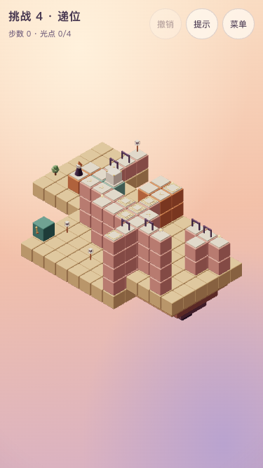

# 挑战 4 · 递位

## 状态与能力衔接

**T6.20设计合同，T6.21已按本稿正式接入。** chapter 4，challenge true，revision 1；主线 **18步**，全收集 **22步**。主题短句：**同一个箱的三次交接**。解锁：第4章三关全部取得全收集历史评价。挑战不影响主线结局。

承接第四章中站卸箱、绕后换推向、按住门与触发板；把一次留下重量深化为三个依次使用的箱位。

「原来如此」：**远庭取光后，箱子先开侧院，再交给归路门。**

garden-weight开远庭，archive-weight开侧院，让人踩一次archive打开近庭home-door；最后箱到weight才开近庭另一道门。选做需先把箱侧推到bonus-weight，再推回中间位。所有平移不限次，不能用耗尽把手制造思考。

全章范围、声音、验证与开发顺序以[共同交接](challenges.md)为准。指标只证明设计约束，不代替用户实际难度体验。



## 屏幕草图

`(a,b)=(x-y,z-y)`；数字是高度。@起点、G灯笼、o必需、*选做、M活动路面、p普通路面、h按住板、t触发板、D门。光点与起终点优先标记；草图是现有rules生成的开局路面快照，门的模式、状态和单向入格方向以下表及完整实现为准，岛屿不可行走。

```text
b\a     1    2    3    4    5    6    7    8    9   10   11   12
 -1     ·   G0    ·    ·    ·    ·    ·    ·    ·    ·    ·    ·
  0     ·   D0    ·    ·   p1   o1    ·    ·    ·    ·    ·    ·
  1     ·   D1    ·    ·   p1   p1    ·    ·    ·    ·    ·    ·
  2    p0   M1   M1    ·    ·   h2    ·    ·    ·   D2   D2   o2
  3    @0   p2   p2   p2   h2   h2   p3    ·    ·    ·   p2    ·
  4     ·    ·    ·   o2   p2   h3   p3   D3   *4    ·    ·    ·
  5     ·    ·    ·    ·    ·    ·   D3    ·    ·    ·    ·    ·
  6     ·    ·    ·    ·    ·    ·   t3    ·    ·    ·    ·    ·
```

## 构图与静态积木

沿用母章的暖色积木、青绿机关、浅顶板、暖白人物与固定相机。岛屿3处，装饰6件。所有机关把手要在手机构图内可见且可点，人物运动使用现有轻微收身，遮挡时沿用剪影，不消除合法的投影错觉连接。

岛屿精确范围：`[{"x":[-1,2],"z":[-1,4],"y":-1,"depth":2},{"x":[3,10],"z":[1,9],"y":-1,"depth":3},{"x":[11,14],"z":[3,8],"y":0,"depth":2.5}]`。其余装饰的坐标及类型在完整实现内；静态积木全部如下，重复高度列出的实体是柱体，不能当成额外路。

| 世界坐标 | 类型 | 颜色 | 单向入格 |
| --- | --- | --- | --- |
| `[-1, -1, -1]` | solid | sand | — |
| `[-1, -1, 0]` | solid | sand | — |
| `[-1, -1, 1]` | solid | sand | — |
| `[-1, -1, 2]` | solid | sand | — |
| `[-1, -1, 3]` | solid | sand | — |
| `[-1, -1, 4]` | solid | sand | — |
| `[0, -1, -1]` | solid | sand | — |
| `[0, -1, 0]` | solid | sand | — |
| `[0, -1, 1]` | solid | sand | — |
| `[0, -1, 2]` | solid | sand | — |
| `[0, -1, 3]` | solid | sand | — |
| `[0, -1, 4]` | solid | sand | — |
| `[1, -1, -1]` | solid | sand | — |
| `[1, -1, 0]` | solid | sand | — |
| `[1, -1, 1]` | solid | sand | — |
| `[1, -1, 2]` | solid | sand | — |
| `[1, -1, 3]` | solid | sand | — |
| `[1, -1, 4]` | solid | sand | — |
| `[2, -1, -1]` | solid | sand | — |
| `[2, -1, 0]` | solid | sand | — |
| `[2, -1, 1]` | solid | sand | — |
| `[2, -1, 2]` | solid | sand | — |
| `[2, -1, 3]` | solid | sand | — |
| `[2, -1, 4]` | solid | sand | — |
| `[3, -1, 1]` | solid | sand | — |
| `[3, -1, 2]` | solid | sand | — |
| `[3, -1, 3]` | solid | sand | — |
| `[3, -1, 4]` | solid | sand | — |
| `[3, -1, 5]` | solid | sand | — |
| `[3, -1, 6]` | solid | sand | — |
| `[3, -1, 7]` | solid | sand | — |
| `[3, -1, 8]` | solid | sand | — |
| `[3, -1, 9]` | solid | sand | — |
| `[4, -1, 1]` | solid | sand | — |
| `[4, -1, 2]` | solid | sand | — |
| `[4, -1, 3]` | solid | sand | — |
| `[4, -1, 4]` | solid | sand | — |
| `[4, -1, 5]` | solid | sand | — |
| `[4, -1, 6]` | solid | sand | — |
| `[4, -1, 7]` | solid | sand | — |
| `[4, -1, 8]` | solid | sand | — |
| `[4, -1, 9]` | solid | sand | — |
| `[5, -1, 1]` | solid | sand | — |
| `[5, -1, 2]` | solid | sand | — |
| `[5, -1, 3]` | solid | sand | — |
| `[5, -1, 4]` | solid | sand | — |
| `[5, -1, 5]` | solid | sand | — |
| `[5, -1, 6]` | solid | sand | — |
| `[5, -1, 7]` | solid | sand | — |
| `[5, -1, 8]` | solid | sand | — |
| `[5, -1, 9]` | solid | sand | — |
| `[6, -1, 1]` | solid | sand | — |
| `[6, -1, 2]` | solid | sand | — |
| `[6, -1, 3]` | solid | sand | — |
| `[6, -1, 4]` | solid | sand | — |
| `[6, -1, 5]` | solid | sand | — |
| `[6, -1, 6]` | solid | sand | — |
| `[6, -1, 7]` | solid | sand | — |
| `[6, -1, 8]` | solid | sand | — |
| `[6, -1, 9]` | solid | sand | — |
| `[7, -1, 1]` | solid | sand | — |
| `[7, -1, 2]` | solid | sand | — |
| `[7, -1, 3]` | solid | sand | — |
| `[7, -1, 4]` | solid | sand | — |
| `[7, -1, 5]` | solid | sand | — |
| `[7, -1, 6]` | solid | sand | — |
| `[7, -1, 7]` | solid | sand | — |
| `[7, -1, 8]` | solid | sand | — |
| `[7, -1, 9]` | solid | sand | — |
| `[8, -1, 1]` | solid | sand | — |
| `[8, -1, 2]` | solid | sand | — |
| `[8, -1, 3]` | solid | sand | — |
| `[8, -1, 4]` | solid | sand | — |
| `[8, -1, 5]` | solid | sand | — |
| `[8, -1, 6]` | solid | sand | — |
| `[8, -1, 7]` | solid | sand | — |
| `[8, -1, 8]` | solid | sand | — |
| `[8, -1, 9]` | solid | sand | — |
| `[9, -1, 1]` | solid | sand | — |
| `[9, -1, 2]` | solid | sand | — |
| `[9, -1, 3]` | solid | sand | — |
| `[9, -1, 4]` | solid | sand | — |
| `[9, -1, 5]` | solid | sand | — |
| `[9, -1, 6]` | solid | sand | — |
| `[9, -1, 7]` | solid | sand | — |
| `[9, -1, 8]` | solid | sand | — |
| `[9, -1, 9]` | solid | sand | — |
| `[10, -1, 1]` | solid | sand | — |
| `[10, -1, 2]` | solid | sand | — |
| `[10, -1, 3]` | solid | sand | — |
| `[10, -1, 4]` | solid | sand | — |
| `[10, -1, 5]` | solid | sand | — |
| `[10, -1, 6]` | solid | sand | — |
| `[10, -1, 7]` | solid | sand | — |
| `[10, -1, 8]` | solid | sand | — |
| `[10, -1, 9]` | solid | sand | — |
| `[11, 0, 3]` | solid | sand | — |
| `[11, 0, 4]` | solid | sand | — |
| `[11, 0, 5]` | solid | sand | — |
| `[11, 0, 6]` | solid | sand | — |
| `[11, 0, 7]` | solid | sand | — |
| `[11, 0, 8]` | solid | sand | — |
| `[12, 0, 3]` | solid | sand | — |
| `[12, 0, 4]` | solid | sand | — |
| `[12, 0, 5]` | solid | sand | — |
| `[12, 0, 6]` | solid | sand | — |
| `[12, 0, 7]` | solid | sand | — |
| `[12, 0, 8]` | solid | sand | — |
| `[13, 0, 3]` | solid | sand | — |
| `[13, 0, 4]` | solid | sand | — |
| `[13, 0, 5]` | solid | sand | — |
| `[13, 0, 6]` | solid | sand | — |
| `[13, 0, 7]` | solid | sand | — |
| `[13, 0, 8]` | solid | sand | — |
| `[14, 0, 3]` | solid | sand | — |
| `[14, 0, 4]` | solid | sand | — |
| `[14, 0, 5]` | solid | sand | — |
| `[14, 0, 6]` | solid | sand | — |
| `[14, 0, 7]` | solid | sand | — |
| `[14, 0, 8]` | solid | sand | — |
| `[1, 0, 3]` | path | terracotta | — |
| `[1, 0, 2]` | path | terracotta | — |
| `[2, 0, 0]` | path | rose | — |
| `[3, 1, 2]` | path | rose | — |
| `[4, 2, 5]` | path | rose | +a |
| `[5, 2, 5]` | path | rose | +a |
| `[6, 2, 5]` | path | rose | — |
| `[7, 2, 5]` | path | rose | — |
| `[8, 2, 4]` | path | rose | — |
| `[8, 2, 5]` | path | rose | — |
| `[6, 2, 6]` | path | rose | — |
| `[7, 2, 6]` | path | rose | — |
| `[6, 1, 2]` | path | terracotta | — |
| `[6, 1, 1]` | path | terracotta | — |
| `[7, 1, 1]` | path | terracotta | — |
| `[7, 1, 2]` | path | terracotta | +b |
| `[9, 3, 7]` | path | rose | — |
| `[3, 0, 8]` | solid | teal | — |
| `[3, 0, 2]` | solid | rose | — |
| `[4, 0, 5]` | solid | rose | — |
| `[4, 1, 5]` | solid | rose | — |
| `[5, 0, 5]` | solid | rose | — |
| `[5, 1, 5]` | solid | rose | — |
| `[6, 0, 5]` | solid | rose | — |
| `[6, 1, 5]` | solid | rose | — |
| `[7, 0, 5]` | solid | rose | — |
| `[7, 1, 5]` | solid | rose | — |
| `[8, 0, 4]` | solid | rose | — |
| `[8, 1, 4]` | solid | rose | — |
| `[8, 0, 5]` | solid | rose | — |
| `[8, 1, 5]` | solid | rose | — |
| `[6, 0, 6]` | solid | rose | — |
| `[6, 1, 6]` | solid | rose | — |
| `[7, 0, 6]` | solid | rose | — |
| `[7, 1, 6]` | solid | rose | — |
| `[6, 0, 2]` | solid | terracotta | — |
| `[6, 0, 1]` | solid | terracotta | — |
| `[7, 0, 1]` | solid | terracotta | — |
| `[7, 0, 2]` | solid | terracotta | — |
| `[9, 0, 7]` | solid | rose | — |
| `[9, 1, 7]` | solid | rose | — |
| `[9, 2, 7]` | solid | rose | — |
| `[12, 2, 4]` | path | rose | — |
| `[12, 1, 4]` | solid | rose | — |
| `[13, 2, 4]` | path | rose | — |
| `[13, 1, 4]` | solid | rose | — |
| `[14, 2, 4]` | path | rose | — |
| `[14, 1, 4]` | solid | rose | — |
| `[13, 2, 5]` | path | rose | — |
| `[13, 1, 5]` | solid | rose | — |
| `[10, 3, 7]` | path | rose | — |
| `[10, 3, 6]` | path | rose | -b |
| `[10, 3, 8]` | path | rose | — |
| `[10, 3, 9]` | path | rose | — |
| `[11, 3, 7]` | path | rose | — |
| `[13, 4, 8]` | path | rose | — |
| `[10, 0, 7]` | solid | rose | — |
| `[10, 1, 7]` | solid | rose | — |
| `[10, 2, 7]` | solid | rose | — |
| `[10, 0, 6]` | solid | rose | — |
| `[10, 1, 6]` | solid | rose | — |
| `[10, 2, 6]` | solid | rose | — |
| `[10, 0, 8]` | solid | rose | — |
| `[10, 1, 8]` | solid | rose | — |
| `[10, 2, 8]` | solid | rose | — |
| `[10, 0, 9]` | solid | rose | — |
| `[10, 1, 9]` | solid | rose | — |
| `[10, 2, 9]` | solid | rose | — |
| `[11, 1, 7]` | solid | rose | — |
| `[11, 2, 7]` | solid | rose | — |
| `[13, 1, 8]` | solid | rose | — |
| `[13, 2, 8]` | solid | rose | — |
| `[13, 3, 8]` | solid | rose | — |
| `[2, 0, -1]` | path | rose | — |

## 机关清单

无uses表示不限次；rotator默认顺转90度，initialStep缺省0；mover默认从首站开始、到端折返；plate缺mode表示到格触发，once才只触发一次；gate缺initialOpen表示初始关闭。reverse是既有反向链接，不新增控制规则。

| ID | 类型 | 完整参数 |
| --- | --- | --- |
| door | gate | `{"tile":[3,1,2],"mode":"hold"}` |
| freight | mover | `{"origin":[3,1,3],"axis":"x","stops":[0,2,6],"blocks":[{"offset":[0,0,0]},{"offset":[1,0,0]},{"offset":[0,-1,0],"kind":"solid","color":"teal"},{"offset":[1,-1,0],"kind":"solid","color":"teal"}],"handle":{"block":[3,0,8],"face":"z"}}` |
| weight | plate | `{"tile":[9,3,7],"target":"door","mode":"hold"}` |
| garden-weight | plate | `{"tile":[8,2,4],"target":"far-hold","mode":"hold"}` |
| call-far | plate | `{"tile":[7,1,1],"target":"far-door","once":true}` |
| far-door | gate | `{"tile":[12,2,4],"mode":"toggle"}` |
| far-hold | gate | `{"tile":[13,2,4],"mode":"hold"}` |
| archive-weight | plate | `{"tile":[8,2,5],"target":"archive-door","mode":"hold"}` |
| archive-door | gate | `{"tile":[10,3,8],"mode":"hold"}` |
| archive | plate | `{"tile":[10,3,9],"target":"home-door","once":true}` |
| home-door | gate | `{"tile":[2,0,0],"mode":"toggle"}` |
| bonus-weight | plate | `{"tile":[7,2,5],"target":"bonus-door","mode":"hold"}` |
| bonus-door | gate | `{"tile":[11,3,7],"mode":"hold"}` |

## 光点与其他元素

下列数组顺序决定现有orb／crate／patrol编号，不能随意重排。单向箭头仅限制进入，照常允许离开；巡逻随一个玩家动作提交推进一次，整段自动行走不按经过格数推进。

```json
{
  "orbs": [
    {
      "tile": [
        7,
        1,
        1
      ]
    },
    {
      "tile": [
        6,
        2,
        6
      ]
    },
    {
      "tile": [
        14,
        2,
        4
      ]
    },
    {
      "tile": [
        13,
        4,
        8
      ],
      "optional": true
    }
  ],
  "crates": [
    {
      "mechanism": "freight",
      "block": 1
    }
  ],
  "patrols": []
}
```

## 标准解法

每行是一次玩家动作；walk自动经过的中间格不额外计步，禁止为了照稿而强迫额外点击中间转角。所有合法同等或更长路线仍允许。

| 步 | 动作 | 原因 |
| --- | --- | --- |
| 1 | 走到 `[3, 1, 3]` | 登运输台空位 |
| 2 | 操作 `freight` | 到中站 |
| 3 | 推 `crate-0` | 卸箱到garden-weight开远庭门 |
| 4 | 走到 `[6, 2, 6]` | 取侧廊必需光 |
| 5 | 走到 `[7, 1, 1]` | 停call-far，一次打开远门并取光 |
| 6 | 走到 `[6, 1, 3]` | 登回运输台 |
| 7 | 操作 `freight` | 前往远站 |
| 8 | 走到 `[14, 2, 4]` | 穿过两门取远庭光 |
| 9 | 走到 `[10, 1, 3]` | 回运输台 |
| 10 | 操作 `freight` | 返回中站 |
| 11 | 走到 `[7, 1, 2]` | 从箱北侧站好 |
| 12 | 推 `crate-0` | 推箱到archive-weight，打开侧院门 |
| 13 | 走到 `[10, 3, 9]` | 停archive，永久打开home-door |
| 14 | 走到 `[8, 2, 4]` | 从箱后方换位 |
| 15 | 推 `crate-0` | 把箱交给最终weight，打开近庭另一门 |
| 16 | 走到 `[6, 1, 3]` | 上空台返程 |
| 17 | 操作 `freight` | 送到起庭 |
| 18 | 走到 `[2, 0, -1]` | 穿过已开的两道门点灯 |

全收集路线见自动验证基准的`all`，逐步可复现且必须在点灯之前完成；全收集与最少步数仍可分局历史累计，本关不改变评价规则。

## 干扰、恢复与反事实

未踩archive就把箱推到最终weight，会失去侧院通道；应撤销到中间位先开门。最短失误是走到[7,2,5]、操作freight、推箱，提示无解，撤销一次恢复。全部14个首步及147个两步前缀仍有解，不宣称所有后期误推可原地反推。

前三关零死局；本关全状态死局数为13568。无限撤销是后期误操作的恢复入口，主动提示对无获胜策略状态返回现有无解反馈；撤销恢复箱、门、板、巡逻与光点，不清空历史成绩。

自动检查全部提示只在合法动作中选取，并严格减少到获胜的距离；全部首步／两步前缀有解。反事实只过滤现有rules产生的边，不修改原关卡、光点必需性或规则；结果完整写在下方基准。

## 声音与界面合同

复用第4章已确认的courtyard谱面与h1混音，挑战按既定设计以90%速度播放，反馈音保持原速度、音量和35ms让位。**T6.21已统一接入音符、和弦、脉冲、currentChord与暂停恢复的90%时钟；慢速版仍待本轮用户试听，母章原速认可及电平检查不代替听感确认。** 不写新旋律、不恢复低频嗡鸣，不靠巡逻或正确箱位触发推进；只响应实际收光、集齐必需、点灯与新评价。

挑战不新增首次教学或常驻操作说明。T6.21复用主线已认可的按压、提亮、运动／到位一句反馈和不可达文案；标题、选关预览关闭。完成后返回选关，不进入十五灯主线结局；三项评价独立累计，提示只影响本局步数评价。上述行为已由T6.21正式接线；用户整体试玩与新慢速试听仍属T6.22。

## 预期指标

| 项目 | 基准 |
| --- | --- |
| 主线／全收集 | 18／22 |
| 状态／死局 | 23022／13568 |
| 80步500次随机，seed 20261016 | 0%（门槛≤10%） |
| 标准主线错觉／取舍 | 15／6 |
| 冷求解记录 | 约1584ms；检查时仍强制<2000ms |
| 结构／角色运动组，每组181姿态 | 1021／3734，零采样问题 |

净空包含顶板、岩层、其他机关与底盘；后两关另含门、箱及巡逻，第三关检查正反联动和差时长。它是离散采样，不是连续碰撞的数学证明。实际交互与截图记录见共同稿；临时日志不是正式设计依据。

## 完整参考实现

```ts
import { defineLevel } from './builders'

export default defineLevel({
  id: 'challenge-4',
  title: '递位',
  chapter: 4,
  revision: 1,
  challenge: true,
  soundtrack: 'courtyard',
  hints: [],
  build: (b) => {
    b.island({ x: [-1, 2], z: [-1, 4], y: -1, depth: 2 })
    b.island({ x: [3, 10], z: [1, 9], y: -1, depth: 3 })
    b.island({ x: [11, 14], z: [3, 8], y: 0, depth: 2.5 })
    b.path([1, 0, 3], 'terracotta')
    b.path([1, 0, 2], 'terracotta')
    b.path([2, 0, 0], 'rose')
    b.path([3, 1, 2], 'rose')
    b.path([4, 2, 5], 'rose', { oneWay: '+a' })
    b.path([5, 2, 5], 'rose', { oneWay: '+a' })
    b.path([6, 2, 5], 'rose')
    b.path([7, 2, 5], 'rose')
    b.path([8, 2, 4], 'rose')
    b.path([8, 2, 5], 'rose')
    b.path([6, 2, 6], 'rose')
    b.path([7, 2, 6], 'rose')
    b.path([6, 1, 2], 'terracotta')
    b.path([6, 1, 1], 'terracotta')
    b.path([7, 1, 1], 'terracotta')
    b.path([7, 1, 2], 'terracotta', { oneWay: '+b' })
    b.path([9, 3, 7], 'rose')
    b.solid([3, 0, 8], 'teal')
    b.solid([3, 0, 2], 'rose')
    b.solid([4, 0, 5], 'rose')
    b.solid([4, 1, 5], 'rose')
    b.solid([5, 0, 5], 'rose')
    b.solid([5, 1, 5], 'rose')
    b.solid([6, 0, 5], 'rose')
    b.solid([6, 1, 5], 'rose')
    b.solid([7, 0, 5], 'rose')
    b.solid([7, 1, 5], 'rose')
    b.solid([8, 0, 4], 'rose')
    b.solid([8, 1, 4], 'rose')
    b.solid([8, 0, 5], 'rose')
    b.solid([8, 1, 5], 'rose')
    b.solid([6, 0, 6], 'rose')
    b.solid([6, 1, 6], 'rose')
    b.solid([7, 0, 6], 'rose')
    b.solid([7, 1, 6], 'rose')
    b.solid([6, 0, 2], 'terracotta')
    b.solid([6, 0, 1], 'terracotta')
    b.solid([7, 0, 1], 'terracotta')
    b.solid([7, 0, 2], 'terracotta')
    b.solid([9, 0, 7], 'rose')
    b.solid([9, 1, 7], 'rose')
    b.solid([9, 2, 7], 'rose')
    b.path([12, 2, 4], 'rose')
    b.solid([12, 1, 4], 'rose')
    b.path([13, 2, 4], 'rose')
    b.solid([13, 1, 4], 'rose')
    b.path([14, 2, 4], 'rose')
    b.solid([14, 1, 4], 'rose')
    b.path([13, 2, 5], 'rose')
    b.solid([13, 1, 5], 'rose')
    b.gate({ id: 'door', tile: [3, 1, 2], mode: 'hold' })
    b.mover({
      id: 'freight',
      origin: [3, 1, 3],
      axis: 'x',
      stops: [0, 2, 6],
      blocks: [
        { offset: [0, 0, 0] },
        { offset: [1, 0, 0] },
        { offset: [0, -1, 0], kind: 'solid', color: 'teal' },
        { offset: [1, -1, 0], kind: 'solid', color: 'teal' },
      ],
      handle: { block: [3, 0, 8], face: 'z' },
    })
    b.plate({ id: 'weight', tile: [9, 3, 7], target: 'door', mode: 'hold' })
    b.plate({
      id: 'garden-weight',
      tile: [8, 2, 4],
      target: 'far-hold',
      mode: 'hold',
    })
    b.plate({
      id: 'call-far',
      tile: [7, 1, 1],
      target: 'far-door',
      once: true,
    })
    b.gate({ id: 'far-door', tile: [12, 2, 4], mode: 'toggle' })
    b.gate({ id: 'far-hold', tile: [13, 2, 4], mode: 'hold' })
    b.crate({ mechanism: 'freight', block: 1 })
    b.orb({ tile: [7, 1, 1] })
    b.orb({ tile: [6, 2, 6] })
    b.orb({ tile: [14, 2, 4] })
    b.orb({ tile: [13, 4, 8], optional: true })
    b.path([10, 3, 7], 'rose')
    b.path([10, 3, 6], 'rose', { oneWay: '-b' })
    b.path([10, 3, 8], 'rose')
    b.path([10, 3, 9], 'rose')
    b.path([11, 3, 7], 'rose')
    b.path([13, 4, 8], 'rose')
    for (const [x, y, z] of [
      [10, 3, 7],
      [10, 3, 6],
      [10, 3, 8],
      [10, 3, 9],
      [11, 3, 7],
      [13, 4, 8],
    ])
      b.column({ x, z, from: x >= 11 ? 1 : 0, to: y - 1 }, 'rose')
    b.plate({
      id: 'archive-weight',
      tile: [8, 2, 5],
      target: 'archive-door',
      mode: 'hold',
    })
    b.gate({ id: 'archive-door', tile: [10, 3, 8], mode: 'hold' })
    b.plate({
      id: 'archive',
      tile: [10, 3, 9],
      target: 'home-door',
      once: true,
    })
    b.gate({ id: 'home-door', tile: [2, 0, 0], mode: 'toggle' })
    b.path([2, 0, -1], 'rose')
    b.plate({
      id: 'bonus-weight',
      tile: [7, 2, 5],
      target: 'bonus-door',
      mode: 'hold',
    })
    b.gate({ id: 'bonus-door', tile: [11, 3, 7], mode: 'hold' })
    b.tree([-1, -1, 3])
    b.flower([3, -1, 8])
    b.window({ pos: [9, 1, 7], face: 'x' })
    b.lamp([4, -1, 7])
    b.lamp([7, -1, 8])
    b.lamp([9, -1, 4])
    b.start([1, 0, 3])
    b.goal([2, 0, -1])
  },
  solution: [
    { type: 'walk', to: [3, 1, 3] },
    { type: 'operate', mechanism: 'freight' },
    { type: 'push', crate: 'crate-0' },
    { type: 'walk', to: [6, 2, 6] },
    { type: 'walk', to: [7, 1, 1] },
    { type: 'walk', to: [6, 1, 3] },
    { type: 'operate', mechanism: 'freight' },
    { type: 'walk', to: [14, 2, 4] },
    { type: 'walk', to: [10, 1, 3] },
    { type: 'operate', mechanism: 'freight' },
    { type: 'walk', to: [7, 1, 2] },
    { type: 'push', crate: 'crate-0' },
    { type: 'walk', to: [10, 3, 9] },
    { type: 'walk', to: [8, 2, 4] },
    { type: 'push', crate: 'crate-0' },
    { type: 'walk', to: [6, 1, 3] },
    { type: 'operate', mechanism: 'freight' },
    { type: 'walk', to: [2, 0, -1] },
  ],
})
```

## 自动验证基准

```json
{
  "metrics": {
    "minActions": 18,
    "minActionsAll": 22,
    "reachableStates": 23022,
    "deadEndStates": 13568,
    "illusions": 15,
    "tradeoffs": 6,
    "randomSteps": 80,
    "randomRate": 0
  },
  "target": {
    "minActions": 18,
    "minActionsAll": 22,
    "reachableStatesMin": 150,
    "randomWin": {
      "steps": 80,
      "maxRate": 0.1
    },
    "illusionsMin": 2,
    "tradeoffsMin": 2
  },
  "all": [
    {
      "type": "walk",
      "to": [
        3,
        1,
        3
      ]
    },
    {
      "type": "operate",
      "mechanism": "freight"
    },
    {
      "type": "push",
      "crate": "crate-0"
    },
    {
      "type": "walk",
      "to": [
        7,
        1,
        1
      ]
    },
    {
      "type": "walk",
      "to": [
        6,
        1,
        3
      ]
    },
    {
      "type": "operate",
      "mechanism": "freight"
    },
    {
      "type": "walk",
      "to": [
        14,
        2,
        4
      ]
    },
    {
      "type": "walk",
      "to": [
        10,
        1,
        3
      ]
    },
    {
      "type": "operate",
      "mechanism": "freight"
    },
    {
      "type": "walk",
      "to": [
        7,
        1,
        2
      ]
    },
    {
      "type": "push",
      "crate": "crate-0"
    },
    {
      "type": "walk",
      "to": [
        10,
        3,
        6
      ]
    },
    {
      "type": "push",
      "crate": "crate-0"
    },
    {
      "type": "walk",
      "to": [
        13,
        4,
        8
      ]
    },
    {
      "type": "walk",
      "to": [
        6,
        2,
        5
      ]
    },
    {
      "type": "push",
      "crate": "crate-0"
    },
    {
      "type": "walk",
      "to": [
        10,
        3,
        9
      ]
    },
    {
      "type": "walk",
      "to": [
        8,
        2,
        4
      ]
    },
    {
      "type": "push",
      "crate": "crate-0"
    },
    {
      "type": "walk",
      "to": [
        6,
        1,
        3
      ]
    },
    {
      "type": "operate",
      "mechanism": "freight"
    },
    {
      "type": "walk",
      "to": [
        2,
        0,
        -1
      ]
    }
  ],
  "clearance": {
    "structuralTransitions": 1021,
    "characterTransitions": 3734,
    "samples": 181,
    "issues": []
  },
  "counterfactuals": {
    "first": 14,
    "second": 147,
    "unsafe1": 0,
    "unsafe2": 0,
    "badPath": [
      {
        "type": "walk",
        "to": [
          7,
          2,
          5
        ]
      },
      {
        "type": "operate",
        "mechanism": "freight"
      },
      {
        "type": "push",
        "crate": "crate-0"
      }
    ],
    "scheduleAll": null,
    "blocked": {
      "no-middle": null,
      "no-home": null,
      "no-bonus": null,
      "noArchive": null
    },
    "winsArchived": true
  }
}
```
