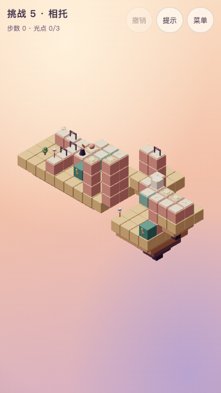

# 挑战 5 · 相托

## 状态与能力衔接

**T6.20设计合同，T6.21已按本稿正式接入。** chapter 5，challenge true，revision 1；主线 **19步**，全收集 **28步**。主题短句：**运回重量，让出站位**。解锁：第5章三关全部取得全收集历史评价。挑战不影响主线结局。

承接第五章巡逻随动作走一步、玩家占位、双重量开门与箱的运输；主线新增把箱送回起庭，随后人让开巡逻的登陆格。

「原来如此」：**箱子先守远门，再运回家；你让开，小生物才接守另一道门。**

去时巡逻守近板开远门，箱在far-weight开北庭；回来箱守home-crate，人从台前让到远端再退到退让格，巡逻进远端bonus-weight，随后一次自动寻路穿过两道归路门。选做先把箱留在bonus-crate，空人回访近庭光，再取箱返家。

全章范围、声音、验证与开发顺序以[共同交接](challenges.md)为准。指标只证明设计约束，不代替用户实际难度体验。



## 屏幕草图

`(a,b)=(x-y,z-y)`；数字是高度。@起点、G灯笼、o必需、*选做、M活动路面、p普通路面、h按住板、t触发板、D门。光点与起终点优先标记；草图是现有rules生成的开局路面快照，门的模式、状态和单向入格方向以下表及完整实现为准，岛屿不可行走。

```text
b\a     0    1    2    3    4    5    6    7    8    9   10   11   12   13
 -2     ·    ·    ·    ·    ·    ·   o2   D2    ·    ·    ·    ·    ·    ·
 -1     ·    ·    ·    ·    ·    ·    ·    ·    ·    ·    ·    ·    ·    ·
  0     ·    ·    ·   p0   o1   p3    ·    ·    ·   p2    ·    ·    ·    ·
  1    *0   D0   p0   h0   M1   h3    ·    ·    ·   D2   p2   h2   h3   p3
  2     ·    ·   D0   @0   h2    ·    ·    ·    ·    ·   M3   p3   p3   p3
  3     ·    ·   D0    ·    ·    ·    ·    ·    ·    ·    ·    ·    ·    ·
  4     ·    ·   G0    ·    ·    ·    ·    ·    ·    ·    ·    ·    ·    ·
```

## 构图与静态积木

沿用母章的暖色积木、青绿机关、浅顶板、暖白人物与固定相机。岛屿4处，装饰4件。所有机关把手要在手机构图内可见且可点，人物运动使用现有轻微收身，遮挡时沿用剪影，不消除合法的投影错觉连接。

岛屿精确范围：`[{"x":[-1,7],"z":[0,4],"y":-1,"depth":2},{"x":[11,14],"z":[1,6],"y":0,"depth":3},{"x":[8,10],"z":[-1,1],"y":0,"depth":2},{"x":[15,16],"z":[4,5],"y":2,"depth":1.4}]`。其余装饰的坐标及类型在完整实现内；静态积木全部如下，重复高度列出的实体是柱体，不能当成额外路。

| 世界坐标 | 类型 | 颜色 | 单向入格 |
| --- | --- | --- | --- |
| `[-1, -1, 0]` | solid | sand | — |
| `[-1, -1, 1]` | solid | sand | — |
| `[-1, -1, 2]` | solid | sand | — |
| `[-1, -1, 3]` | solid | sand | — |
| `[-1, -1, 4]` | solid | sand | — |
| `[0, -1, 0]` | solid | sand | — |
| `[0, -1, 1]` | solid | sand | — |
| `[0, -1, 2]` | solid | sand | — |
| `[0, -1, 3]` | solid | sand | — |
| `[0, -1, 4]` | solid | sand | — |
| `[1, -1, 0]` | solid | sand | — |
| `[1, -1, 1]` | solid | sand | — |
| `[1, -1, 2]` | solid | sand | — |
| `[1, -1, 3]` | solid | sand | — |
| `[1, -1, 4]` | solid | sand | — |
| `[2, -1, 0]` | solid | sand | — |
| `[2, -1, 1]` | solid | sand | — |
| `[2, -1, 2]` | solid | sand | — |
| `[2, -1, 3]` | solid | sand | — |
| `[2, -1, 4]` | solid | sand | — |
| `[3, -1, 0]` | solid | sand | — |
| `[3, -1, 1]` | solid | sand | — |
| `[3, -1, 2]` | solid | sand | — |
| `[3, -1, 3]` | solid | sand | — |
| `[3, -1, 4]` | solid | sand | — |
| `[4, -1, 0]` | solid | sand | — |
| `[4, -1, 1]` | solid | sand | — |
| `[4, -1, 2]` | solid | sand | — |
| `[4, -1, 3]` | solid | sand | — |
| `[4, -1, 4]` | solid | sand | — |
| `[5, -1, 0]` | solid | sand | — |
| `[5, -1, 1]` | solid | sand | — |
| `[5, -1, 2]` | solid | sand | — |
| `[5, -1, 3]` | solid | sand | — |
| `[5, -1, 4]` | solid | sand | — |
| `[6, -1, 0]` | solid | sand | — |
| `[6, -1, 1]` | solid | sand | — |
| `[6, -1, 2]` | solid | sand | — |
| `[6, -1, 3]` | solid | sand | — |
| `[6, -1, 4]` | solid | sand | — |
| `[7, -1, 0]` | solid | sand | — |
| `[7, -1, 1]` | solid | sand | — |
| `[7, -1, 2]` | solid | sand | — |
| `[7, -1, 3]` | solid | sand | — |
| `[7, -1, 4]` | solid | sand | — |
| `[11, 0, 1]` | solid | sand | — |
| `[11, 0, 2]` | solid | sand | — |
| `[11, 0, 3]` | solid | sand | — |
| `[11, 0, 4]` | solid | sand | — |
| `[11, 0, 5]` | solid | sand | — |
| `[11, 0, 6]` | solid | sand | — |
| `[12, 0, 1]` | solid | sand | — |
| `[12, 0, 2]` | solid | sand | — |
| `[12, 0, 3]` | solid | sand | — |
| `[12, 0, 4]` | solid | sand | — |
| `[12, 0, 5]` | solid | sand | — |
| `[12, 0, 6]` | solid | sand | — |
| `[13, 0, 1]` | solid | sand | — |
| `[13, 0, 2]` | solid | sand | — |
| `[13, 0, 3]` | solid | sand | — |
| `[13, 0, 4]` | solid | sand | — |
| `[13, 0, 5]` | solid | sand | — |
| `[13, 0, 6]` | solid | sand | — |
| `[14, 0, 1]` | solid | sand | — |
| `[14, 0, 2]` | solid | sand | — |
| `[14, 0, 3]` | solid | sand | — |
| `[14, 0, 4]` | solid | sand | — |
| `[14, 0, 5]` | solid | sand | — |
| `[14, 0, 6]` | solid | sand | — |
| `[8, 0, -1]` | solid | sand | — |
| `[8, 0, 0]` | solid | sand | — |
| `[8, 0, 1]` | solid | sand | — |
| `[9, 0, -1]` | solid | sand | — |
| `[9, 0, 0]` | solid | sand | — |
| `[9, 0, 1]` | solid | sand | — |
| `[10, 0, -1]` | solid | sand | — |
| `[10, 0, 0]` | solid | sand | — |
| `[10, 0, 1]` | solid | sand | — |
| `[15, 2, 4]` | solid | sand | — |
| `[15, 2, 5]` | solid | sand | — |
| `[16, 2, 4]` | solid | sand | — |
| `[16, 2, 5]` | solid | sand | — |
| `[0, 0, 1]` | path | rose | — |
| `[1, 0, 1]` | path | rose | — |
| `[8, 3, 4]` | path | rose | — |
| `[8, 0, 4]` | solid | rose | — |
| `[8, 1, 4]` | solid | rose | — |
| `[8, 2, 4]` | solid | rose | — |
| `[2, 0, 3]` | path | rose | — |
| `[2, 0, 1]` | path | rose | — |
| `[2, 0, 2]` | path | rose | — |
| `[3, 0, 1]` | path | rose | — |
| `[3, 0, 2]` | path | rose | — |
| `[6, 2, 4]` | path | rose | — |
| `[6, 0, 4]` | solid | rose | — |
| `[6, 1, 4]` | solid | rose | — |
| `[11, 2, 3]` | path | rose | — |
| `[11, 1, 3]` | solid | rose | — |
| `[12, 2, 3]` | path | rose | — |
| `[12, 1, 3]` | solid | rose | — |
| `[9, 2, 0]` | path | rose | — |
| `[9, 1, 0]` | solid | rose | — |
| `[8, 2, 0]` | path | rose | — |
| `[8, 1, 0]` | solid | rose | — |
| `[13, 2, 3]` | path | rose | — |
| `[13, 1, 3]` | solid | rose | — |
| `[14, 3, 5]` | path | rose | +a |
| `[14, 1, 5]` | solid | rose | — |
| `[14, 2, 5]` | solid | rose | — |
| `[15, 3, 5]` | path | rose | — |
| `[15, 3, 4]` | path | rose | — |
| `[16, 3, 4]` | path | rose | -b |
| `[16, 3, 5]` | path | rose | — |
| `[11, 2, 2]` | path | rose | — |
| `[11, 1, 2]` | solid | rose | — |
| `[3, 0, 0]` | path | rose | — |
| `[8, 3, 3]` | path | rose | -b |
| `[8, 0, 3]` | solid | rose | — |
| `[8, 1, 3]` | solid | rose | — |
| `[8, 2, 3]` | solid | rose | — |
| `[2, 0, 4]` | path | rose | — |
| `[4, 0, 3]` | solid | teal | — |
| `[14, 1, 6]` | solid | teal | — |

## 机关清单

无uses表示不限次；rotator默认顺转90度，initialStep缺省0；mover默认从首站开始、到端折返；plate缺mode表示到格触发，once才只触发一次；gate缺initialOpen表示初始关闭。reverse是既有反向链接，不新增控制规则。

| ID | 类型 | 完整参数 |
| --- | --- | --- |
| ferry | mover | `{"origin":[5,1,2],"axis":"x","stops":[0,4],"blocks":[{"offset":[0,0,0]},{"offset":[0,0,-1]}],"handle":{"block":[4,0,3],"face":"z"}}` |
| lift | mover | `{"origin":[13,3,5],"axis":"y","stops":[0,3],"blocks":[{"offset":[0,0,0]}],"handle":{"block":[14,1,6],"face":"z"}}` |
| weight | plate | `{"tile":[3,0,1],"mode":"hold","target":"door"}` |
| door | gate | `{"tile":[11,2,3],"mode":"hold"}` |
| home-crate | plate | `{"tile":[6,2,4],"target":"crate-door","mode":"hold"}` |
| crate-door | gate | `{"tile":[2,0,3],"mode":"hold"}` |
| far-weight | plate | `{"tile":[13,2,3],"mode":"hold","target":"north-door"}` |
| north-door | gate | `{"tile":[9,2,0],"mode":"hold"}` |
| bonus-crate | plate | `{"tile":[15,3,4],"mode":"hold","target":"bonus-door"}` |
| home-door | gate | `{"tile":[2,0,2],"mode":"hold"}` |
| bonus-weight | plate | `{"tile":[8,3,4],"mode":"hold","target":"home-door"}` |
| bonus-door | gate | `{"tile":[1,0,1],"mode":"hold"}` |

## 光点与其他元素

下列数组顺序决定现有orb／crate／patrol编号，不能随意重排。单向箭头仅限制进入，照常允许离开；巡逻随一个玩家动作提交推进一次，整段自动行走不按经过格数推进。

```json
{
  "orbs": [
    {
      "mechanism": "ferry",
      "block": 1
    },
    {
      "tile": [
        8,
        2,
        0
      ]
    },
    {
      "tile": [
        0,
        0,
        1
      ],
      "optional": true
    }
  ],
  "crates": [
    {
      "tile": [
        12,
        2,
        3
      ]
    }
  ],
  "patrols": [
    {
      "mode": "pingpong",
      "route": [
        {
          "tile": [
            3,
            0,
            1
          ]
        },
        {
          "mechanism": "ferry",
          "block": 0
        },
        {
          "tile": [
            8,
            3,
            4
          ]
        }
      ]
    }
  ]
}
```

## 标准解法

每行是一次玩家动作；walk自动经过的中间格不额外计步，禁止为了照稿而强迫额外点击中间转角。所有合法同等或更长路线仍允许。

| 步 | 动作 | 原因 |
| --- | --- | --- |
| 1 | 走到 `[5, 1, 2]` | 登台前格，挡住巡逻上台 |
| 2 | 操作 `ferry` | 乘坐去远岸，巡逻留在近板守门 |
| 3 | 走到 `[11, 2, 3]` | 站到箱西侧 |
| 4 | 推 `crate-0` | 把箱推到far-weight，开北庭门 |
| 5 | 走到 `[13, 3, 5]` | 登升降台 |
| 6 | 操作 `lift` | 上升接北庭 |
| 7 | 走到 `[8, 2, 0]` | 穿门收北庭必需光 |
| 8 | 走到 `[13, 6, 5]` | 返回升降台 |
| 9 | 操作 `lift` | 下降回远庭 |
| 10 | 走到 `[15, 3, 4]` | 从单向廊绕到箱东侧 |
| 11 | 推 `crate-0` | 先把箱移离far-weight |
| 12 | 推 `crate-0` | 继续推向登台口 |
| 13 | 推 `crate-0` | 将箱推上台前格 |
| 14 | 走到 `[9, 1, 1]` | 人从背格登台并取台上必需光 |
| 15 | 操作 `ferry` | 把箱和人运回近庭 |
| 16 | 推 `crate-0` | 推箱下台到home-crate开第一道归门 |
| 17 | 走到 `[8, 3, 4]` | 人走到远端板，让巡逻登台前格 |
| 18 | 走到 `[8, 3, 3]` | 退到高位退让格，让巡逻走到远端板 |
| 19 | 走到 `[2, 0, 4]` | 趁两道门已开，一次自动寻路到灯笼 |

全收集路线见自动验证基准的`all`，逐步可复现且必须在点灯之前完成；全收集与最少步数仍可分局历史累计，本关不改变评价规则。

## 干扰、恢复与反事实

先回到近庭远端压板可以经退让格退出，不形成首步死局；新增退让格与远端板均高3以避开运输实体，绕箱入口为单向+a，不能从其右侧逆走回升降台。先取北光再绕到箱东侧；最短失误是标准前4步后走[15,3,5]，此时无解，撤销一次恢复。全部8个首步及57个两步前缀有解。箱卸到家后再想拿近庭选做光已晚，应撤销到远庭箱位安排之前。最终走路提交后巡逻允许离板，不要求获胜状态还站在远板。

前三关零死局；本关全状态死局数为7936。无限撤销是后期误操作的恢复入口，主动提示对无获胜策略状态返回现有无解反馈；撤销恢复箱、门、板、巡逻与光点，不清空历史成绩。

自动检查全部提示只在合法动作中选取，并严格减少到获胜的距离；全部首步／两步前缀有解。反事实只过滤现有rules产生的边，不修改原关卡、光点必需性或规则；结果完整写在下方基准。

## 声音与界面合同

复用第5章已确认的courtyard谱面与h1混音，挑战按既定设计以90%速度播放，反馈音保持原速度、音量和35ms让位。**T6.21已统一接入音符、和弦、脉冲、currentChord与暂停恢复的90%时钟；慢速版仍待本轮用户试听，母章原速认可及电平检查不代替听感确认。** 不写新旋律、不恢复低频嗡鸣，不靠巡逻或正确箱位触发推进；只响应实际收光、集齐必需、点灯与新评价。

挑战不新增首次教学或常驻操作说明。T6.21复用主线已认可的按压、提亮、运动／到位一句反馈和不可达文案；标题、选关预览关闭。完成后返回选关，不进入十五灯主线结局；三项评价独立累计，提示只影响本局步数评价。上述行为已由T6.21正式接线；用户整体试玩与新慢速试听仍属T6.22。

## 预期指标

| 项目 | 基准 |
| --- | --- |
| 主线／全收集 | 19／28 |
| 状态／死局 | 12946／7936 |
| 80步500次随机，seed 20261016 | 0%（门槛≤10%） |
| 标准主线错觉／取舍 | 11／4 |
| 冷求解记录 | 约1674ms；检查时仍强制<2000ms |
| 结构／角色运动组，每组181姿态 | 1038／6196，零采样问题 |

净空包含顶板、岩层、其他机关与底盘；后两关另含门、箱及巡逻，第三关检查正反联动和差时长。它是离散采样，不是连续碰撞的数学证明。实际交互与截图记录见共同稿；临时日志不是正式设计依据。

## 完整参考实现

```ts
import { defineLevel } from './builders'
import type { Vec3 } from './types'
const p = (a: number, b: number, y: number): Vec3 => [a + y, y, b + y]
export default defineLevel({
  id: 'challenge-5',
  title: '相托',
  chapter: 5,
  revision: 1,
  challenge: true,
  soundtrack: 'courtyard',
  hints: [],
  solution: [
    { type: 'walk', to: [5, 1, 2] },
    { type: 'operate', mechanism: 'ferry' },
    { type: 'walk', to: [11, 2, 3] },
    { type: 'push', crate: 'crate-0' },
    { type: 'walk', to: [13, 3, 5] },
    { type: 'operate', mechanism: 'lift' },
    { type: 'walk', to: [8, 2, 0] },
    { type: 'walk', to: [13, 6, 5] },
    { type: 'operate', mechanism: 'lift' },
    { type: 'walk', to: [15, 3, 4] },
    { type: 'push', crate: 'crate-0' },
    { type: 'push', crate: 'crate-0' },
    { type: 'push', crate: 'crate-0' },
    { type: 'walk', to: [9, 1, 1] },
    { type: 'operate', mechanism: 'ferry' },
    { type: 'push', crate: 'crate-0' },
    { type: 'walk', to: [8, 3, 4] },
    { type: 'walk', to: [8, 3, 3] },
    { type: 'walk', to: [2, 0, 4] },
  ],
  build: (b) => {
    b.island({ x: [-1, 7], z: [0, 4], y: -1, depth: 2 })
    b.island({ x: [11, 14], z: [1, 6], y: 0, depth: 3 })
    b.island({ x: [8, 10], z: [-1, 1], y: 0, depth: 2 })
    b.island({ x: [15, 16], z: [4, 5], y: 2, depth: 1.4 })
    const paths: [number, number, number][] = [
      [0, 1, 0],
      [1, 1, 0],
      [5, 1, 3],
      [2, 3, 0],
      [2, 1, 0],
      [2, 2, 0],
      [3, 1, 0],
      [3, 2, 0],
      [4, 2, 2],
      [9, 1, 2],
      [10, 1, 2],
      [7, -2, 2],
      [6, -2, 2],
      [11, 1, 2],
      [11, 2, 3],
      [12, 2, 3],
      [12, 1, 3],
      [13, 1, 3],
      [13, 2, 3],
      [9, 0, 2],
      [3, 0, 0],
      [5, 0, 3],
      [2, 4, 0],
    ]
    for (const [a, z, y] of paths) {
      b.path(
        p(a, z, y),
        'rose',
        (a === 13 && z === 1) || (a === 5 && z === 0) ? { oneWay: '-b' } : a === 11 && z === 2 ? { oneWay: '+a' } : {},
      )
      if (y > 0)
        b.column(
          {
            x: a + y,
            z: z + y,
            from: a + y >= 15 ? 3 : a < 6 ? 0 : 1,
            to: y - 1,
          },
          'rose',
        )
    }
    b.solid([4, 0, 3], 'teal')
    b.solid([14, 1, 6], 'teal')
    b.mover({
      id: 'ferry',
      origin: p(4, 1, 1),
      axis: 'x',
      stops: [0, 4],
      blocks: [{ offset: [0, 0, 0] }, { offset: [0, 0, -1] }],
      handle: { block: [4, 0, 3], face: 'z' },
    })
    b.mover({
      id: 'lift',
      origin: p(10, 2, 3),
      axis: 'y',
      stops: [0, 3],
      blocks: [{ offset: [0, 0, 0] }],
      handle: { block: [14, 1, 6], face: 'z' },
    })
    b.patrol({
      mode: 'pingpong',
      route: [{ tile: p(3, 1, 0) }, { mechanism: 'ferry', block: 0 }, { tile: p(5, 1, 3) }],
    })
    b.plate({ id: 'weight', tile: p(3, 1, 0), mode: 'hold', target: 'door' })
    b.gate({ id: 'door', tile: p(9, 1, 2), mode: 'hold' })
    b.crate({ tile: p(10, 1, 2) })
    b.orb({ mechanism: 'ferry', block: 1 })
    b.plate({
      id: 'home-crate',
      tile: p(4, 2, 2),
      target: 'crate-door',
      mode: 'hold',
    })
    b.gate({ id: 'crate-door', tile: p(2, 3, 0), mode: 'hold' })
    b.plate({
      id: 'far-weight',
      tile: p(11, 1, 2),
      mode: 'hold',
      target: 'north-door',
    })
    b.gate({ id: 'north-door', tile: p(7, -2, 2), mode: 'hold' })
    b.plate({
      id: 'bonus-crate',
      tile: p(12, 1, 3),
      mode: 'hold',
      target: 'bonus-door',
    })
    b.gate({ id: 'home-door', tile: p(2, 2, 0), mode: 'hold' })
    b.orb({ tile: p(6, -2, 2) })
    b.plate({
      id: 'bonus-weight',
      tile: p(5, 1, 3),
      mode: 'hold',
      target: 'home-door',
    })
    b.gate({ id: 'bonus-door', tile: p(1, 1, 0), mode: 'hold' })
    b.orb({ tile: p(0, 1, 0), optional: true })
    b.tree([0, -1, 3])
    b.flower([5, -1, 3])
    b.lamp([11, 0, 6])
    b.window({ pos: [11, 1, 3], face: 'x' })
    b.start(p(3, 2, 0))
    b.goal(p(2, 4, 0))
  },
})
```

## 自动验证基准

```json
{
  "metrics": {
    "minActions": 19,
    "minActionsAll": 28,
    "reachableStates": 12946,
    "deadEndStates": 7936,
    "illusions": 11,
    "tradeoffs": 4,
    "randomSteps": 80,
    "randomRate": 0
  },
  "target": {
    "minActions": 19,
    "minActionsAll": 28,
    "reachableStatesMin": 150,
    "randomWin": {
      "steps": 80,
      "maxRate": 0.1
    },
    "illusionsMin": 2,
    "tradeoffsMin": 2
  },
  "all": [
    {
      "type": "walk",
      "to": [
        5,
        1,
        2
      ]
    },
    {
      "type": "operate",
      "mechanism": "ferry"
    },
    {
      "type": "walk",
      "to": [
        11,
        2,
        3
      ]
    },
    {
      "type": "push",
      "crate": "crate-0"
    },
    {
      "type": "walk",
      "to": [
        13,
        3,
        5
      ]
    },
    {
      "type": "operate",
      "mechanism": "lift"
    },
    {
      "type": "walk",
      "to": [
        8,
        2,
        0
      ]
    },
    {
      "type": "walk",
      "to": [
        13,
        6,
        5
      ]
    },
    {
      "type": "operate",
      "mechanism": "lift"
    },
    {
      "type": "walk",
      "to": [
        12,
        2,
        3
      ]
    },
    {
      "type": "push",
      "crate": "crate-0"
    },
    {
      "type": "walk",
      "to": [
        9,
        1,
        1
      ]
    },
    {
      "type": "operate",
      "mechanism": "ferry"
    },
    {
      "type": "walk",
      "to": [
        3,
        0,
        0
      ]
    },
    {
      "type": "walk",
      "to": [
        0,
        0,
        1
      ]
    },
    {
      "type": "walk",
      "to": [
        5,
        1,
        1
      ]
    },
    {
      "type": "operate",
      "mechanism": "ferry"
    },
    {
      "type": "walk",
      "to": [
        16,
        3,
        4
      ]
    },
    {
      "type": "push",
      "crate": "crate-0"
    },
    {
      "type": "push",
      "crate": "crate-0"
    },
    {
      "type": "push",
      "crate": "crate-0"
    },
    {
      "type": "push",
      "crate": "crate-0"
    },
    {
      "type": "walk",
      "to": [
        9,
        1,
        1
      ]
    },
    {
      "type": "operate",
      "mechanism": "ferry"
    },
    {
      "type": "push",
      "crate": "crate-0"
    },
    {
      "type": "walk",
      "to": [
        8,
        3,
        4
      ]
    },
    {
      "type": "walk",
      "to": [
        8,
        3,
        3
      ]
    },
    {
      "type": "walk",
      "to": [
        2,
        0,
        4
      ]
    }
  ],
  "clearance": {
    "structuralTransitions": 1038,
    "characterTransitions": 6196,
    "samples": 181,
    "issues": []
  },
  "counterfactuals": {
    "first": 8,
    "second": 57,
    "unsafe1": 0,
    "unsafe2": 0,
    "badPath": [
      {
        "type": "walk",
        "to": [
          5,
          1,
          2
        ]
      },
      {
        "type": "operate",
        "mechanism": "ferry"
      },
      {
        "type": "walk",
        "to": [
          11,
          2,
          3
        ]
      },
      {
        "type": "push",
        "crate": "crate-0"
      },
      {
        "type": "walk",
        "to": [
          15,
          3,
          5
        ]
      }
    ],
    "scheduleAll": null,
    "blocked": {
      "no-home": null,
      "no-far": null,
      "no-bonus": null,
      "noPatrolHome": null
    },
    "winsBoxHome": true
  }
}
```
