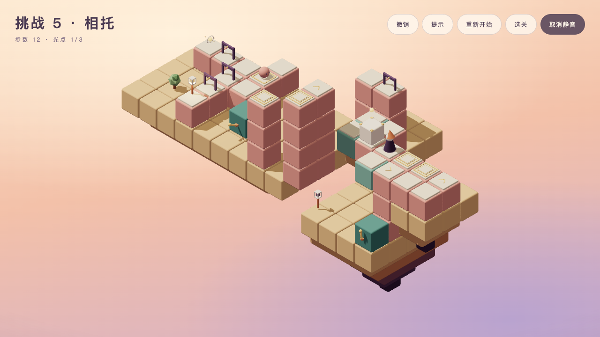

# 五个挑战关设计与开发交接（T6.20）

2026-10-25。T6.20交付五份设计稿、可执行验证与渲染原型；T6.21现已按本稿正式接入五挑战及独立目标。主线仍十五关，全部正式关二十关／六十项评价；前十五关、原目标、revision、存档格式、既有混音和依赖保持。用户整体试玩与挑战慢速新声已在T6.22获本轮确认；性能及文档收尾见后续记录。本稿与challenge-1～5为实现合同。

## 能力、发现与难度衔接

| 挑战 | 母章能力 | 深化的发现 | 主线／全收集 | 状态／死局 |
| --- | --- | --- | --- | --- |
| [1 回针](challenge-1.md) | 第一章：转动、乘坐、离台 | 三庭折线往返，先远后近改变返程成本 | 23／23 | 3280／0 |
| [2 分岸](challenge-2.md) | 第二章：转盘、高低换乘、遮挡 | 两端不能在台上互走，回岸换端再渡 | 16／21 | 2996／0 |
| [3 逆织](challenge-3.md) | 第三章：联动、换控制来源 | 同一远桥由两处把手分别正转／反转 | 18／20 | 2536／0 |
| [4 递位](challenge-4.md) | 第四章：运箱、换推向、两种板与门 | 一个箱依次开远庭、侧院和归路，选做插入一次侧向借压 | 18／22 | 23022／13568 |
| [5 相托](challenge-5.md) | 第五章：巡逻随动作推进、占位让路、双重量 | 运回箱子再让巡逻换岗，选做需先空人回访、再取箱 | 19／28 | 12946／7936 |

挑战各自承接母章，解锁后即能运用已学能力；不要求先完成其他挑战。第一章只学过转动与乘坐，所以用三庭的行程顺序制造规划，不提前塞入未学机制。第二章主线从23回到16步不表示难度退回教学：新增三类运动的换乘与不连通的双端站位；第三至五章逐步增加控制来源、重量交接和动态让位。挑战不是第二条必须按编号通关的主线，不能仅按步数排序，也不宣称这五个数字就是主观难度曲线。

每关都明显超出母章的单次能力演示，但不把所有既有机制硬堆在每关里；禁用该关关键安排后确实无法获胜。第一关取中光后再去远庭仍合法，最少27步，23步来自路线规划；二至五关全收集在原主线非行走动作序列中仅插入行走均不可达，需要改变操作安排。普通自动寻路经过转角、压板或门内位置的合法性保持，禁止强迫额外点击中间格凑步数。第二挑战在近岸允许一次自动经固定岸廊换到另一端；“两端不通”仅指远岸脱离岸廊时，不能为了符合笼统表述而禁止近岸合法路线。

## 解锁、入口与完成

- 挑战1：第一章三关历史done全为真；该章没有选做光，不要求额外条件。
- 挑战2～5：对应章三关历史allOrbs全为真。看历史累计，不要求同局、当前会话或最少步数评价；完成主线结局不自动解锁未全收集的挑战。
- 正式接入后主线仍15关／45项，全部正式关合计20关／60项；挑战成绩按challenge-N独立保存，全部revision 1。旧存档主线成绩不回退，不把未玩挑战预置成完成，不修改存档版本。
- 卡片复用主线的编号旁数量、三项具名评价和最少步数行。锁定文案沿用“通关第一章”／“集齐第X章选做光点”。主题短句采用单关稿；不加“已获取／待补”、重玩说明、历史评价面板或常驻解法文案。
- 桌面挑战悬停／聚焦预览复用该关真实Scene，标题与预览关闭操作反馈和剪影；手机保持无预览Canvas。预览不能写成绩或教学。
- 挑战完成卡统一“回到选关／再试一次”，不沿用盲目的“下一关”：下一个母章可能尚未解锁。只显示本次三项结果与“本次步数／最少”，历史成绩仍累计，提示不抹掉旧评价。
- 挑战不进入十五灯主线结局，不改标题的主线续玩目标，返回主线继续原进度。

## 试错、提示与净空

前三关全部状态有解。第四、五关所有首次和两步合法前缀仍有解，后期错误卸箱、侧廊绕行或错过选做允许出现死局，现有主动提示应显示“这条路走不通了，试试撤销”。不宣称任意探索都能原地补救。最短误操作序列写在单关基准；每条末步撤销一次恢复到有获胜策略状态，撤销应恢复板、门、箱、巡逻、光点与机关游标。

所有提示仍调用rules／solver，后台worker预构建；设计检查证明每个有解非终态的实际提示都合法并减少到获胜的距离，死局与终态不返回动作。不在UI另算箱的方向、联动或巡逻时间。

`node docs/levels/check-challenges.mjs`读取五稿完整TS，严格类型检查，再调用现有validate／metrics／solver。精确比对主线、全收集、80步500次随机（seed 20261016）、状态数、错觉及取舍；每个全新对象冷求解必须小于2秒，状态不超过100000；不放宽16～30步、≥150状态、随机≤10%、错觉／取舍各≥2。全收集解法在原关卡获胜终态前完成，不能改optional属性求另一套规则的解。

反事实搜索只过滤rules生成的动作边：三转盘不可省；二关必须乘另一端才能全收集；三关两处控制均不可省；四关必须箱中转、归位和踩archive，全获胜状态箱在最终板且archive已触发；五关必须箱守远庭、运回家和巡逻到远端，选做另需箱守bonus-crate。最后一次自动行走可以在门开时穿过，再提交巡逻离板，不能新增“获胜状态巡逻必须仍留板”的条件。

第一、二关复用core运动净空；第三至五关设计检查补充正反联动、差时长、门、箱与巡逻的现有几何。最长运动按181个空间进度采样，再反算缓动时刻，其他运动按各自时长取姿态，角色收身按实际时间并在末姿态恢复；结构／角色组依次为192／1536、108／1572、32／384、1021／3734、1038／6196，全部零采样问题。这是离散检查，不是连续碰撞证明；合法投影跨高度行走保持。

第三关托座去掉pivot同高的多余一层，底盘仍落在下一层柱顶；不能恢复会遮住全收集路线边角的[8,4,5]实心块。第五关退让格和远端压板高3，不能降回运输台人物包络内；远庭绕箱入口保持单向+a。全部坐标以完整TS为准，临时原型不是替代依据。

`--runtime`留给T6.21：要求正式五关的完整对象、顺序和targets与文档相等，并重跑相同检查。T6.20空挑战列表时明确失败；T6.21已正式导出五关，正式实现仍须通过该模式。十五关完整对象SHA-256同时锁定，前关数据不得漂移。

## 声音衔接与待实现边界

挑战沿用各母章已经通过用户试听的courtyard谱面、调式、音色和h1混音，不另写探索主题。沿用既定“挑战速度为母章90%”，反馈音本身保持原速度与电平；思考留白来自放慢乐句，不靠增大旋律、加低频或频繁成功音。

T6.20设计时music.ts仅generative处理challenge节奏；**T6.21现已把courtyard接入统一90%时钟**。实现合同为：谱面位置按实际播放时间×0.9，谱面起音与持续时间÷0.9；和弦边界、脉冲、循环索引、currentChord、调度前瞻、静音暂停恢复和切回母章都使用同一尺度。不可只拉长主音符，让收光和声与背景错位；反馈音的包络、响应和调式查询沿用原规则。

保持主题3.3、旋律0.5、音乐0.18、音效0.75、主音量0.28，铺底0.08与180Hz高通，35ms反馈让位，总源12／音乐8、可取消的未来排程。只有实际收光推进音乐层，不读取最优解、正确箱位、巡逻站对板或可达关系。挑战只用普通点灯与新评价声，不叠十五灯／塔收束。

前五章原速声音已确认，并不代表挑战慢速版已确认。T6.21提供与正式运行相同源码的试听，核对母章→挑战→母章、收光／集齐／点灯／评价的清晰度、静音／撤销／退出取消与长时间循环；新慢速版须由用户试听。T6.22再确认五挑战整体手感、难度与声音，不提前勾选。

## 美术与操作反馈

沿用已有材质、配色、暖白剪影、固定相机及高／低画质，无新资源、依赖或风格。按母章几何语言逐步衔接：三庭旋桥→高庭双端运输→双源远桥→三段运箱侧院→箱与小生物交接。每关2～4岛、3～6件装饰；码上生成的岩层和支撑必须接住建筑，浅顶面才是路，不把大岛面误写成可走场地。

T6.21将主线已认可的tactile反馈复用于正式挑战：把手按压、对应建筑短暂提亮、移动／到位一句状态、不可达与缺光点。无解吐司采用与HUD相同的正文墨色，不用浅底上的暖白文字，保持现有配色与简洁布局。挑战不写主线教学，不显示首次教学／常驻操作说明；运动时显示状态，到位1.4秒收起，不恢复空底栏。标题和预览仍关闭反馈；不添加新的金光正确解提示，不改变usedHint。

## 原型与后续验收

Browser plugin not available，使用已有Playwright／Chromium147，隔离5182源，桌面1280×720高画质主线、手机375×667低画质全收集；手机仅尺寸模拟，非真机。原型通过内存插件载入设计对象及独立目标，借现有UI、Scene、sim、worker真实点击；探针只读取状态与相机，逐步比对rules结果，不注入模拟器状态。只预置隔离源主线完成记录以验证解锁，5180用户存档未访问、未清空、未预置。

上方T6.20原型不替代正式验收。T6.21已接入慢速音乐、挑战预览、完成出口与tactile，并按正式源码重新逐关实点；T6.20参考图仍保留原型身份。技术检查不代替T6.22用户难度、整体体验及慢速听感确认。

T6.21依次完成五个数据文件与目标、入口预览及完成出口、挑战反馈、统一慢速音乐时钟；一个任务一提交。类型、格式、测试、构建与默认／--runtime全部通过后本地中文提交，不推送。不得修改前关targets、降低门槛、增加规则或擅改谜题；验证不符先反馈。

## T6.20验收记录

默认设计检查、五份参考TS与原型完整对象比对均通过；主线／全收集与表格一致。固定随机五关均0%，冷求解实测约0.08／0.12／0.04／1.62／1.94秒，强制两秒门槛保留，后两关预算接近上限，T6.21须以正式对象再次实测，不能用缓存后耗时替代冷检查。十五关完整对象与targets均受摘要保护。

桌面高画质五关主线23／16／18／18／19步，手机低画质全收集23／21／20／22／28步，逐动作与rules状态一致；第三关移除多余顶块后按最终对象重测两尺寸。应用错误0，无横向溢出；仅保留已有Clock与阴影弃用提示。各关worker正常准备，桌面绘制峰值133／217／161／300／263，手机98／153／122／224／199；仅原型观测，不替代T6.22正式性能或目标设备长期帧率验收。

新存档五挑战均锁；第一章全done、其余仅done时只开挑战1，第二章只补两关allOrbs仍锁挑战2，全部allOrbs后五挑战可点。第四／五关最短误操作分别3／5步，实际点提示显示无解，撤销一次后提示再次返回合法动作。手机第五关28步完成面板在入场结束后补拍，2／3本次评价、28／19步数和两个按钮完整可见。

提交前四项检查全部通过，21文件376项测试通过；生产gzip约352.43 KB，保留既有体积提示。本轮不变更运行源码或音频；正式接入、新慢速听感与整体试玩仍待T6.21／T6.22。

## T6.21正式接入验收

2026-10-25。五个正式文件及目标原样接入，--runtime对五个完整对象、顺序、目标、指标、最短解、全收集、提示、反事实和181姿态净空通过；十五关完整数据及targets摘要保持，未改core规则、存档格式或依赖。默认设计检查通过。一次多浏览器及离线渲染并行验收时，正式第五关冷求解2191ms超预算；全部浏览器结束后单独重测正式检查通过，后两关1555／1806ms，未放宽两秒门槛，也未改谜题。正式测试额外用全新对象验证五关冷求解与100000状态上限。

正式桌面1280×720高画质逐关主线23／16／18／18／19步，375×667低画质逐关全收集23／21／20／22／28步；开局、关键安排、完成与运动截图齐全，逐动作状态与rules相等，无应用错误、错误覆盖或横向溢出。桌面同一Canvas五次切换真实挑战预览，手机无预览；完成均返回选关，无下一关或十五灯结局。首局45/60到五挑战56/60、刷新保留；主线记录不改，挑战不新增教学。仅尺寸模拟，非真机。

正式绘制峰值桌面134／218／162／301／264，手机99／154／123／225／200；worker准备最慢1525／1491ms。它们是本轮交互观测，T6.22正式性能与目标硬件长期帧率仍待复测。保留已有Clock、阴影及构建体积提示。生产脚本gzip约354.28 KB，未引入外部素材，验收探针不在正式源码与构建中。

干扰实点：回针先取中庭光仍27步点灯；分岸到远岸点另一端反馈不可达、步数不增，近岸仍可一次自动经岸廊换端；逆织错用relay后撤销恢复完整状态；递位最短误操作后无解提示、撤销一次恢复提示；相托先到远端板再经退让格退出仍有解，另实点五步阶段错误／提示／撤销。第二挑战先16步取步数评价，再21步提示局补全收集，历史3/3与bestSteps16保留。本轮仅澄清第二关的笼统干扰描述，没有禁止合法自动路线。

音频：五章courtyard纯函数增加challenge参数，主线缺省false的原速结果保持，所有音乐时间与currentChord统一90%。真实浏览器主线→挑战→主线速度切换，静音零活动源、elapsed冻结、恢复不补播，撤销／重开／退出取消未来效果通过；第五挑战约221秒跨两轮101.587秒乐句，11次检查和声同步、活动源2～3无累积。完整游玩连续采样峰值桌面0.049／手机0.056（主音量后、压缩前），总源最大12、音乐最大7／6、反馈拒绝0。

五章各31秒试听复用实际theory、renderCourtyardNote／Pad、renderSound、混响和h1参数，包含探索、收光、必需集齐、选做、推动／门、点灯和新增评价。输出峰值依次0.0712／0.0739／0.0750／0.0820／0.0828，零削波及反馈拒绝，最多11／11／10／11／9源，没有响度归一化；试听不进入站点资源，文件在/private/tmp/seemingly-t621/chapter-N-challenge.wav。电平和技术检查不代替主观听感，新慢速试听、难度及整体体验仍待T6.22用户确认。

使用前端测试技能，Browser插件不可用，复用已有Playwright／Chromium147。截图、实际操作、冷求解与音频记录在/private/tmp/seemingly-t621/；正式数据以本稿为准。5180服务保留，用户存档未访问、未清空、未预置；四项提交检查与393项测试通过后本地提交，不推送，不勾选T6.22。

## T6.22用户确认与最终收尾

2026-10-25用户完成试玩，在明确询问五挑战整体与新慢速音乐是否有难度、操作或反馈盖声问题后回复“没有”。据此确认本轮体验与声音，保留f3541d4五关、原目标、revision及h1混音；上方待确认文字均为各轮历史交付状态。

正式二十关重测：桌面1280×720高画质主线与挑战246步，手机375×667低画质全收集290步；逐动作与rules一致，主线十五灯结局、挑战回选关、进度及静音持久、提示局不抹历史评价、减少动态通过。峰值347／275次绘制，后台准备最慢约1450／1382ms，无需改关卡或渲染。手机仅尺寸模拟，非真机长期帧率证明。完整逐关表、资源与生产子路径检查见[性能检查](../performance.md)。

README、三张正式截图及分享简介同步当前十五主线加五挑战。四项检查与393项测试通过后完成T6.22本地提交，不推送；5180用户存档未访问、清空或预置。临时过程在/private/tmp/seemingly-t622/，完整设计仍以五份正式稿为准。
