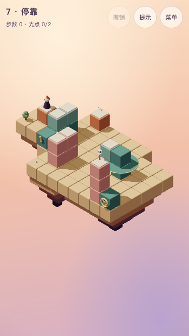
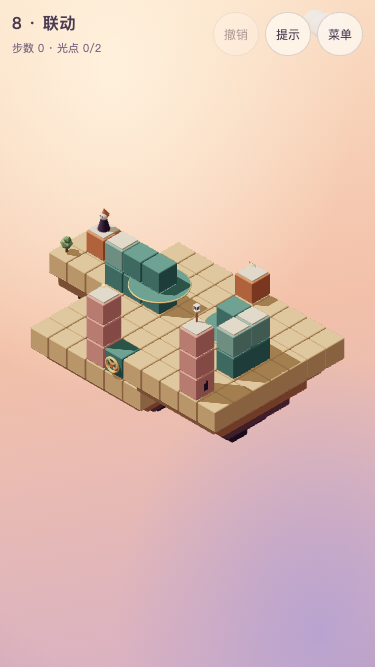
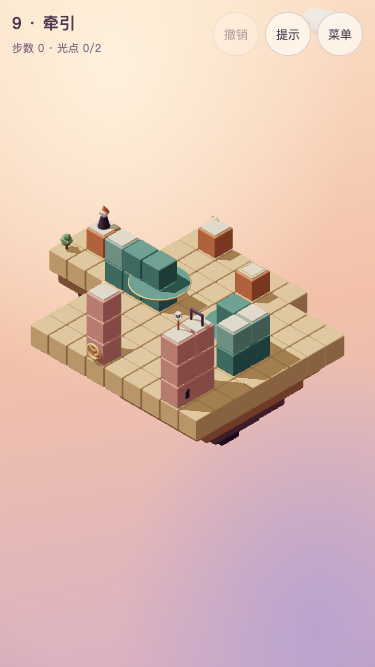
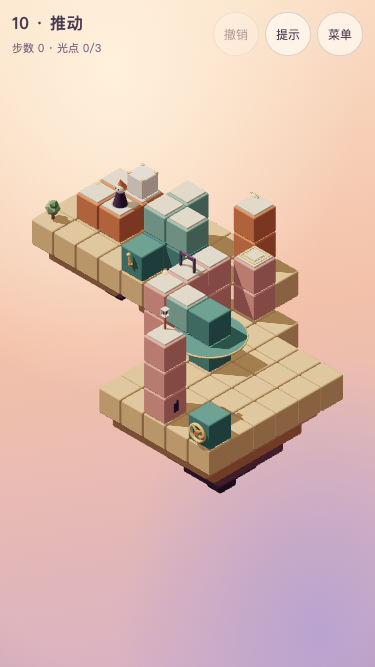
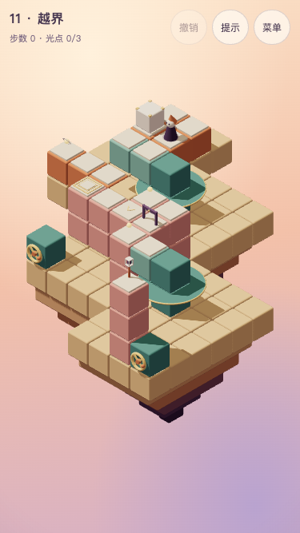
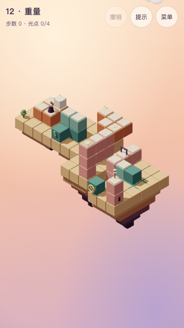

# 第三、四章设计交接（T6.13）

2026-10-22，前六关整体体验已获用户确认。用户指定的设计者在本任务完成第7～12关设计与原型验证；**正式入口仍为六关，T6.14尚未实现**。本稿及六份完整参考实现取代旧关卡表的早期方向，不覆盖前六关已确认版本。

## 节奏与区别

| 关                     | 主题短句         | 核心发现                           | 主线／全收集 | 状态／死局 | 随机通关率 |
| ---------------------- | ---------------- | ---------------------------------- | ------------ | ---------- | ---------- |
| [7 停靠](level-07.md)  | 在停靠之间取舍   | 三站中间必须离台，再回台去远站     | 8／9         | 436／0     | 40步1.2%   |
| [8 联动](level-08.md)  | 一处转轮，两座桥 | 换乘无把手的远桥后，仍操作原转轮   | 8／9         | 90／0      | 40步18.8%  |
| [9 牵引](level-09.md)  | 留在远处的开关   | 到压板上停住，门的切换结果保留     | 9／15        | 224／0     | 40步7.2%   |
| [10 推动](level-10.md) | 随台过岸的重量   | 箱子与人一起运，箱留压板，人过门   | 8／9         | 564／0     | 50步0%     |
| [11 越界](level-11.md) | 转过桥，再换推向 | 转盘运箱后重新绕后，改变推动方向   | 10／11       | 3368／704  | 50步0%     |
| [12 重量](level-12.md) | 留箱，再送自己   | 两次把手分给人箱同程、人独行第二程 | 13／14       | 686／340   | 50步0%     |

随机模拟每关500次、种子20261016；0%仅指本次固定样本未通关。第三章保持7～16步、≥40状态、40步≤35%；第四章保持10～20步、≥60状态、50步≤25%。第十关依章节首关允许低2步的规则采用8步，其余无例外。全部主线错觉≥2、取舍≥1，状态数远低于30000；不修改运行中的targets。

第五关已经教过升降与显露，第七关不再重教拉杆。第七关独立的多站平移与短桥，第八关同时转动的双桥，第九关留在后庭的切换开关，依次增加操作与结果之间的距离。第九关不是新增另一种投影规则：门只封住自身那一格。其选做需要暂缓换乘、绕到北停靠，再恢复换乘相位，主线不要求额外绕圈。

第四章第一关先让人和箱子同行；第二关换成转盘运箱，推向随站位改变；第三关把两段运输分配给有限次数。三个原型均验证：禁止箱子随机关移动或禁止跨错觉推动，会变为无解，不是普通平地推箱。禁止角色乘坐，六关均无解。反事实仅用于验证设计必要性，不加入真实规则。

## 唯一数据与复验

每份单关稿的“完整参考实现”包含全部岛屿、路面、实心支撑、机关偏移、把手、光点、箱子、箭头、装饰和主线解法。“自动验证基准”包含全收集解法与精确指标；复制时不从临时文件、旧排期表或其他关源码推导坐标。

在仓库根目录执行：

```bash
node docs/levels/check-designs.mjs
```

脚本直接读取六份Markdown中的TypeScript，用既有builders、rules、solver、validate与metrics验证；不把候选加入mainLevels、不写存档、不更改targets。它核对主线最优、全收集最优、两条解法的可见性与遮挡规则、全部提示动作是否合法，以及乘坐／运箱／错觉推动的必要性。精确数值漂移时停止实现并交设计者复核，不能下调门槛。

净空模型复用core/clearance的几何辅助方法及shapes尺寸，只在该脚本的Vite验证进程中临时导出辅助方法，正式源码和构建不变。在全部可达状态下，枚举真实规则产生的建筑运动，含同步联动、运载／停放箱体、顶板、岩层、其他底盘、门的开闭包络和角色收身／恢复；每次181姿态。箱体0.76高包络包含角饰。当前候选只使用同向、等时的联动转盘，脚本遇到反向或不同持续时间的混合联动会拒绝，不宣称已支持。

这是离散几何检查，不是连续碰撞证明，不参与寻路，也不把高低错觉连接判成穿模。门收入自己的路面沿用现有视觉约定，不把槽体接触算建筑相撞；未模拟门槽内部、摆动装饰及行走／推箱的三维实体碰撞。T6.14仍须将六关正式接线并保留本脚本回归，不得调用原先只支持独立机关的checkMotionClearance后忽略“不支持”错误。

## 首次教学接线要求（T6.14）

延续v4的能力记忆，一次一句，完成对应操作后收起，已学状态跨撤销、重开、重进和刷新保留。既有走路、收光、转动、乘坐、升降不重教；不恢复level.hints常驻说明，不增加评价规则解释。

| 首次出现    | 简短说明                         | 完成条件                           |
| ----------- | -------------------------------- | ---------------------------------- |
| 8 联动      | 一个转轮，也会带动另一座桥       | 一次操作引发两桥，全部到位         |
| 9 触发压板  | 停在金色压板上，切换远处的门     | 实际plate事件完成，不是经过        |
| 10 推箱     | 站到箱子旁，点击箱子向前推一格   | 成功推动结束；拒绝推动不算         |
| 10 按住压板 | 箱子留在双框压板上，门会保持打开 | 箱子实际压住并开门；接在推箱教学后 |
| 11 单向格   | 顺着箭头进入路面                 | 成功进入箭头格；离开方向不受限制   |
| 12 限次把手 | 亮点是剩余次数，撤销可恢复       | 成功使用本关的限次把手并到位       |

新能力写在既有可选tutorials字段中，不新增存档版本；旧有效通关记录按该关必经操作推断，新关记录尚不存在则首次出现。usedHint仍只由主动提示按钮设置；首次教学、错误点击、死局反馈均不自动算提示。常规运动、到位、缺光点反馈保留。

## 死局与恢复

第7～10关零死局。第11关704、第12关340个死局为有意设计的推箱端点与有限资源选择，包含不同站位和光点记录，不表示有这么多种独立陷阱。

- 第11关最短误推示例：开局走到(3,1,3)，向回推crate-0，箱子到起点端点后缺少新的后站位。一次撤销恢复箱子；进一步撤销恢复开局。
- 第12关开局空台用一次把手，即无法在剩余一次内完成装载与两段运输。一次撤销应恢复台位与两颗亮点。正常13步解法实际用了两次，不能偷偷补次数。
- 无解时提示显示既有“这条路走不通了，试试撤销”，不高亮一个不存在的解；重开恢复箱位、门、压板与全部次数。撤销不清除已学能力或历史评价。
- 未取选做不导致主线失败；限次耗尽后漏收选做，可撤销第二程或重开补取，不能修改par或强迫主线收选做。

## 构图、点击与原型证据

沿用暖色圆角积木、固定视角、金色交互、浅色路面，不新增材质、资源、镜头或动效。每关2～4座岛屿、3处装饰，全部姿态屏幕跨度≤14×14。投影看似接通而实际高度不同是必要内容，支柱与底盘运动则应留出真实净空。

设计预览使用独立5181源，临时将候选接到实际渲染、输入和模拟器，通过鼠标／触控尺寸点击完成1280×720高画质主线及375×667低画质全收集；没有给模拟器注入解法指令。5180继续只有原六关，用户存档未读取、清空或预置。手机为尺寸模拟，非真机。

浏览器发现箱体会挡住规则射线未计入的点击位置，因此第11关选做伸到低侧廊外端，第12关压板后移一格；最终稿不保留原先能求解却难点击的落点。正式实现必须再测箱子停放后的点击、运动中间帧、限次亮点、压板门、无解提示与撤销。既有Clock／阴影／构建体积提示保留，不顺手扩大修复范围。

| 手机开局                                  | 手机开局                                    | 手机开局                                    |
| ----------------------------------------- | ------------------------------------------- | ------------------------------------------- |
|  |    |    |
|  |  |  |

临时完整操作记录和中间帧在/private/tmp/seemingly-t613/；正式数据以本目录六份单关稿为准，临时截图和脚本不能替代它们。

## 正式接入边界（T6.14）

1. 按六份稿新增level-07.ts～level-12.ts，revision均为1，在mainLevels按顺序追加；登记本稿确定的目标，不修改前六关数据、评价和revision。新关沿用独立三项历史累计与提示限制。
2. 接入主题短句、新首次能力、旧记录推断与评价目标；第六关完成后解锁第七关，第十二关完成卡显示“第五章即将开放”，主按钮“回到选关”。不提前创建第五章或挑战关。
3. 第三章仍按已定D多利亚、第四章E♭大调设计章节声音。参考数据的courtyard表示使用v6乐句框架与现有音色／混音，不代表当前代码已支持新调式：现有courtyard只区分第一章与第二章，临时原型全程静音。正式接入须扩展第三、四章乐句与相应和声，保持v6高通、低铺底、音源预算及收光推进；不能退回旧生成式持续低音，也不能直接把第二章乐句冒充新章。新声音要实际试听后才能通过对应试听验收，前六关已认可混音保持。
4. 运行设计脚本及四项提交检查，再在正式入口连续试玩6→7→…→12，桌面、手机、低画质、刷新、选关预览、静音、提示、撤销、重开与新增评价均须验证。当前设计预览未接targets和首次教学，不能据此宣称这些正式流程已经通过。
5. T6.13只勾设计任务；T6.14及阶段一T6.15仍未完成。新六关的主观体验、音乐、性能和最终发布需后续验收，不把前六关的用户确认外推为后六关通过。不推送。
