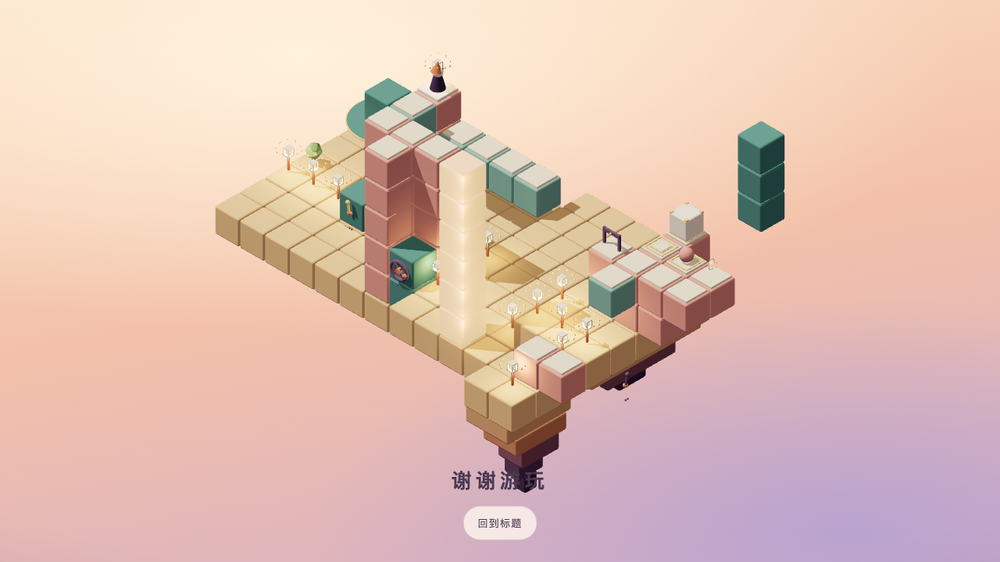

# 第五章设计与开发交接（T6.17a）

2026-10-24。用户在复核后授权修订设计。本稿与level-13～15完整实现、验证基准覆盖T6.17第一稿，是T6.18唯一实现合同。T6.17a仅修订设计；T6.18现已按本合同正式接入十五关、目标、第五章声音和结局，前十二关与已确认四章混音保持，用户存档沿用。

## 能力与难度衔接

| 连续段        | 继承能力                       | 新增主线依赖                                             | 选做的额外发现                                     |
| ------------- | ------------------------------ | -------------------------------------------------------- | -------------------------------------------------- |
| 12重量→13留步 | 留下重量、乘坐、两台换乘与返程 | 移走台使巡逻留在开门板；章首缓冲、零死局                 | 人先占侧位让它登台，再让位、移走空台，改守另一块板 |
| 13→14相守     | 动态压力、推箱、运输与门       | 箱守一板并挡退路，巡逻守另一板；两种重量配合去返         | 从南侧释放卸箱位，取箱下光；允许其他合法顺序       |
| 14→15归来     | 双重量、停板联动、阶段规划     | 先各守一门；联动揭退路并关旧下船口，再让箱与巡逻交换职责 | 卸箱后先借空台回旧桥，取光后再联动改桥返家         |

主线／全收集为10／14、13／15、15／19。第十三关使用既定章首10步缓冲，并非退回孤立机制演示。终章不靠超过第十二关16步来宣称更难：它同时改变箱、巡逻、门与回路的职责，且布局改为双格纵向运输与高低庭院，不照搬十四关四格横台。

第一稿复核发现：终章可先换压再以16步通关，旧验证器只证明必须推箱／联动，没有证明声称的阶段依赖；该结论撤回。新稿保留门内占位、投影连接和所有合法顺序，通过布局与联动形成真正依赖，不加禁路或新规则。新布局须在远庭光取得后再停exchange、最终换箱；提前停板本身也是阶段错误，可撤销恢复。停板后可无限思考，不按现实时间推进，但下一步需要完成换位才能稳定留住巡逻。

## 试错与验证边界

第十四、十五关两台运输均不限次，不用耗尽额度替代思考。后两关全部首步、两步合法前缀及一次空送往返仍有解；后期误推、提前最终换位或错过选做仍需撤销。十三关保持零死局。无限撤销和提示沿用现有实现，不自动赠送次数，不宣称任意探索都安全。

`node docs/levels/check-chapter5.mjs`读取文档完整TS，用现有rules／solver／validate核对解法、指标、全部提示、两步恢复、反事实、结局及声音谱面。终章新增：禁止最终换位不可通关；全部提前换位状态无获胜策略；所有获胜状态箱与巡逻均完成交接；选做在联动之后不可再取得。不能只检查某条标准解法中“出现了推箱”。

`--runtime`现逐项核对十五关正式对象、targets及第五章谱面。前十二关完整数据及revision 2／3／4／3／3／4／1／2／2／2／2／2保持。主线≤30000状态、单关求解<2秒及原第五章指标不放宽。

## 玩法、画面与教学

规则仍只在core/rules.ts。固定相机、投影连接、遮挡断路、乘坐、压力及门内占位保护保持；只用现有builder，不加依赖、资源或目录。

首次能力教学只新增patrol：第十三关首次可操作时一句“小生物会在你完成一步后走一格”，首次真实移动动画结束、状态提交后收起并记忆。整段行走只推进一次，不按路面格数或现实时间；重开、撤销、重进、刷新不重教。旧第五关能力推断固定为原五项，不随新增标识扩张；教学不计usedHint。

后两关不恢复常驻解法说明。忙碌文字区分建筑与巡逻；等待小跳没有伤害、不反复发声，不用金光提示正确停板。人物、箱、巡逻的实体运动不能相穿，合法错觉跨高度连接保留。

终章采用低庭旧桥与高庭折廊，中央塔贯穿构图；单块青绿遮挡体沿固定托座滑动，代替原孤立三格柱。联动改接旧桥并关闭旧下船口，玩家仍可自动寻路走到终点，不强迫单独登桥或额外点击。十五灯与塔精确数据只在level-15.ending，decor不重复造灯。桌面结局沿用手机的横排“谢谢游玩／回到标题”：>720px时底边20px加安全区、间距20px、标题24px、按钮至少44px，避免纵排文字压住岩层；手机原布局保持。不改变相机。

## 声音交接与结局

前四章已认可h1声音保持。第五章F利底亚、84 BPM、128拍约91.429秒；完整51音与八段和声在[谱面](chapter-5-score.mjs)，B自然音与调式一致。96→84 BPM定位为从重量章的推进转入终章的舒展，不能用抬高主旋律制造高潮，也不能因相同混音参数就宣称反馈一定清楚。

沿用felt／plucked／silk合成：主题3.3、旋律0.5、音乐0.18、音效0.75、主音量0.28，铺底0.08、180Hz高通、反馈35ms让位，总源12／音乐8。推进只由实际收光决定，不查询巡逻是否站对、解法或连接。巡逻移动轻点音低于脚步，等待不重复响。

终点先亮，其余14灯每隔0.45秒点亮，6.9秒塔亮，7.8秒出现“谢谢游玩／回到标题”。终点成功与新增评价沿原调度；其余14灯只做视觉回应，不逐灯播放完整灯笼琶音。进入结局即取消探索旋律未来排程，1.2秒内淡到Fmaj9♯11收束铺底（53／57／60／64／71，包络不超过原0.08，原高通保留），不重启整章循环。塔亮才播放finaleNotes五音，最后一音在谢谢游玩出现前起音；沿用成功声让位，背景不再盖过收束。

T6.18给MusicPlayer接入可取消的结局模式；撤销、重开、退出、静音取消未来灯／塔／收束音与页面演出，恢复只读当前实际阶段，不补播已过演出。撤销返回撤销后的实际收光进度层，重开返回探索层。不能仅在旧onLanternLit中保留playSound('lantern')后再叠一套终章音。

T6.18必须提供同源码新章试听，并检查12→13跨章、13／14探索和关键收光／推箱／开门、15正常／减少动态／撤销／静音及结尾。比较反馈相对背景、峰值、12／8源和长时间循环；T6.19仍由用户试听确认。此次原型静音验证，只完成声音设计，不主张听感通过。

## 实现顺序与验收

1. T6.18按13→14→15接入完整对象与目标，再接入口短句、patrol教学、第五章谱面与结局模式；与本设计修订分开提交，不混改前十二关。
2. 默认及--runtime、全部四项检查通过；旧7～12检查器届时核对主线15关的前12关前缀，保留原有全部检查。
3. 桌面1280×720主线、手机375×667低画质全收集，第十二至十五关连续实际点击，核对开局、关键安排、点灯与结局。另验14／15开局空点远台、两次空送、终章提前换位无解提示及撤销、选做先回访、旧存档／静音／教学保持。
4. T6.19复测十五关性能、更新README和用户关卡／新声音确认；不自动推送发布或开始挑战章。5180用户存档不清空、不预置。

## T6.17a验证记录

三关主线／全收集10／14、13／15、15／19，状态2390／10109／2838，死局0／6662／1296，固定60步500次随机均0%。主线错觉10／14／12，取舍4／3／4。指标不等于实际难度。

运动净空72／300／86组结构、1240／3636／526组角色，每组181姿态，零采样问题，含巡逻、箱、门、岩层及差时长联动。离散采样不是连续碰撞证明。终章672个提前最终换位状态均无获胜策略，禁止最终换位不可通关。

默认设计检查及新增阶段反事实全部通过；十四关8种首步／61种两步前缀、十五关4种首步／15种两步前缀均有解，两秒求解预算保持。四项提交检查通过，21文件356项测试通过，保留既有构建体积、Clock与阴影提示。

Browser插件不可用，复用本地Playwright／Chromium在隔离5182源实点：桌面1280×720连续12→15主线16／10／13／15步；手机375×667低画质连续全收集17／14／15／19步，均看到十五灯、塔和谢谢游玩。十四关最后移除主台限次后，再以最终完整对象比对并重测：先空送远台和主台各一往返，再完成桌面主线17步／手机全收集19步。终章另以最终完整对象、手机减少动态模式验证过早停exchange→无解提示→撤销一次→继续通关，执行16次动作、撤销1次、净15步。各流程无应用错误或横向溢出，手机仅尺寸模拟，非真机。

桌面结局横排在原型DOM注入同一目标CSS后补验，与岩层不重叠；三张手机开局图与十五灯图已更新。临时日志、逐步截图和脚本在/private/tmp/seemingly-t617a/；交接只依赖本稿和单关完整数据，不以临时文件替代。第五章新音乐未接入试听，T6.18／19及用户整体确认保留。源码、正式十二关、targets与5180用户存档保持。

## T6.18正式实现

已正式接入三关与目标、巡逻首次教学、第五章84 BPM乐句与F结局模式。演出期间保留撤销／重开／选关／静音，键盘在完成页仍可撤销、重开或退出；未来音源、塔与消息随退出取消。完整技术与实际音频验收记录见路线图T6.18。T6.19性能及用户关卡／新声音确认仍待完成，不据本轮测试宣称体验最终定稿。
