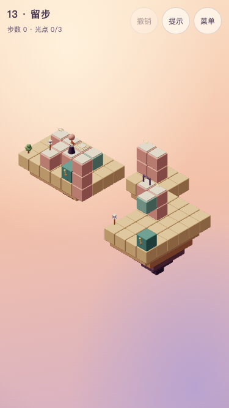

# 第 13 关 · 留步

## 状态与教学

**T6.17 第五章设计稿，2026-10-24，尚未接入正式主线。** 目标revision 1，chapter 5。主线 **10步**，全收集 **11步**。选关短句：**把台移开，留住远处的重量**。

教学点：巡逻每个动作后走一格；路线失连会等待。承接乘坐、离台、两台换乘与返程。

「原来如此」：**先登上运输台，让小生物走到压板；再把台移走，它就会留在板上替你开门。**

衔接：从第十二关的静态留箱转向动态留驻；章首减少箱子与限次负担，仍需两次乘坐换乘及完整返程。 不能仅凭步数或状态数断言体验更难；与第十二关连续试玩仍是T6.18～19验收项。共同合同见[第五章交接](chapter-5.md)。

文档原型参考（375×667低画质，非正式入口）：



## 屏幕草图

`(a,b)=(x-y,z-y)`，数字为高度；@起点、G灯笼、o必需、*选做、h按住板、D按住门、p普通路面。M为初始活动路面；各停靠的精确世界坐标见机关表与完整实现，结构、岛屿不当作道路。可同时有光点／压板时以光点符号优先。

```text
 b\a    0    1    2    3    4    5    6    7    8    9   10   11   12   13   14
  -2    ·    ·    ·    ·    ·    ·   o2   p2    ·    ·    ·    ·    ·    ·    ·
  -1    ·    ·    ·    ·    ·    ·    ·    ·    ·    ·    ·    ·    ·    ·    ·
   0    ·    ·    ·    ·    ·    ·    ·    ·    ·    ·    ·    ·    ·    ·    ·
   1    ·   *0   p0   h0   M1    ·    ·    ·    ·   D2   o2    ·    ·    ·    ·
   2    ·    ·   p0   @0   p2    ·    ·    ·    ·    ·   M3    ·    ·    ·    ·
   3    ·    ·   G0    ·    ·    ·    ·    ·    ·    ·    ·    ·    ·    ·    ·
```

## 积木清单与构图

完整参考实现中的`p(a,b,y)`严格转换为`[a+y,y,b+y]`；paths逐项列出全部静态路面，for循环只补对应柱体。岛屿范围、颜色、结构、全部活动块偏移与装饰均在同一参考实现中明确给出，实现者不得另补道路或改高度。

主体为两岸运输与后庭；沿用暖色积木、固定镜头、浅色顶板、青绿机关。静态路面rose，支撑与岛屿按代码；未声明的格子不可行走。开局需看清小生物、板、门、箱与光点，移动途中核对实体净空。

## 机关清单

| ID     | 定义                                                                                   |
| ------ | -------------------------------------------------------------------------------------- |
| ferry  | mover，原点[5, 1, 2]、轴x、停靠[0, 4]；把手{'block': [4, 0, 3], 'face': 'z'}；联动[]   |
| lift   | mover，原点[13, 3, 5]、轴y、停靠[0, 3]；把手{'block': [14, 1, 6], 'face': 'z'}；联动[] |
| weight | plate，路面[3, 0, 1]、hold，目标door                                                   |
| door   | gate，路面[11, 2, 3]、hold，目标—                                                      |

ferry#0需乘坐去远庭；lift#0需乘坐到北侧高低投影接口。不得把多高度投影连接改成真实三维道路。

## 光点与其他元素

```json
{
  "orbs": [
    {
      "tile": [12, 2, 3]
    },
    {
      "tile": [8, 2, 0]
    },
    {
      "tile": [1, 0, 1],
      "optional": true
    }
  ],
  "crates": [],
  "patrols": [
    {
      "mode": "pingpong",
      "route": [
        {
          "tile": [2, 0, 1]
        },
        {
          "tile": [3, 0, 1]
        },
        {
          "mechanism": "ferry",
          "block": 0
        }
      ]
    }
  ]
}
```

静态光点引用上表世界坐标；巡逻按route顺序、pingpong往返，下一格失连或被占就等待。只按已完成玩家动作推进，不按现实时间，也不逐格推进。没有额外单向格；限次只按把手定义，不赠送次数。

## 主线标准解法

以下是求解器验证的最优路线之一，不禁止等长或更长的合法路线。

| 步  | 动作              | 目的                                           |
| --- | ----------------- | ---------------------------------------------- |
| 1   | 走到 `(5, 1, 2)`  | 登上运输台；这一步结束时巡逻从起始格走上压板。 |
| 2   | 操作 `ferry`      | 人随台去远庭，巡逻下一格失连，留板开门。       |
| 3   | 走到 `(13, 3, 5)` | 穿过门、顺路收远庭光，再登升降台。             |
| 4   | 操作 `lift`       | 乘台接到北侧支路。                             |
| 5   | 走到 `(8, 2, 0)`  | 离台收北侧必需光。                             |
| 6   | 走到 `(13, 6, 5)` | 回到升降台，准备恢复下层停靠。                 |
| 7   | 操作 `lift`       | 乘回下层，保留远庭归路。                       |
| 8   | 走到 `(9, 1, 2)`  | 穿过仍由巡逻保持的门，登回运输台。             |
| 9   | 操作 `ferry`      | 乘回入口侧，小生物的下一格恢复连接。           |
| 10  | 走到 `(2, 0, 3)`  | 回庭院点灯；不强制分格点击。                   |

## 选做、干扰与恢复

- 最可能的错误假设：以为小生物会按时间移动，或以为门打开后会一直开。等待现实时间没有作用；保持运输台离岸才能维持巡逻的断路。
- 选做：选做在开局被巡逻堵住的支路末端，须认识其占位会随动作解除；提前绕去收光会改变巡逻相位，回到登台位置再调整。
- 恢复：没有限次资源、零死局。误把空台送走、把小生物带上台都可再召回；主动提示根据真实游标给出动作。
- 斜对角看似接近不表示相连，移动中不接受新行走／操作；不要扩大点击来让非法路线成功。
- 不直接搬用旧混音、旧第五章方向或临时截图修改本稿；规则只调用core/rules.ts。

## 指标与验收

主线／全收集10／11，可达状态1174、死局0，固定500次、种子20261016、60步随机通过率0.8%，主线错觉10、取舍4。0%仅表示固定样本零次通过。

第五章门槛保持≥80状态、随机≤20%、错觉≥2、取舍≥2。第十三关使用章首10步缓冲例外，其余仍12～24步。大量有限资源与错误箱位状态会形成死局，不能拿它们代替主观难度或恢复体验。正式实现必须保持本稿对象与指标，并验证提示、撤销、重开、旧十二关存档保留，以及桌面1280×720／手机375×667实际点击主线及全收集。

目标只在T6.18接入对应关卡时写入`src/game/levels/targets.ts`：

```json
{
  "minActions": 10,
  "minActionsAll": 11,
  "reachableStatesMin": 80,
  "randomWin": {
    "steps": 60,
    "maxRate": 0.2
  },
  "illusionsMin": 2,
  "tradeoffsMin": 2
}
```

## 自动验证基准

```json
{
  "metrics": {
    "minActions": 10,
    "minActionsAll": 11,
    "reachableStates": 1174,
    "deadEndStates": 0,
    "illusions": 10,
    "tradeoffs": 4,
    "randomSteps": 60,
    "randomRate": 0.008
  },
  "all": [
    {
      "type": "walk",
      "to": [5, 1, 2]
    },
    {
      "type": "operate",
      "mechanism": "ferry"
    },
    {
      "type": "walk",
      "to": [13, 3, 5]
    },
    {
      "type": "operate",
      "mechanism": "lift"
    },
    {
      "type": "walk",
      "to": [8, 2, 0]
    },
    {
      "type": "walk",
      "to": [13, 6, 5]
    },
    {
      "type": "operate",
      "mechanism": "lift"
    },
    {
      "type": "walk",
      "to": [9, 1, 2]
    },
    {
      "type": "operate",
      "mechanism": "ferry"
    },
    {
      "type": "walk",
      "to": [1, 0, 1]
    },
    {
      "type": "walk",
      "to": [2, 0, 3]
    }
  ],
  "counters": {
    "noPush": null,
    "noPatrol": {
      "solved": false,
      "states": 10
    },
    "noHome": null
  },
  "clearance": {
    "structuralTransitions": 36,
    "characterTransitions": 620,
    "samples": 181,
    "issues": []
  }
}
```

## 完整参考实现

```ts
import { defineLevel } from './builders'
import type { Vec3 } from './types'
const p = (a: number, b: number, y: number): Vec3 => [a + y, y, b + y]
export default defineLevel({
  id: 'level-13',
  title: '留步',
  chapter: 5,
  revision: 1,
  soundtrack: 'courtyard',
  hints: [],
  solution: [
    { type: 'walk', to: [5, 1, 2] },
    { type: 'operate', mechanism: 'ferry' },
    { type: 'walk', to: [13, 3, 5] },
    { type: 'operate', mechanism: 'lift' },
    { type: 'walk', to: [8, 2, 0] },
    { type: 'walk', to: [13, 6, 5] },
    { type: 'operate', mechanism: 'lift' },
    { type: 'walk', to: [9, 1, 2] },
    { type: 'operate', mechanism: 'ferry' },
    { type: 'walk', to: [2, 0, 3] },
  ],
  build: (b) => {
    b.island({ x: [0, 5], z: [0, 3], y: -1, depth: 2 })
    b.island({ x: [11, 14], z: [1, 6], y: 0, depth: 3 })
    b.island({ x: [8, 10], z: [-1, 1], y: 0, depth: 2 })
    const paths: [number, number, number][] = [
      [1, 1, 0],
      [2, 3, 0],
      [2, 1, 0],
      [2, 2, 0],
      [3, 1, 0],
      [3, 2, 0],
      [4, 2, 2],
      [9, 1, 2],
      [10, 1, 2],
      [7, -2, 2],
      [6, -2, 2],
    ]
    for (const [a, z, y] of paths) {
      b.path(p(a, z, y), 'rose')
      if (y > 0) b.column({ x: a + y, z: z + y, from: 1, to: y - 1 }, 'rose')
    }
    b.solid([6, 0, 4], 'rose')
    b.solid([4, 0, 3], 'teal')
    b.solid([14, 1, 6], 'teal')
    b.mover({
      id: 'ferry',
      origin: p(4, 1, 1),
      axis: 'x',
      stops: [0, 4],
      blocks: [{ offset: [0, 0, 0] }],
      handle: { block: [4, 0, 3], face: 'z' },
    })
    b.mover({
      id: 'lift',
      origin: p(10, 2, 3),
      axis: 'y',
      stops: [0, 3],
      blocks: [{ offset: [0, 0, 0] }],
      handle: { block: [14, 1, 6], face: 'z' },
    })
    b.patrol({
      mode: 'pingpong',
      route: [{ tile: p(2, 1, 0) }, { tile: p(3, 1, 0) }, { mechanism: 'ferry', block: 0 }],
    })
    b.plate({ id: 'weight', tile: p(3, 1, 0), mode: 'hold', target: 'door' })
    b.gate({ id: 'door', tile: p(9, 1, 2), mode: 'hold' })
    b.orb({ tile: p(10, 1, 2) })
    b.orb({ tile: p(6, -2, 2) })
    b.orb({ tile: p(1, 1, 0), optional: true })
    b.tree([0, -1, 3])
    b.flower([5, -1, 3])
    b.lamp([11, 0, 6])
    b.window({ pos: [11, 1, 3], face: 'x' })
    b.start(p(3, 2, 0))
    b.goal(p(2, 3, 0))
  },
})
```
