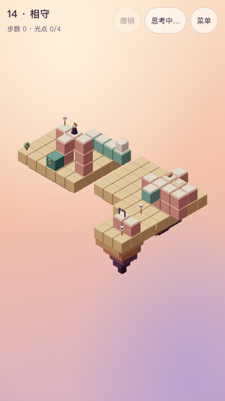

# 第 14 关 · 相守

## 状态与教学

**T6.17 第五章设计稿，2026-10-24，尚未接入正式主线。** 目标revision 1，chapter 5。主线 **13步**，全收集 **15步**。选关短句：**箱子挡回路，小生物守另一块板**。

教学点：同一箱子既是压力，也是巡逻回路的挡块；两块按住板控制不同的门。承接第十一、十二关的中途箱位、有限运输与返程。

「原来如此」：**箱子卸在第一块板后，小生物退回第二块板，被箱子挡住；两扇门才会同时保持打开。**

衔接：从第十三关依靠断开的桥留驻，转为人、箱、巡逻共同站位；主线必须运箱、跨错觉推箱并利用两种重量，远庭往返需要保持这个安排。 不能仅凭步数或状态数断言体验更难；与第十二关连续试玩仍是T6.18～19验收项。共同合同见[第五章交接](chapter-5.md)。

文档原型参考（375×667低画质，非正式入口）：



## 屏幕草图

`(a,b)=(x-y,z-y)`，数字为高度；@起点、G灯笼、o必需、*选做、h按住板、D按住门、p普通路面。M为初始活动路面；各停靠的精确世界坐标见机关表与完整实现，结构、岛屿不当作道路。可同时有光点／压板时以光点符号优先。

```text
 b\a    0    1    2    3    4    5    6    7    8    9   10   11   12   13   14
   0    ·    ·    ·    ·    ·    ·    ·    ·    ·    ·    ·    ·   p1    ·    ·
   1    ·    ·    ·    ·   M1   M1   M1   M1    ·    ·    ·    ·   *2   h2   o2
   2    ·    ·   G0   @0   p2    ·    ·    ·    ·    ·    ·   D3   p3   p3   p3
   3    ·    ·    ·   o1    ·    ·    ·    ·    ·    ·    ·    ·   M4    ·    ·
   4    ·    ·    ·    ·    ·    ·    ·    ·    ·    ·    ·    ·    ·    ·    ·
   5    ·    ·    ·    ·    ·    ·    ·    ·    ·    ·    ·    ·    ·    ·    ·
   6    ·    ·    ·    ·    ·    ·    ·    ·    ·    ·    ·    ·    ·    ·    ·
   7    ·    ·    ·    ·    ·    ·    ·    ·    ·    ·    ·    ·    ·   D5   o5
```

## 积木清单与构图

完整参考实现中的`p(a,b,y)`严格转换为`[a+y,y,b+y]`；paths逐项列出全部静态路面，for循环只补对应柱体。岛屿范围、颜色、结构、全部活动块偏移与装饰均在同一参考实现中明确给出，实现者不得另补道路或改高度。

主体为两岸运输与后庭；沿用暖色积木、固定镜头、浅色顶板、青绿机关。静态路面rose，支撑与岛屿按代码；未声明的格子不可行走。开局需看清小生物、板、门、箱与光点，移动途中核对实体净空。

## 机关清单

| ID         | 定义                                                                                              |
| ---------- | ------------------------------------------------------------------------------------------------- |
| ferry      | mover，原点[5, 1, 2]、轴x、停靠[0, 4]；把手{'block': [4, 0, 5], 'face': 'z', 'uses': 4}；联动[]   |
| lift       | mover，原点[16, 4, 7]、轴z、停靠[0, 4]；把手{'block': [16, 1, 7], 'face': 'x', 'uses': 2}；联动[] |
| weight     | plate，路面[14, 2, 3]、hold，目标door                                                             |
| weight-far | plate，路面[15, 2, 3]、hold，目标far-door                                                         |
| door       | gate，路面[14, 3, 5]、hold，目标—                                                                 |
| far-door   | gate，路面[18, 5, 12]、hold，目标—                                                                |

ferry#2登台后向+a推crate-0到(14,2,3)；巡逻停(15,2,3)。两门分别由箱与巡逻维持；取光前不得释放两者。

## 光点与其他元素

```json
{
  "orbs": [
    {
      "tile": [4, 1, 4]
    },
    {
      "tile": [16, 2, 3]
    },
    {
      "tile": [19, 5, 12]
    },
    {
      "tile": [14, 2, 3],
      "optional": true
    }
  ],
  "crates": [
    {
      "mechanism": "ferry",
      "block": 3
    }
  ],
  "patrols": [
    {
      "mode": "pingpong",
      "route": [
        {
          "tile": [14, 2, 3]
        },
        {
          "tile": [15, 2, 3]
        },
        {
          "tile": [16, 2, 3]
        }
      ]
    }
  ]
}
```

静态光点引用上表世界坐标；巡逻按route顺序、pingpong往返，下一格失连或被占就等待。只按已完成玩家动作推进，不按现实时间，也不逐格推进。没有额外单向格；限次只按把手定义，不赠送次数。

## 主线标准解法

以下是求解器验证的最优路线之一，不禁止等长或更长的合法路线。

| 步  | 动作               | 目的                                                 |
| --- | ------------------ | ---------------------------------------------------- |
| 1   | 走到 `(4, 1, 4)`   | 先取近庭光，给后续运输腾出注意力。                   |
| 2   | 走到 `(7, 1, 2)`   | 站到箱子后方的运输台第二格。                         |
| 3   | 操作 `ferry`       | 连人带箱送到远庭，巡逻继续沿既定路线移动。           |
| 4   | 推 `crate-0` 一格  | 把箱跨错觉推上第一板，挡住巡逻回路，让它留在第二板。 |
| 5   | 走到 `(16, 4, 7)`  | 穿过箱压的门，登远台。                               |
| 6   | 操作 `lift`        | 乘远台赴外庭，两处重量都留在原位。                   |
| 7   | 走到 `(19, 5, 12)` | 穿过巡逻压住的第二扇门，收远庭必需光。               |
| 8   | 走到 `(16, 4, 11)` | 原路回到外庭停靠的远台。                             |
| 9   | 操作 `lift`        | 把人带回中庭；还未到换箱时机。                       |
| 10  | 走到 `(16, 2, 3)`  | 趁巡逻被留在板上，进入其端点支路取第三束必需光。     |
| 11  | 走到 `(12, 1, 2)`  | 回到运输台前端，箱继续留在远庭。                     |
| 12  | 操作 `ferry`       | 独自返回近岸，保留两次余量。                         |
| 13  | 走到 `(2, 0, 2)`   | 回庭院点灯。                                         |

## 选做、干扰与恢复

- 最可能的错误假设：只看见第一扇门开，误以为自己站上压板即可完成远庭往返；或在取远庭光之前便把箱子推离。
- 选做：选做放在箱子最终压住的路面上。须先完成远庭，再从南侧把箱子推到北侧空位，角色跟进收光，趁自己挡住巡逻的这一动作直接登回运输台。
- 恢复：ferry有4次，主线用2次，允许一次空送往返后重新安排。lift只允许去返各一次；误用需撤销。错误箱位和过早消耗运输存在设计死局，不以死局数评价难度。
- 斜对角看似接近不表示相连，移动中不接受新行走／操作；不要扩大点击来让非法路线成功。
- 不直接搬用旧混音、旧第五章方向或临时截图修改本稿；规则只调用core/rules.ts。

## 指标与验收

主线／全收集13／15，可达状态16189、死局14324，固定500次、种子20261016、60步随机通过率0.0%，主线错觉14、取舍3。0%仅表示固定样本零次通过。

第五章门槛保持≥80状态、随机≤20%、错觉≥2、取舍≥2。第十三关使用章首10步缓冲例外，其余仍12～24步。大量有限资源与错误箱位状态会形成死局，不能拿它们代替主观难度或恢复体验。正式实现必须保持本稿对象与指标，并验证提示、撤销、重开、旧十二关存档保留，以及桌面1280×720／手机375×667实际点击主线及全收集。

目标只在T6.18接入对应关卡时写入`src/game/levels/targets.ts`：

```json
{
  "minActions": 13,
  "minActionsAll": 15,
  "reachableStatesMin": 80,
  "randomWin": {
    "steps": 60,
    "maxRate": 0.2
  },
  "illusionsMin": 2,
  "tradeoffsMin": 2
}
```

## 自动验证基准

```json
{
  "metrics": {
    "minActions": 13,
    "minActionsAll": 15,
    "reachableStates": 16189,
    "deadEndStates": 14324,
    "illusions": 14,
    "tradeoffs": 3,
    "randomSteps": 60,
    "randomRate": 0
  },
  "all": [
    {
      "type": "walk",
      "to": [4, 1, 4]
    },
    {
      "type": "walk",
      "to": [7, 1, 2]
    },
    {
      "type": "operate",
      "mechanism": "ferry"
    },
    {
      "type": "push",
      "crate": "crate-0"
    },
    {
      "type": "walk",
      "to": [16, 4, 7]
    },
    {
      "type": "operate",
      "mechanism": "lift"
    },
    {
      "type": "walk",
      "to": [19, 5, 12]
    },
    {
      "type": "walk",
      "to": [16, 4, 11]
    },
    {
      "type": "operate",
      "mechanism": "lift"
    },
    {
      "type": "walk",
      "to": [15, 3, 5]
    },
    {
      "type": "push",
      "crate": "crate-0"
    },
    {
      "type": "walk",
      "to": [16, 2, 3]
    },
    {
      "type": "walk",
      "to": [12, 1, 2]
    },
    {
      "type": "operate",
      "mechanism": "ferry"
    },
    {
      "type": "walk",
      "to": [2, 0, 2]
    }
  ],
  "counters": {
    "noPush": {
      "solved": false,
      "states": 781
    },
    "noPatrol": {
      "solved": false,
      "states": 1
    },
    "noHome": null
  },
  "clearance": {
    "structuralTransitions": 250,
    "characterTransitions": 2976,
    "samples": 181,
    "issues": []
  }
}
```

## 完整参考实现

```ts
import { defineLevel } from './builders'
import type { Vec3 } from './types'
const p = (a: number, b: number, y: number): Vec3 => [a + y, y, b + y]
export default defineLevel({
  id: 'level-14',
  title: '相守',
  chapter: 5,
  revision: 1,
  soundtrack: 'courtyard',
  hints: [],
  solution: [
    { type: 'walk', to: [4, 1, 4] },
    { type: 'walk', to: [7, 1, 2] },
    { type: 'operate', mechanism: 'ferry' },
    { type: 'push', crate: 'crate-0' },
    { type: 'walk', to: [16, 4, 7] },
    { type: 'operate', mechanism: 'lift' },
    { type: 'walk', to: [19, 5, 12] },
    { type: 'walk', to: [16, 4, 11] },
    { type: 'operate', mechanism: 'lift' },
    { type: 'walk', to: [16, 2, 3] },
    { type: 'walk', to: [12, 1, 2] },
    { type: 'operate', mechanism: 'ferry' },
    { type: 'walk', to: [2, 0, 2] },
  ],
  build: (b) => {
    b.island({ x: [1, 6], z: [1, 5], y: -1, depth: 2 })
    b.island({ x: [9, 12], z: [1, 5], y: 0, depth: 2 })
    b.island({ x: [13, 16], z: [2, 7], y: 1, depth: 2 })
    b.island({ x: [17, 19], z: [11, 13], y: 4, depth: 3 })
    const paths: [number, number, number][] = [
      [2, 2, 0],
      [3, 2, 0],
      [4, 2, 2],
      [3, 3, 1],
      [12, 0, 1],
      [12, 1, 2],
      [13, 1, 2],
      [14, 1, 2],
      [11, 2, 3],
      [12, 2, 3],
      [13, 2, 3],
      [14, 2, 3],
      [13, 7, 5],
      [14, 7, 5],
    ]
    for (const [a, z, y] of paths) {
      b.path(p(a, z, y), 'rose')
      const floor = a >= 12 && z >= 7 ? 5 : a < 5 ? 0 : a + y >= 13 && z + y >= 2 ? 2 : 1
      for (let h = floor; h < y; h++) b.solid([a + y, h, z + y], 'rose')
    }
    b.solid([4, 0, 5], 'teal')
    b.mover({
      id: 'ferry',
      origin: p(4, 1, 1),
      axis: 'x',
      stops: [0, 4],
      blocks: [{ offset: [0, 0, 0] }, { offset: [1, 0, 0] }, { offset: [2, 0, 0] }, { offset: [3, 0, 0] }],
      handle: { block: [4, 0, 5], face: 'z', uses: 4 },
    })
    b.mover({
      id: 'lift',
      origin: p(12, 3, 4),
      axis: 'z',
      stops: [0, 4],
      blocks: [{ offset: [0, 0, 0] }],
      handle: { block: [16, 1, 7], face: 'x', uses: 2 },
    })
    b.crate({ mechanism: 'ferry', block: 3 })
    b.patrol({
      mode: 'pingpong',
      route: [{ tile: p(12, 1, 2) }, { tile: p(13, 1, 2) }, { tile: p(14, 1, 2) }],
    })
    b.plate({ id: 'weight', tile: p(12, 1, 2), target: 'door', mode: 'hold' })
    b.plate({
      id: 'weight-far',
      tile: p(13, 1, 2),
      target: 'far-door',
      mode: 'hold',
    })
    b.gate({ id: 'door', tile: p(11, 2, 3), mode: 'hold' })
    b.gate({ id: 'far-door', tile: p(13, 7, 5), mode: 'hold' })
    b.orb({ tile: p(3, 3, 1) })
    b.orb({ tile: p(14, 1, 2) })
    b.orb({ tile: p(14, 7, 5) })
    b.orb({ tile: p(12, 1, 2), optional: true })
    b.tree([1, -1, 5])
    b.flower([6, -1, 5])
    b.window({ pos: [14, 1, 3], face: 'x' })
    b.lamp([19, 4, 13])
    b.lamp([15, 1, 7])
    b.start(p(3, 2, 0))
    b.goal(p(2, 2, 0))
  },
})
```
