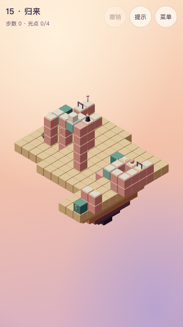

# 第 15 关 · 归来

## 状态与教学

**T6.17a设计稿，T6.18已于2026-10-24正式接入。** 本稿覆盖T6.17第一稿，revision 1，chapter 5。主线 **15步**，全收集 **19步**。选关短句：**去时各守一门，回来交换职责**。

教学点：触发压板同时改接旧桥、揭开巡逻退路并关旧下船口；随后箱子与巡逻交换守门职责。承接两阶段规划、停板联动、错觉推箱和动态压力。

「原来如此」：**先让箱与巡逻各守一门，取完远庭光后再揭开退路：箱子去守巡逻的旧板，小生物走入归门板，两者交换职责。**

衔接：从第十二关“一个箱的两阶段用途”、十四关“两种重量同时守门”，推进到两者同时换位。双格纵向运输台、环形后庭、低处旧桥与高处庭院形成新的构图；不再复用十四关的四格横台和同一箱位。 数值通过不等于体验定稿；完整范围及声音状态见[第五章交接](chapter-5.md)。



## 屏幕草图

`(a,b)=(x-y,z-y)`；数字为高度。@起点、G灯笼、o必需、*选做、h按住板、t触发板、D关闭门、d初始开门、M活动路面、p普通路面。同格优先标光点；这是规则层初始路面快照，岛屿和结构不当道路。全部坐标及停靠位以下方完整实现为准。

```text
 b\a      2    3    4    5    6    7    8    9   10   11   12   13   14
  -3      ·  G-2    ·    ·    ·    ·    ·    ·    ·    ·    ·    ·    ·
  -2      ·  D-2    ·   o0    ·    ·    ·    ·    ·    ·    ·    ·    ·
  -1      ·    ·   M1   @3    ·    ·    ·    ·    ·    ·    ·    ·    ·
   0    M-1   p1   M1    ·    ·    ·    ·    ·    ·    ·    ·    ·   d6
   1     *0    ·    ·    ·    ·    ·    ·    ·    ·   h1   h5   h5   t6
   2      ·    ·    ·    ·    ·    ·    ·    ·    ·    ·   o5    ·   p6
   3      ·    ·    ·    ·    ·    ·    ·    ·    ·    ·   M6   p6   p6
   4      ·    ·    ·    ·    ·    ·    ·    ·    ·    ·    ·    ·    ·
   5      ·    ·    ·    ·    ·    ·    ·    ·    ·    ·    ·    ·    ·
   6      ·    ·    ·    ·    ·    ·    ·    ·    ·    ·    ·    ·    ·
   7      ·    ·    ·    ·    ·    ·    ·    ·    ·    ·    ·   D6   o6
```

## 积木清单与构图

低处归桥与高处折廊围住中央灯塔；滑动遮挡块沿玫瑰色托座移动，替代孤立悬空的三格柱。旧桥由支路改接归门，终点回到低庭，呼应启程的入口灯与高处庭院。 沿用暖色积木、浅色路面、青绿活动结构和固定镜头。完整实现逐项给出静态路面、柱体、岛屿、颜色、活动偏移和装饰；`p(a,b,y)`严格转换为`[a+y,y,b+y]`，不另补路或改高度。

## 机关清单

| ID           | 精确定义                                                                                                                                     |
| ------------ | -------------------------------------------------------------------------------------------------------------------------------------------- |
| ferry        | mover；`{"origin":[5,1,1],"axis":"x","stops":[0,9],"blocks":[{"offset":[0,0,0]},{"offset":[0,0,-1]}],"handle":{"block":[4,0,1],"face":"z"}}` |
| lift         | mover；`{"origin":[18,6,9],"axis":"z","stops":[0,4],"blocks":[{"offset":[0,0,0]}],"handle":{"block":[19,5,14],"face":"z"}}`                  |
| weight       | plate；`{"tile":[17,5,6],"mode":"hold","target":"door"}`                                                                                     |
| weight-far   | plate；`{"tile":[18,5,6],"mode":"hold","target":"far-door"}`                                                                                 |
| home-weight  | plate；`{"tile":[12,1,2],"mode":"hold","target":"home-door"}`                                                                                |
| landing-door | gate；`{"tile":[20,6,6],"mode":"toggle","initiallyOpen":true}`                                                                               |
| door         | gate；`{"tile":[20,6,7],"mode":"hold"}`                                                                                                      |
| far-door     | gate；`{"tile":[19,6,13],"mode":"hold"}`                                                                                                     |
| home-door    | gate；`{"tile":[1,-2,-4],"mode":"hold"}`                                                                                                     |
| exchange     | plate；`{"tile":[20,6,7],"target":"home","once":true}`                                                                                       |
| home         | rotator；`{"pivot":[1,-1,-2],"initialStep":3,"blocks":[{"offset":[1,0,0]}],"links":[{"target":"veil"},{"target":"landing-door"}]}`           |
| veil         | mover；`{"origin":[15,4,5],"axis":"z","stops":[0,2],"blocks":[{"offset":[0,0,0],"kind":"solid","color":"teal"}]}`                            |

## 光点与其他元素

```json
{
  "orbs": [
    {
      "tile": [5, 0, -2]
    },
    {
      "tile": [17, 5, 7]
    },
    {
      "tile": [20, 6, 13]
    },
    {
      "tile": [2, 0, 1],
      "optional": true
    }
  ],
  "crates": [
    {
      "mechanism": "ferry",
      "block": 0
    }
  ],
  "patrols": [
    {
      "mode": "pingpong",
      "route": [
        {
          "tile": [18, 5, 6]
        },
        {
          "tile": [17, 5, 6]
        },
        {
          "tile": [12, 1, 2]
        }
      ]
    }
  ]
}
```

巡逻严格按固定路线随每个完成动作推进；路过普通触发板不触发，停住才触发。投影跨高度连接保留，不加入三维连通条件。

## 主线标准解法

以下为最优路线之一，不禁止其他合法顺序或自动经过中间格；逐步坐标均是当时的世界坐标。

| 步  | 动作               | 目的                                                         |
| --- | ------------------ | ------------------------------------------------------------ |
| 1   | 走到 `(5, 1, 0)`   | 登上箱子后方的双格运输台。                                   |
| 2   | 操作 `ferry`       | 人箱同乘赴高庭。                                             |
| 3   | 推 `crate-0` 一格  | 把箱卸到外庭板，巡逻留在旧板，各守一门。                     |
| 4   | 走到 `(18, 6, 9)`  | 穿过巡逻守住的门，沿折廊登远台。                             |
| 5   | 操作 `lift`        | 乘到外庭。                                                   |
| 6   | 走到 `(20, 6, 13)` | 穿箱子守住的门，取远庭必需光。                               |
| 7   | 走到 `(18, 6, 13)` | 回远台准备返程。                                             |
| 8   | 操作 `lift`        | 乘回内庭。                                                   |
| 9   | 走到 `(17, 5, 7)`  | 离台取中庭光，保留原箱位。                                   |
| 10  | 走到 `(20, 6, 7)`  | 停exchange，联动改桥、揭退路并关闭旧下船口，巡逻进入归门板。 |
| 11  | 推 `crate-0` 一格  | 从东侧把箱推到旧巡逻板，封住退路并接管旧门。                 |
| 12  | 走到 `(14, 1, 1)`  | 经已空出的箱位登台。                                         |
| 13  | 操作 `ferry`       | 独自回低庭。                                                 |
| 14  | 走到 `(5, 0, -2)`  | 取近庭必需光。                                               |
| 15  | 走到 `(1, -2, -5)` | 经已接归桥和巡逻守住的归门点灯。                             |

## 选做、干扰与恢复

- exchange是一次性触发板：只路过不触发，停住才联动。需要在远庭光取得后再停板；提前停板会把巡逻放入归门板，但下一步它会退回旧板并朝箱子等待，无法再完成所需交接，须撤销停板。
- 停板后旧下船口关闭，归桥改接，巡逻退路显露。可无限思考，不考现实时间反应；下一步向西推箱封住巡逻退路，才形成稳定交接。门内停板遵守既有占位保护；不修改门、可见性或巡逻规则。
- 最终换位必须在远庭光取得后。提前把箱推到旧巡逻板，会把巡逻封在归门板，原远庭板再无重量；不论增加多少走路或操作，都无法补取远庭光。需要撤销最后的换位。
- 选做在旧桥支路。初始箱挡住近岸通往旧桥的台面；必须先运箱卸下，再借空台回近庭取选做，之后再赴远庭。exchange会把旧桥改接归路，选做支路不再相连。主线两程、全收集四程，都有明确目的。
- 两台运输均无限次，全部首步、两步试探均有解；限次负担不与终章新依赖叠加。最终换位和一次性联动仍有需要撤销的阶段错误，不宣称任意操作都可无损恢复。
- 归桥接好后允许自动经桥、归门走到终点，不要求先单独登桥或强制乘坐。

## 指标与验收

主线／全收集 **15／19**；可达状态 **2838**，死局 **1296**；60步固定随机500次（种子20261016）通过率0%；主线错觉／取舍 **12／4**。0%只表示固定样本没有通关，不等于数学概率为零。

第五章门槛保持：第十三关使用10步章首缓冲例外，其余12～24步；≥80状态、60步随机≤20%、错觉≥2、取舍≥2，主线状态≤30000、单次求解<2秒。不能用死局或步数代替发现深度。

以下目标已由T6.18写入targets，正式前十二关保持：

```json
{
  "minActions": 15,
  "minActionsAll": 19,
  "reachableStatesMin": 80,
  "randomWin": {
    "steps": 60,
    "maxRate": 0.2
  },
  "illusionsMin": 2,
  "tradeoffsMin": 2
}
```

运动净空86组结构／526组角色，每组181采样姿态，零采样问题；包含人物、箱、巡逻、门、岩层及差时长联动。它是离散检查，不是连续碰撞证明，也不把错觉行走改为三维碰撞。

全收集逐步解法在下方基准all中，必须用同一规则层验证。正式实现仍须默认与--runtime、全部四项检查、桌面1280×720主线及手机375×667低画质全收集、干扰恢复、旧存档保持与用户体验确认。

## 自动验证基准

```json
{
  "metrics": {
    "minActions": 15,
    "minActionsAll": 19,
    "reachableStates": 2838,
    "deadEndStates": 1296,
    "illusions": 12,
    "tradeoffs": 4,
    "randomSteps": 60,
    "randomRate": 0
  },
  "all": [
    {
      "type": "walk",
      "to": [5, 1, 0]
    },
    {
      "type": "operate",
      "mechanism": "ferry"
    },
    {
      "type": "push",
      "crate": "crate-0"
    },
    {
      "type": "operate",
      "mechanism": "ferry"
    },
    {
      "type": "walk",
      "to": [2, 0, 1]
    },
    {
      "type": "walk",
      "to": [5, 1, 1]
    },
    {
      "type": "operate",
      "mechanism": "ferry"
    },
    {
      "type": "walk",
      "to": [18, 6, 9]
    },
    {
      "type": "operate",
      "mechanism": "lift"
    },
    {
      "type": "walk",
      "to": [20, 6, 13]
    },
    {
      "type": "walk",
      "to": [18, 6, 13]
    },
    {
      "type": "operate",
      "mechanism": "lift"
    },
    {
      "type": "walk",
      "to": [17, 5, 7]
    },
    {
      "type": "walk",
      "to": [20, 6, 7]
    },
    {
      "type": "push",
      "crate": "crate-0"
    },
    {
      "type": "walk",
      "to": [14, 1, 1]
    },
    {
      "type": "operate",
      "mechanism": "ferry"
    },
    {
      "type": "walk",
      "to": [5, 0, -2]
    },
    {
      "type": "walk",
      "to": [1, -2, -5]
    }
  ],
  "clearance": {
    "structuralTransitions": 86,
    "characterTransitions": 526,
    "samples": 181,
    "issues": []
  }
}
```

## 完整参考实现

```ts
import { defineLevel } from './builders'
import type { Vec3 } from './types'
const p = (a: number, b: number, y: number): Vec3 => [a + y, y, b + y]
export default defineLevel({
  id: 'level-15',
  title: '归来',
  chapter: 5,
  revision: 1,
  soundtrack: 'courtyard',
  hints: [],
  solution: [
    { type: 'walk', to: [5, 1, 0] },
    { type: 'operate', mechanism: 'ferry' },
    { type: 'push', crate: 'crate-0' },
    { type: 'walk', to: [18, 6, 9] },
    { type: 'operate', mechanism: 'lift' },
    { type: 'walk', to: [20, 6, 13] },
    { type: 'walk', to: [18, 6, 13] },
    { type: 'operate', mechanism: 'lift' },
    { type: 'walk', to: [17, 5, 7] },
    { type: 'walk', to: [20, 6, 7] },
    { type: 'push', crate: 'crate-0' },
    { type: 'walk', to: [14, 1, 1] },
    { type: 'operate', mechanism: 'ferry' },
    { type: 'walk', to: [5, 0, -2] },
    { type: 'walk', to: [1, -2, -5] },
  ],
  ending: {
    lanterns: [
      [1, -2, -5],
      [1, -3, 2],
      [2, -3, 2],
      [3, -3, 2],
      [5, -3, 2],
      [9, 0, 2],
      [10, 0, 2],
      [12, 0, 2],
      [9, 0, 0],
      [17, 4, 8],
      [18, 4, 8],
      [19, 4, 8],
      [17, 4, 9],
      [18, 4, 14],
      [19, 4, 14],
    ],
    tower: Array.from({ length: 5 }, (_, i): Vec3 => [10, i + 1, 5]),
  },
  build: (b) => {
    b.island({ x: [0, 6], z: [-5, 3], y: -3, depth: 2 })
    b.island({ x: [7, 15], z: [-1, 7], y: 0, depth: 2 })
    b.island({ x: [17, 19], z: [5, 14], y: 4, depth: 3 })
    const paths: Vec3[] = [
      [5, -1, 3],
      [5, -2, 0],
      [3, 0, 1],
      [2, 1, 0],
      [3, -2, -2],
      [3, -3, -2],
      [11, 1, 1],
      [12, 1, 5],
      [13, 1, 5],
      [14, 0, 6],
      [14, 1, 6],
      [14, 2, 6],
      [12, 2, 5],
      [13, 3, 6],
      [14, 3, 6],
      [13, 7, 6],
      [14, 7, 6],
    ]
    for (const [a, z, y] of paths) {
      b.path(p(a, z, y), 'rose')
      const floor = a < 7 ? (a + y >= 7 ? 1 : -2) : a >= 12 ? 5 : 1
      for (let h = floor; h < y; h++) b.solid([a + y, h, z + y], 'rose')
    }
    b.solid([19, 5, 14], 'teal')
    b.mover({
      id: 'ferry',
      origin: p(4, 0, 1),
      axis: 'x',
      stops: [0, 9],
      blocks: [{ offset: [0, 0, 0] }, { offset: [0, 0, -1] }],
      handle: { block: [4, 0, 1], face: 'z' },
    })
    b.mover({
      id: 'lift',
      origin: p(12, 3, 6),
      axis: 'z',
      stops: [0, 4],
      blocks: [{ offset: [0, 0, 0] }],
      handle: { block: [19, 5, 14], face: 'z' },
    })
    b.crate({ mechanism: 'ferry', block: 0 })
    b.patrol({ mode: 'pingpong', route: [{ tile: p(13, 1, 5) }, { tile: p(12, 1, 5) }, { tile: p(11, 1, 1) }] })
    b.plate({ id: 'weight', tile: p(12, 1, 5), mode: 'hold', target: 'door' })
    b.plate({ id: 'weight-far', tile: p(13, 1, 5), mode: 'hold', target: 'far-door' })
    b.plate({ id: 'home-weight', tile: p(11, 1, 1), mode: 'hold', target: 'home-door' })
    b.gate({ id: 'landing-door', tile: p(14, 0, 6), mode: 'toggle', initiallyOpen: true })
    b.gate({ id: 'door', tile: p(14, 1, 6), mode: 'hold' })
    b.gate({ id: 'far-door', tile: p(13, 7, 6), mode: 'hold' })
    b.gate({ id: 'home-door', tile: p(3, -2, -2), mode: 'hold' })
    b.plate({ id: 'exchange', tile: p(14, 1, 6), target: 'home', once: true })
    b.column({ x: 1, z: -2, from: -2, to: -1 }, 'teal')
    b.rotator({
      id: 'home',
      pivot: p(2, -1, -1),
      initialStep: 3,
      blocks: [{ offset: [1, 0, 0] }],
      links: [{ target: 'veil' }, { target: 'landing-door' }],
    })
    b.mover({
      id: 'veil',
      origin: [15, 4, 5],
      axis: 'z',
      stops: [0, 2],
      blocks: [{ offset: [0, 0, 0], kind: 'solid', color: 'teal' }],
    })
    for (let z = 5; z <= 7; z++) b.solid([15, 3, z], 'rose')
    b.column({ x: 15, z: 5, from: 1, to: 2 }, 'rose')
    b.column({ x: 15, z: 7, from: 1, to: 2 }, 'rose')
    b.column({ x: 10, z: 5, from: 1, to: 5 }, 'rose')
    b.orb({ tile: p(5, -2, 0) })
    b.orb({ tile: p(12, 2, 5) })
    b.orb({ tile: p(14, 7, 6) })
    b.orb({ tile: p(2, 1, 0), optional: true })
    b.tree([1, -3, 1])
    b.flower([6, -3, 2])
    b.window({ pos: [13, 0, 4], face: 'x' })
    b.start(p(5, -1, 3))
    b.goal(p(3, -3, -2))
  },
})
```

## 十五灯与塔

ending.lanterns共15个唯一位置，第一个精确等于goal。其余14盏按低庭→中央→高庭的顺序点亮，回望前四章，而非读取旧关途中角色位置；每盏都有静态基座。ending.tower引用中央五块既有静态柱体。decor不重复添加灯笼。

终点先亮，其余每隔0.45秒亮一盏；全部亮后0.6秒塔亮，再过0.9秒显示“谢谢游玩／回到标题”。沿用固定镜头。声音的过渡、塔收束与取消要求见共同稿；新声音尚未试听确认。
