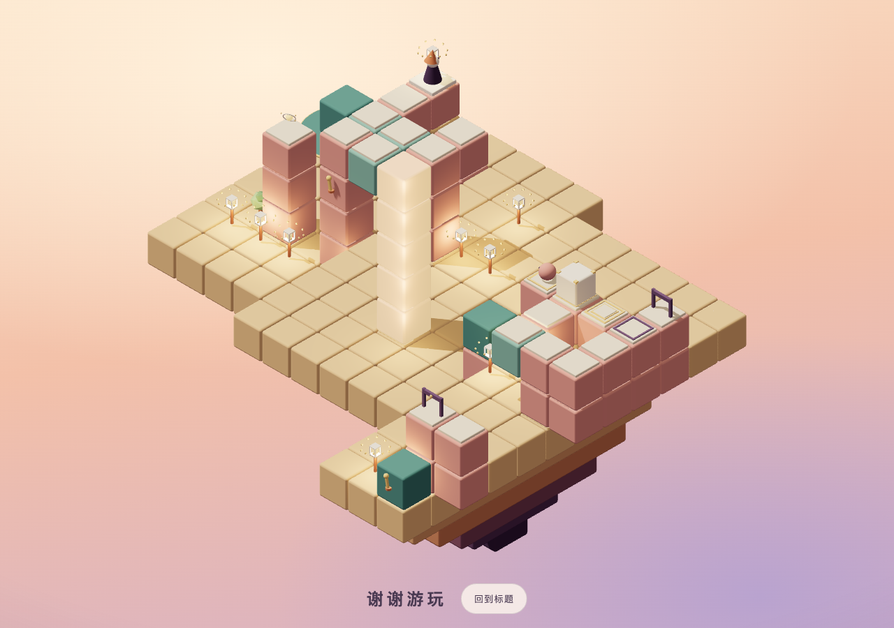

# 验收与性能记录

## 当前结论

十五主线、五挑战、完整结局和当前声音均已获用户试玩确认。T6.22f整体复核通过22个测试文件、410项测试及类型／格式／构建检查；用户随后确认修复已推送、远程正常。项目开发和发布已完成，个人主页T5.4继续暂缓。

本页保留最新有效数据、复跑方法与限制。首版及各中间阶段的逐轮日志、临时路径和失败记录不再复制，变更原因可通过Git历史查询。文档整理不重新宣称已经完成未覆盖的设备验收。

## 二十关绘制与帧采样

数据来自2026-10-25的T6.22完整实点，基线f3541d4。此后只调整完成反馈、规则查询性能与本地成绩卡，关卡／几何／混音保持；这张表不是每次收尾都重测二十关的结果。

环境：已有Playwright／Chromium147，Apple M5 Pro、ANGLE Metal、WebGL2，DPR1；桌面1280×720高画质，手机尺寸375×667低画质。两组分别顺序采样，不并行构建或其他负载；每关Worker就绪后预热0.6秒、取60帧，帧时间为59个间隔的中位数／P95。绘制含阴影pass，峰值覆盖所走解法、运动、收光、点灯与完整结局，不穷举全部布局。

桌面新进度走主线，挑战阶段合并另一套实玩取得的母章全收集记录解锁；手机尺寸从新进度实际走全收集并自然解锁挑战。主线152／176步，挑战94／114步；不是两套都一次获得全部评价。自动化只读取场景状态、投影点击并逐步与rules核对，不直接写人物或棋盘状态；探针不进入生产构建。

调用列为“开局／全过程峰值”，帧时间为“中位数／P95”，时间单位均为毫秒。后台准备包括Worker创建、加载与策略建立，不能替代冷analyze预算。

| 关卡 | 高画质调用 | 低画质调用 | 高画质帧时间 | 低画质帧时间 | 后台准备 高 / 低 |
| --- | ---: | ---: | ---: | ---: | ---: |
| 1 · 启程 | 93 / 95 | 66 / 68 | 8.3 / 9.2 | 8.3 / 9.2 | 14.6 / 24.4 |
| 2 · 转动 | 75 / 77 | 56 / 58 | 8.3 / 9.6 | 8.3 / 8.9 | 13.0 / 12.8 |
| 3 · 随行 | 84 / 86 | 62 / 64 | 8.4 / 9.4 | 8.3 / 9.1 | 12.3 / 13.4 |
| 4 · 换乘 | 115 / 117 | 85 / 87 | 8.4 / 9.4 | 8.3 / 9.1 | 14.3 / 15.6 |
| 5 · 叠庭 | 169 / 171 | 121 / 123 | 8.3 / 9.6 | 8.3 / 9.3 | 24.5 / 23.2 |
| 6 · 回环 | 157 / 159 | 117 / 119 | 8.3 / 9.2 | 8.4 / 9.8 | 20.6 / 21.3 |
| 7 · 停靠 | 124 / 126 | 93 / 95 | 8.3 / 9.9 | 8.2 / 9.9 | 24.3 / 23.5 |
| 8 · 联动 | 150 / 152 | 114 / 116 | 8.4 / 9.1 | 8.3 / 9.6 | 32.1 / 30.7 |
| 9 · 牵引 | 185 / 187 | 135 / 137 | 8.3 / 9.3 | 8.3 / 9.8 | 40.6 / 39.3 |
| 10 · 推动 | 176 / 178 | 131 / 133 | 8.5 / 9.2 | 8.3 / 9.7 | 45.0 / 45.4 |
| 11 · 越界 | 216 / 218 | 166 / 168 | 8.3 / 9.2 | 8.3 / 10.4 | 137.8 / 131.1 |
| 12 · 重量 | 248 / 250 | 186 / 188 | 8.3 / 9.6 | 8.3 / 10.2 | 392.6 / 388.9 |
| 13 · 留步 | 170 / 172 | 126 / 128 | 8.4 / 9.2 | 8.3 / 9.9 | 202.0 / 199.0 |
| 14 · 相守 | 196 / 198 | 151 / 153 | 8.3 / 9.6 | 8.3 / 10.0 | 885.6 / 868.7 |
| 15 · 归来 | 208 / 347 | 159 / 275 | 8.2 / 9.7 | 8.2 / 10.3 | 339.0 / 342.6 |
| 挑战1 · 回针 | 132 / 134 | 97 / 99 | 8.3 / 9.1 | 8.2 / 9.9 | 128.2 / 107.5 |
| 挑战2 · 分岸 | 216 / 218 | 152 / 154 | 8.3 / 9.3 | 8.3 / 10.0 | 131.9 / 116.4 |
| 挑战3 · 逆织 | 160 / 162 | 121 / 123 | 8.3 / 10.0 | 8.3 / 10.2 | 124.6 / 50.6 |
| 挑战4 · 递位 | 299 / 301 | 223 / 225 | 8.3 / 10.5 | 8.3 / 9.8 | 1180.2 / 1160.3 |
| 挑战5 · 相托 | 262 / 264 | 198 / 200 | 8.4 / 9.7 | 8.4 / 10.1 | 1450.3 / 1381.8 |

高／低绘制峰值347／275，均低于400次预算；后台准备最慢1450.3／1381.8ms。灯笼同材质光粒已实例化，高／低仍10／5颗，减少动态不创建光粒，时序与外观保持。



## 求解、规则与正式设计

T6.22b／d只优化规则查询与搜索分配：只读定义索引、最多64布局的静态几何／邻接复用、动态压力与占位逐状态求值；指标分析省去不用的正向边，提示保留完整动作边。没有放宽谜题、targets、状态规模或两秒断言。

优化前后二十关加内部样段78651个状态、656173条转移的动作顺序、邻接、全部路线、门、完整Transition和提示策略摘要一致。后续初始化失效、图副本和动态门回归测试保留。

2026-10-26 T6.22f三套正式 `--runtime` 完整通过，含源码／设计／targets、最短与全收集、全部提示、反事实和181姿态净空；本机后两挑战冷求解646／377ms。它们是新对象的本机数据，不能外推为目标设备耗时。两秒冷求解、主线30000／挑战100000状态上限、10秒组合测试窗口保持。

远程可追溯记录：[434d4cc运行](https://github.com/zzugbb/Seemingly/actions/runs/40252828292)与[d0ae97a运行](https://github.com/zzugbb/Seemingly/actions/runs/40262369140)的Check、构建和Pages发布均成功。之后084ea71的推送与远程正常由用户确认，不虚构未独立读取的运行编号。

## 界面、进度与异常路径

T6.22二十关桌面主线／手机尺寸全收集连续实点通过。T6.22f补验1280×720、375×667、320×568、667×375、800×600入口、选关、首关实点通关、菜单、完成卡与重试；无意外横向溢出、错误覆盖层或未捕获应用异常。

- 行走中撤销、运动中重开、提示中退出、连续六次重开后旧Worker回收正常。
- 禁用Worker时仍可游玩，提示不可用说明不计usedHint；禁用存储／音频仍能在会话中解锁，缺少WebGL2显示说明。
- 主线／挑战／六十项评价分开统计，挑战不跳锁定项；撤销、重玩、刷新不抹历史，三项评价分次累计。
- 五章与挑战的配置／当前和弦、静音零源、暂停／恢复和退出取消通过，采样音源峰值6（音乐6），保留已确认混音。
- 全部验收使用隔离源，不访问、清空或预置用户开发源存档。

## 成绩卡与生产资源

成绩卡在打开时按需加载，建立1080×1000、DPR1的局部高画质画布，第四帧复制到1080×2100 PNG后卸载；图片约635～638KB。预览与下载逐字节一致，快速关闭不留导出Canvas／对象URL。图片生成错误、上下文丢失事件和12秒无结果后可重试；首次模块请求失败保留原游戏，刷新后恢复，离开页面后忽略晚到模块。

T6.22f生产HTML／CSS／主JS合计358181字节gzip（Node24 zlib默认参数，不含HTTP头、按需Worker和文档图），低于1MB。成绩卡模块约3.03KB gzip，原始主chunk超过500KB的提示已评估并保留；Clock和阴影库提示不作为新缺陷扩大处理。

隔离生产 `/Seemingly/` 路径的标题、二十卡／六组、首关与挑战五Worker有效提示、Worker不可用反馈、模块故障隔离及正常PNG下载通过，无意外请求错误或验收探针。生产冒烟不是生产二十关完整实玩。[成绩卡示例](assets/journey-scorecard.png)为隔离测试进度，不代表玩家存档或一次获得的评价。

## 复跑方法

```bash
npm run typecheck && npm run format:check && npm test && npm run build
node docs/levels/check-designs.mjs --runtime
node docs/levels/check-chapter5.mjs --runtime
node docs/levels/check-challenges.mjs --runtime
npm run metrics
```

交互验收使用隔离端口／浏览器上下文；不注入用户存档。后台标签页可能暂停动画帧，点击后先截图刷新再判断空闲。测量性能时不并行其他重负载；统计真实渲染、Worker和音源，不在生产源码留下探针。

## 仍未覆盖

手机目前是同一电脑GPU上的尺寸模拟，Safari及其他目标浏览器、真实系统文件分享／长按入相册、目标设备长期帧率仍须真机补验。系统分享成功／取消／失败分支已用能力替身验证，不等于系统分享实测；不能保证直接写入相册。短窗口帧采样不代表所有设备60帧，181姿态净空不是连续碰撞的数学证明。
